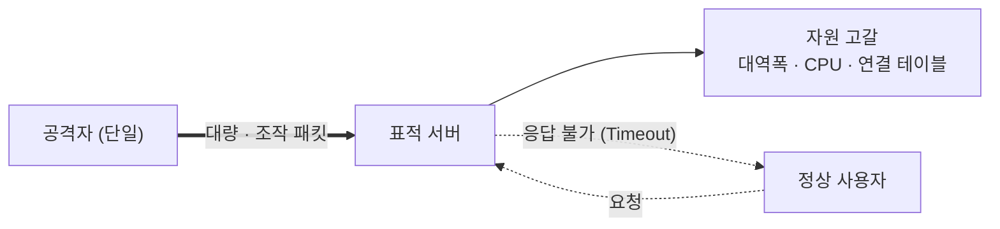

# DoS (Denial of Service)

---

## I. 서비스를 멈추게 하는 공격, DoS의 개요

### 가. 정의

- 표적 시스템의 **네트워크 대역폭·CPU·메모리·연결 자원을 고갈시키거나 취약점으로 장애를 일으켜 정상 사용자의 서비스 이용을 방해**하는 공격

### 나. 특징

| 구분 | 내용 |
| --- | --- |
| [[가용성]] 침해 | CIA 중 가용성을 직접 공격 |
| 자원 고갈형 | 처리 용량을 넘는 요청·트래픽 전송 |
| 취약점형 | 조작된 패킷으로 프로토콜 처리 오류·크래시 유발 |
| 단일 출발지 | 출발지 차단으로 비교적 대응 가능 → [[DDOS\|DDoS]]로 진화 |

---

## II. 공격 구조 및 유형

### 가. 공격 구조

- 표적이 악성 요청 처리에 자원을 소진해 정상 요청에 응답하지 못하게 만듦

### 나. 공격 유형

| 구분 | 요소 | 설명 |
| --- | --- | --- |
| 대역폭 고갈 | UDP Flood | 대량 UDP 패킷으로 회선 포화 |
| | Smurf | 출발지를 표적으로 위조한 ICMP Echo를 브로드캐스트 주소로 보내 응답 폭주 유도 |
| 프로토콜 취약점 | SYN Flood | SYN만 보내고 ACK를 보내지 않아 반개방 연결 큐 고갈 |
| 패킷 조작 | Ping of Death | 65,535바이트를 넘는 ICMP를 [[단편화]]해 재조합 시 오류 유발 |
| | Teardrop | 단편 오프셋을 겹치게 조작해 재조합 오류 유발 |
| | [[Land Attack]] | 출발지·목적지를 표적 IP·포트로 동일하게 위조해 자기 응답 루프 |
| 애플리케이션 | Slowloris | HTTP 헤더를 끝내지 않고 조금씩 보내 연결 점유 |
| | RUDY | POST 본문을 매우 느리게 전송해 연결 점유 |
| 대응 | SYN Cookie·백로그 조정 | 반개방 연결 자원 보호 |
| | 패킷 검증·패치 | 비정상 단편·헤더 차단, OS 패치 |
| | 타임아웃·연결 제한 | Slow 공격 대응 |

---

## III. 비교 및 동향

### 가. DoS vs DDoS

| 비교 항목 | DoS | [[DDOS\|DDoS]] |
| --- | --- | --- |
| 출발지 | 단일 (1:1) | 다수 봇넷 (N:1) |
| 규모 | 상대적으로 작음 | Gbps~Tbps |
| 탐지·차단 | 출발지 IP 차단으로 비교적 쉬움 | 정상·악성 구분 어려움 |
| 대응 | [[방화벽]], IPS, OS 패치 | 스크러빙, [[CDN]], Anti-DDoS 서비스 |

### 나. 동향

- **L7 중심 공격**: 정상 사용자로 위장한 애플리케이션 계층 공격 증가
- **클라우드 엣지 방어**: [[WAAP|WAAP(Web Application and API Protection)]]·CDN 경유 구조 표준화
- **행위 기반 탐지**: 머신러닝 기반 트래픽 기준선 학습과 자동 완화

---

### 🔗 연관 토픽

- **소속 도메인**: [[00_보안_MOC|🛡️ 보안]]
- **세부 분류**: `1. 정보보안 원칙 & 거버넌스 · 인증`
- **핵심 연관 토픽**:
  - [[DDOS]]
  - [[DRDOS]]
  - [[Land Attack]]
  - [[가용성]]
  - [[방화벽]]
