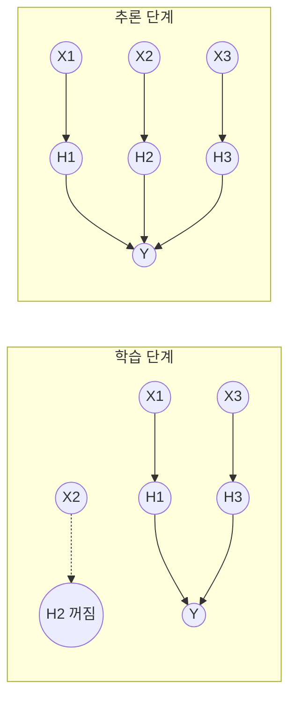

# Dropout (드롭아웃)

---

## I. 뉴런을 무작위로 끄는 정규화, Dropout의 개요

### 가. 정의

- 학습 중 **각 뉴런의 출력을 정해진 확률로 무작위로 0으로 만들어** 과적합을 줄이는 신경망 정규화 기법 (Srivastava, Hinton et al., 2014)

### 나. 등장 배경 및 특징

| 구분 | 내용 |
| --- | --- |
| 배경 | 깊은 신경망의 많은 파라미터로 인한 과적합 |
| 공동 적응 방지 | 특정 뉴런끼리 서로 의존하는 Co-adaptation 억제 |
| 앙상블 효과 | 미니배치마다 다른 부분 네트워크를 학습, 추론 시 이들의 평균에 근사 |
| 단순성 | 구현이 간단하고 대부분 구조에 적용 가능 |

---

## II. 동작 원리 및 구성요소

### 가. 학습·추론 동작

- **학습**: 미니배치마다 뉴런을 무작위로 꺼 순전파·[[역전파]]에서 제외
- **추론**: 모든 뉴런을 사용하고, 학습 시 기대 출력과 맞도록 스케일 보정

### 나. 구성요소

| 구분 | 요소 | 설명 |
| --- | --- | --- |
| 확률 | Drop 비율 / Keep 확률 $p$ | 원 논문 권장: 은닉층 유지 확률 0.5, 입력층 0.8 |
| 마스크 | 베르누이 마스크 | $m \sim Bernoulli(p)$를 출력과 원소별 곱 ([[베르누이 분포]]) |
| 스케일 | Inverted Dropout | 학습 시 유지된 출력을 $1/p$배 하여 추론 시 보정 불필요 (주요 프레임워크 기본) |
| 효과 | 공동 적응 방지 | 각 뉴런이 독립적으로 유용한 특징 학습 |
| | 암묵적 앙상블 | 가중치를 공유하는 $2^n$개 부분 네트워크의 평균 근사 |
| 변형 | Spatial Dropout | [[CNN]]에서 채널(특징 맵) 단위로 드롭 |
| | 변분·Recurrent Dropout | [[RNN (Recurrent Neural Network)\|RNN]]에서 시간 단계마다 같은 마스크 사용 |
| | DropConnect·DropPath | 가중치·잔차 경로(Stochastic Depth) 단위로 드롭 |
| | MC Dropout | 추론 시에도 켜고 여러 번 예측해 불확실성 추정 ([[베이지안 딥러닝]]) |

---

## III. 비교 및 동향

### 가. Dropout vs Weight Decay

| 비교 항목 | Dropout | Weight Decay (L2) |
| --- | --- | --- |
| 방식 | 뉴런 출력을 확률적으로 제거 | 손실에 가중치 크기 패널티 (L1은 희소화) |
| 효과 | 특정 뉴런 의존 감소, 앙상블 | 가중치를 작게 유지 |
| 비용 | 연산은 적으나 수렴이 느려질 수 있음 | 추가 비용 거의 없음 |
| 관계 | 함께 사용 가능 | |

### 나. 동향

- **[[배치 정규화]]와의 관계**: Dropout 뒤에 BN이 오면 학습·추론 간 분산 불일치(Variance Shift)로 성능 저하 가능, BN을 쓰는 CNN에서는 Dropout을 줄이거나 분류층 직전에만 사용
- **Transformer·LLM**: 어텐션·잔차 경로에 소량(0.1 내외) 사용, 대규모 데이터로 사전학습하는 LLM은 Dropout을 0으로 두는 경우가 많음
- **비율 튜닝**: 모델 용량이 크고 데이터가 적을수록 비율을 높이고, 과소적합이면 낮춤 ([[과적합 문제]])

---

### 🔗 연관 토픽

- **소속 도메인**: [[00_인공지능_MOC|🤖 인공지능]]
- **세부 분류**: `1. 수학 · 통계학 & 데이터 전처리`
- **핵심 연관 토픽**:
  - [[과적합 문제|과적합 (overfitting)문제]]
  - [[배치 정규화]]
  - [[정규화, 규제화, 표준화]]
  - [[베이지안 딥러닝]]
  - [[앙상블 학습|앙상블 학습(Ensemble Learning)]]
