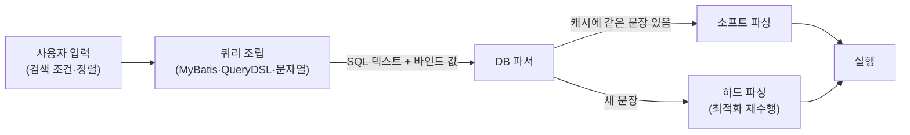

# Dynamic SQL (동적 SQL)

---

## I. 실행 시점에 만드는 SQL, Dynamic SQL의 개요

### 가. 정의

- SQL 문장을 **컴파일 시점이 아니라 실행 시점에 조건에 따라 조립해 실행하는 기법** (선택적 검색 조건, 동적 정렬, 가변 테이블·컬럼)

### 나. 특징

| 구분 | 내용 |
| --- | --- |
| 유연성 | 다양한 검색 조건 조합을 하나의 로직으로 처리 |
| 파싱 비용 | 문장 텍스트가 달라지면 하드 파싱 증가 |
| 보안 위험 | 입력값을 문자열로 결합하면 [[SQL Injection]] 취약 |
| 대응 | 바인드 변수, 식별자 화이트리스트, 쿼리 빌더 |

---

## II. 동작 구조 및 구성요소

### 가. 처리 흐름

- 값은 바인드 변수로 넘겨 문장 텍스트를 고정해야 실행 계획을 재사용하고 인젝션도 막을 수 있음

### 나. 구성요소

| 구분 | 요소 | 설명 |
| --- | --- | --- |
| 구현 | 문자열 결합 | if/else로 SQL 문자열 직접 조립, 가장 위험 |
| | SQL Mapper | MyBatis `<if>`, `<choose>`, `<where>` 동적 태그 |
| | 쿼리 빌더 | JPA Criteria, QueryDSL, jOOQ로 타입 안전한 조립 |
| DB 내부 | EXECUTE IMMEDIATE·sp_executesql | 프로시저 안에서 동적 DDL·DML 실행 ([[절차형 SQL]]) |
| 성능 | 바인드 변수 | 값만 바꿔 같은 문장 재사용, 소프트 파싱 유도 |
| | 하드·소프트 파싱 | 실행 계획 신규 생성 vs 캐시 재사용 |
| 보안 | PreparedStatement | 문장 구조와 데이터 분리, 인젝션 방어 |
| | 식별자 검증 | 테이블·컬럼명은 바인딩 불가 → 허용 목록으로 검증 |

---

## III. 비교 및 동향

### 가. Static SQL vs Dynamic SQL

| 비교 항목 | Static SQL | Dynamic SQL |
| --- | --- | --- |
| 확정 시점 | 컴파일 시점 | 실행 시점 |
| 유연성 | 낮음 | 높음 |
| 파싱 | 재사용 용이 | 구조 변경 시 하드 파싱 |
| 오류 발견 | 컴파일 시 | 실행 시 (쿼리 빌더는 컴파일 시) |
| 보안 | 상대적으로 안전 | 바인딩 미적용 시 취약 |

### 나. 동향

- **타입 안전 쿼리 빌더**: QueryDSL·jOOQ로 문자열 조립을 대체해 컴파일 시 오류 검출
- **시큐어 코딩 기준**: 행정안전부 소프트웨어 보안약점 진단 기준 등에서 SQL 삽입 방지를 위해 바인딩 사용 요구
- **실행 계획 안정화**: 값에 따라 계획이 흔들리는 문제(바인드 변수 엿보기)에 적응형 커서 공유·계획 고정 활용

---

### 🔗 연관 토픽

- **소속 도메인**: [[00_데이터베이스_MOC|🗄️ 데이터베이스]]
- **세부 분류**: `3. 장애 회복 기법 & 데이터 무결성`
- **핵심 연관 토픽**:
  - [[SQL Injection]]
  - [[절차형 SQL]]
  - [[OPTIMIZER]]
  - [[JDBC]]
  - [[SQL(Structured Query Language)]]
