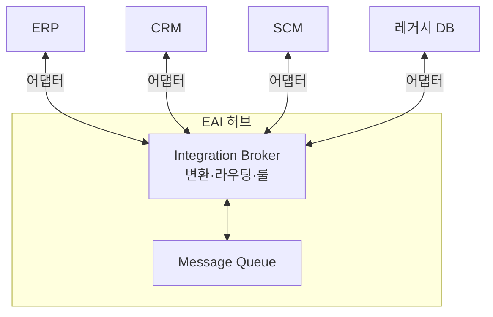

# EAI (Enterprise Application Integration)

---

## I. 이기종 애플리케이션을 하나로 잇는, EAI의 개요

### 가. 정의

- 기업 내 이기종 애플리케이션·[[데이터베이스]]·레거시 시스템을 **중앙 연계 엔진(브로커)과 어댑터로 통합**해 데이터와 업무 프로세스를 연동하는 전사 통합 아키텍처

### 나. 필요성 및 특징

| 구분 | 내용 |
| --- | --- |
| 연계 복잡도 해소 | [[Point-to-Point]] 방식의 N(N−1)/2 연결을 허브 1개 연결로 축소 |
| 데이터 일관성 | 부서별 시스템 간 데이터 동기화로 사일로 해소 |
| 확장 용이 | 신규 시스템은 어댑터만 추가해 연계 |
| 비동기 신뢰 전송 | 메시지 큐로 장애 시에도 전달 보장 |

---

## II. EAI의 구조 및 구성요소

### 가. Hub & Spoke 구조

- 어댑터가 각 시스템의 고유 인터페이스를 표준 메시지로 변환하고, 브로커가 규칙에 따라 변환·라우팅하며 큐가 비동기 전달을 보장

### 나. 구성요소

| 구분 | 요소 | 설명 |
| --- | --- | --- |
| 연결 | 어댑터 (Adapter) | 애플리케이션·[[DBMS]]와 EAI 엔진을 연결하는 인터페이스 모듈 |
| 처리 | 통합 브로커 | 메시지 변환·검증·라우팅을 수행하는 핵심 엔진 |
| | 데이터 변환 (Mapping) | [[XML]]·[[JSON]]·CSV 등 포맷과 코드 체계 변환 |
| | 메시지 라우팅 | 내용·업무 규칙 기반 수신처 결정 |
| 전송 | 메시지 [[Queue]] | 비동기 전송, 유실 방지, 순서 보장 |
| 프로세스 | BPM | 여러 시스템에 걸친 업무 흐름 제어·모니터링 |
| 토폴로지 | Hub & Spoke | 중앙 허브 집중형, 관리 용이 / 허브 병목·단일 장애점 |
| | Message Bus | 공용 버스 기반 분산형, 확장성 높음 |

---

## III. EAI vs ESB 비교 및 동향

### 가. 비교

| 구분 | EAI | ESB |
| --- | --- | --- |
| 관점 | 애플리케이션·데이터 통합 | SOA 기반 서비스 통합 |
| 구조 | Hub & Spoke (중앙 집중) | 버스형 (분산) |
| [[결합도]] | 상대적으로 강함, 벤더 어댑터 의존 | 표준 기반 느슨한 결합 |
| 표준 | 벤더 고유 어댑터·[[프로토콜]] | 웹서비스 표준 (SOAP, WSDL, REST) |
| 적용 | 사내 레거시 연계 | 사내외 서비스 연계 |

### 나. 동향

- **API 중심 통합**: [[MSA (Micro Service Architecture)|MSA]] 환경에서는 [[API Gateway]]와 이벤트 스트리밍(Kafka 등) 기반 연계가 주류
- **iPaaS**: 온프레미스와 SaaS를 클라우드형 통합 플랫폼으로 연계
- **B2B 연계 확장**: 기업 간 거래는 [[EDI]]·API 기반 연계로 확장

---

### 🔗 연관 토픽

- **소속 도메인**: [[00_경영전략_MOC|📈 경영전략]]
- **세부 분류**: `2. IT 거버넌스 & 엔터프라이즈 아키텍처 (EA/ISP)`
- **핵심 연관 토픽**:
  - [[Point-to-Point]]
  - [[API Gateway]]
  - [[MSA (Micro Service Architecture)]]
  - [[EDI]]
  - [[결합도]]
