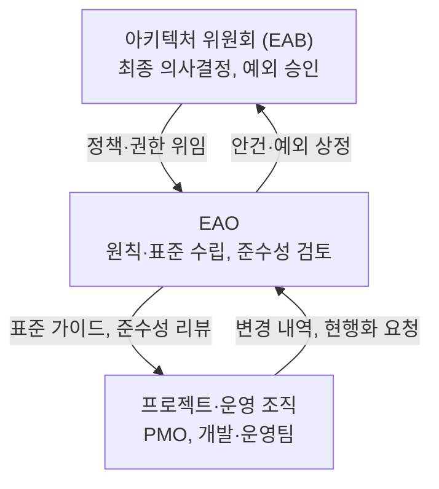

# EAO (Enterprise Architecture Office)

---

## I. EA를 지속적으로 운영하는 전담 조직, EAO의 개요

### 가. 정의

- 전사 아키텍처(EA)의 **원칙·표준을 수립하고, 프로젝트의 아키텍처 준수를 검토하며, EA 정보를 현행화**하는 상설 전담 조직

### 나. 필요성 및 특징

| 구분 | 내용 |
| --- | --- |
| 지속성 확보 | EA를 일회성 구축 사업으로 끝내지 않고 As-Is·To-Be를 계속 현행화 |
| 중복 투자 방지 | 부서별 개별 시스템 도입을 통제해 상호운용성·재사용 확보 |
| 비즈니스–IT 정렬 | 경영 전략 변화를 목표 아키텍처와 이행계획에 반영 |
| 거버넌스 실무 | 의사결정 기구(아키텍처 위원회)의 실무 지원 조직 |

---

## II. EAO의 역할 구조 및 구성요소

### 가. EA 거버넌스 내 위치

- EAO가 위원회 정책을 표준 가이드로 구체화해 프로젝트에 적용하고, 프로젝트 결과를 EA 정보에 반영하는 순환 구조

### 나. 핵심 역할

| 구분 | 요소 | 설명 |
| --- | --- | --- |
| 기획 | 목표 아키텍처·이행계획 | 경영 목표에 맞춘 To-Be 아키텍처와 전환 로드맵 수립 |
| 표준 | EA [[프레임워크]] 맞춤화 | Zachman, TOGAF 등을 조직에 맞게 조정, 아키텍처 원칙 정의 |
| | 참조모델 관리 | PRM(성과)·BRM(업무)·SRM(서비스)·DRM(데이터)·TRM(기술) 참조모델 갱신 |
| 통제 | 준수성 검토 | 신규 사업 설계가 원칙·표준 기술에 맞는지 검토하고 시정 요구 |
| | 예외 관리 | 비표준 기술 사용 요청의 타당성 검토 후 위원회 상정 |
| 자산 관리 | EA 정보 현행화 | EA 관리시스템(EAMS)에 시스템 변경 내역 반영 |
| | IT 포트폴리오 분석 | 중복·노후 시스템 식별, 통폐합 권고 |
| 변화 관리 | 교육·내재화 | 현업·IT 인력 대상 EA 활용 교육, 가이드 배포 |

---

## III. PMO 비교 및 동향

### 가. EAO vs PMO

| 구분 | EAO | [[PMO]] |
| --- | --- | --- |
| 관리 대상 | 전사 아키텍처 (업무·데이터·응용·기술) | 프로젝트 일정·비용·품질·위험 |
| 조직 성격 | 상설, 전사 최적화 관점 | 상설 또는 한시, 프로젝트 성공 관점 |
| 핵심 목표 | 정렬, 복잡도 통제, 중복 투자 방지 | 범위·일정·예산 내 목표 품질 달성 |
| 평가 지표 | 표준 준수율, 재사용률, 중복 시스템 감소 | 일정·예산 준수율, 결함률 |

### 나. 동향

- **경영진 후원**: 개별 프로젝트 이해관계에 밀리지 않도록 [[CIO]] 산하 독립 권한과 제도적 근거 필요
- **애자일 EA**: 사전 승인 중심의 통제에서 가드레일·셀프서비스 가이드 제공으로 전환, [[클라우드 네이티브]]·[[MSA (Micro Service Architecture)|MSA]] 환경 지원
- **공공 EA**: 범정부 EA 포털(GEAP) 기반 정보자원 현황 관리와 [[ISP 및 ISMP 수립 공통가이드 9판(2025.05)|ISP/ISMP]] 연계

---

### 🔗 연관 토픽

- **소속 도메인**: [[00_경영전략_MOC|📈 경영전략]]
- **세부 분류**: `2. IT 거버넌스 & 엔터프라이즈 아키텍처 (EA/ISP)`
- **핵심 연관 토픽**:
  - [[IT 거버넌스]]
  - [[CIO]]
  - [[PMO]]
  - [[ISP (Information Strategy Plan)]]
  - [[ISP 및 ISMP 수립 공통가이드 9판(2025.05)]]
