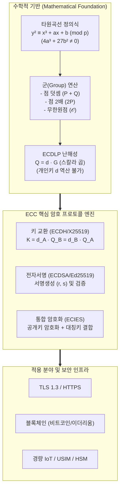

# ECC(Elliptic Curve Cryptography)

---

## I. 이산대수 기반 경량·고강도 공개키 암호, ECC의 개요

### 가. ECC(Elliptic Curve Cryptography)의 정의
유한체(Finite Field) 상의 타원곡선 이산대수 문제(ECDLP)의 계산적 난해성에 기반하여 적은 비트 수로 높은 보안 강도를 제공하는 공개키 [[암호화]] [[알고리즘]]이다.

### 나. ECC의 등장 배경 및 주요 특징
| 구분 | 내용 |
| --- | --- |
| **등장 배경** | 소인수분해 기반 [[RSA (Rivest Shamir Adleman)\|RSA]]의 키 길이 급증(3072비트 이상)에 따른 연산 지연 및 메모리 한계를 극복하기 위해 등장 |
| **경량·고강도 보안** | 256비트 키 길이만으로 RSA 3072비트 수준의 동등 보안 강도를 제공하여 전력·연산 제약 환경(IoT, 모바일) 최적화 |
| **스칼라 곱셈 기반** | 점 덧셈(Point Addition)과 점 2배 산출(Point Doubling)의 반복을 통한 스칼라 곱($Q = d \cdot G$) 기반 일방향 함수 구조 |
| **광범위한 프로토콜 적용** | 키 교환(ECDH), 전자서명(ECDSA, Ed25519), 하이브리드 암호(ECIES) 등 현대 보안 인프라의 핵심 표준 채택 |

---

## II. ECC의 아키텍처 및 핵심 기술 요소

### 가. ECC의 메커니즘 및 암호화 아키텍처

- 타원곡선의 기준점($G$)에 개인키($d$)를 스칼라 배 곱하여 공개키($Q$)를 생성하며, $Q$와 $G$가 공개되어도 역연산($d$)이 계산적으로 불가능(ECDLP)한 특성을 활용하여 키 교환·전자서명·하이브리드 [[암호화]] 수행

### 나. ECC의 핵심 기술 및 구성 요소

|**구분**|**핵심 기술/요소**|**세부 설명**|
|---|---|---|
|**수학적 기반**|**Weierstrass 방정식**|$y^2 = x^3 + ax + b \pmod p$, 비특이 곡선 조건($4a^3 + 27b^2 \neq 0$) 만족|
|**수학적 기반**|**ECDLP**|$Q = d \cdot G$에서 점 $G, Q$를 알 때 스칼라 값 $d$(개인키)를 구하는 이산대수 역산의 난해성|
|**기본 연산**|**Point Addition / Doubling**|기하학적 접선 및 교점 계산을 유한체 모듈러 연산으로 치환하여 군(Abelian Group) 형성|
|**기본 연산**|**Scalar Multiplication**|Double-and-Add, Montgomery Ladder 기법을 적용한 $k \cdot P$ 연산 가속화 및 [[부채널 공격]] 방어|
|**암호 [[프로토콜]]**|**ECDH / X25519**|Diffie-Hellman 원리를 타원곡선에 적용한 고속 세션키 교환 [[프로토콜]] ([[SSL-TLS\|TLS]] 1.3 표준)|
|**암호 프로토콜**|**ECDSA / EdDSA**|타원곡선 기반 전자서명 알고리즘 (Ed25519: 슈노르 서명 결합, 부채널 내성 및 고속 검증)|
|**표준 곡선**|**NIST Curves & secp256k1**|NIST P-256(범용), secp256k1(Koblitz 곡선 기반 [[블록체인]] 서명), Curve25519(고속/안전 곡선)|
|**하이브리드 암호**|**ECIES**|타원곡선 기반 공개키 암호와 대칭키([[AES]]) 및 메시지 인증코드([[MAC]])를 결합한 암·복호화 기법|

---

## III. ECC vs RSA 비교 및 향후 전망

### 가. ECC와 RSA 암호 기술 비교

|**비교 항목**|**ECC (Elliptic Curve Cryptography)**|**[[RSA (Rivest Shamir Adleman)\|RSA (Rivest-Shamir-Adleman)]]**|
|---|---|---|
|**수학적 난제**|**타원곡선 이산대수 문제 (ECDLP)**|**큰 수의 소인수분해 문제 (IFP)**|
|**키 길이 (128-bit 보안 기준)**|**256 bit** (매우 짧음)|**3072 bit** (상대적으로 매우 긺)|
|**연산 및 처리 속도**|키 생성 및 서명 속도 **매우 빠름**, 저전력 소모|서명 검증은 빠르나, 키 생성 및 서명 연산 무거움|
|**자원 점유율**|메모리, 대역폭, 저장공간 점유 최소화|대용량 인증서 크기 및 네트워크 대역폭 소모 큼|
|**주요 적용 분야**|**TLS 1.3, [[블록체인]], 모바일 결제, 경량 IoT 기기**|레거시 PKI, 전자서명 인증서, 웹 보안 인프라|

### 나. 주요 동향 및 발전 전망
* **양자 컴퓨팅 위협(Shor 알고리즘)**: 양자 컴퓨터 실용화 시 쇼어 알고리즘에 의해 다항 시간($O(n^3)$) 내 ECDLP가 해독되어 공개키 기반 보안 체계 붕괴 위험 노출
* **하이브리드 PQC 전환 가속화**: 과도기적 암호 복원력을 위해 격자 기반 양자내성암호(ML-KEM, ML-[[DSA]])와 고속 타원곡선(X25519)을 결합한 하이브리드 키 교환 표준(Composite Crypto) 도입 확대
* **차세대 고속 안전 곡선(Ed25519) 확산**: 타이밍 공격 등 부채널 취약점이 내재된 전통적 NIST 곡선을 대체하여 안전성과 연산 성능이 입증된 Curve25519/Ed25519 표준 채택 가속화

---

### 🔗 연관 토픽

- **소속 도메인**: [[00_보안_MOC|🛡️ 보안]]
- **세부 분류**: `2. 현대 암호학 & 키 관리 · 전자서명`
- **핵심 연관 토픽**:
  - [[RSA (Rivest Shamir Adleman)]]
  - [[양자내성암호]]
  - [[암호화|암호화 (Encryption)]]
  - [[부채널 공격|부채널 공격(Side Channel Attack)]]
  - [[AES]]
