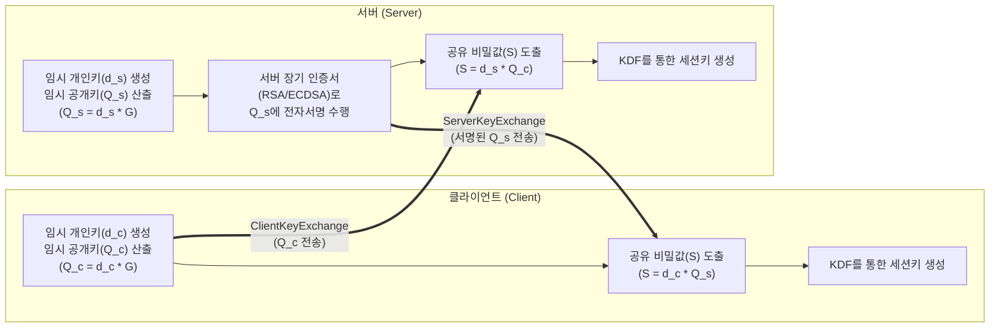

# ECDHE(Elliptic Curve Diffie-Hellman Ephemeral)

---

## I. 완벽한 전방향 정합성(PFS)을 보장하는 키 교환 프로토콜, ECDHE의 개요

### 가. ECDHE(Elliptic Curve Diffie-Hellman Ephemeral)의 정의
타원곡선 암호([[ECC]])와 디피-헬만(DH) 알고리즘을 결합하여 매 세션마다 일회성 임시(Ephemeral) 키 쌍을 생성함으로써 안전하게 대칭 세션키를 교환하는 암호 통신 [[프로토콜]]이다.

### 나. ECDHE의 등장 배경 및 주요 특징
| 구분 | 내용 |
| --- | --- |
| **등장 배경** | 서버의 장기 마스터 키 유출 시 과거 모든 세션이 복호화되는 정적 키 교환(RSA, Static DH)의 보안 위협 해결 |
| **전방향 정합성(PFS)** | 마스터 비밀키가 유출되더라도 과거에 캡처된 통신 암호문이 영구히 해독되지 않는 Perfect Forward Secrecy 보장 |
| **경량·고성능 연산** | 타원곡선 이산대수(ECDLP) 기반으로 256비트 키 수준에서 고속 키 합의를 지원하여 네트워크 오버헤드 최소화 |
| **TLS 1.3 표준 채택** | 보안 취약 정적 키 교환 방식이 전면 폐지된 TLS 1.3 규격에서 기본 세션키 교환 메커니즘으로 필수 적용 |

---

## II. ECDHE의 개념도 및 핵심 기술 요소

### 가. ECDHE의 개념도 및 동작 원리

* 클라이언트와 서버는 해당 세션에서만 유효한 임시 키($d_c, d_s$)를 생성하고 교환하며, 서버는 중간자 공격(MITM) 방지를 위해 인증서의 장기 개인키로 임시 공개키($Q_s$)를 서명함
* 교환된 공개키와 자신의 개인키를 곱하여 동일한 공유 비밀값($S$)을 도출 후 암호화 통신 수행

### 나. ECDHE의 핵심 기술 및 구성 요소

| 구분 | 요소기술(키워드) | 세부 설명 |
| --- | --- | --- |
| **핵심 속성** | PFS (전방향 정합성) | 마스터 키(장기 인증서 키)가 손상되더라도 이전 세션의 암호문은 해독할 수 없는 보안 특성 |
| **키 관리** | Ephemeral Key (임시 키) | 각 통신 세션마다 새롭게 생성되고 통신 종료 시 즉각 메모리에서 폐기되는 일회성 키 쌍 |
| **기반 [[알고리즘]]** | 타원곡선 (ECC) / ECDLP | 타원곡선 이산대수 난제를 활용하여 효율적인 자원 소모로 강력한 키 교환 수학적 기반 제공 |
| **표준 곡선** | X25519 / secp256r1 | ECDHE에서 주로 사용되는 안전하고 성능이 검증된 표준 타원곡선 파라미터 |
| **인증 결합** | RSA / ECDSA 전자서명 | DH 알고리즘 자체는 신분 인증 기능이 없으므로, 장기 인증서를 활용한 전자서명 결합 필수 |
| **보안 위협 방어** | MITM (중간자 공격) 방어 | 서버의 전자서명 절차를 통해 네트워크 중간에서 공개키를 가로채어 변조하는 공격 차단 |
| **키 파생** | KDF (Key Derivation Func.) | 생성된 공유 비밀값(S)과 난수 등을 조합하여 실제 [[대칭키 암호화]]([[AES]] 등)에 쓸 세션키 추출 |

---

## III. ECDHE와 기존 키 교환 방식 비교 및 최신 동향

### 가. 주요 키 교환 알고리즘 비교 (ECDHE vs ECDH vs RSA)

| 비교 항목 | ECDHE (Ephemeral) | ECDH (Static) | RSA (정적 키 교환) |
| --- | --- | --- | --- |
| **키 생성 방식** | 매 세션마다 임시 키 생성 | 인증서에 고정된 정적 키 사용 | 인증서의 RSA 공개키/개인키 사용 |
| **전방향 정합성(PFS)** | **완벽히 보장함** | 보장하지 않음 | 보장하지 않음 |
| **개인키 유출 시 피해** | 해당 임시 세션만 위험 (과거 안전) | 과거 및 미래의 모든 [[세션]] 해독됨 | 과거 및 미래의 모든 세션 해독됨 |
| **인증 및 키교환 분리** | 분리됨 (키교환: ECDHE, 인증: 서명) | 결합됨 (인증서 키로 직접 교환) | 결합됨 (클라이언트가 프리마스터키 암호화) |
| **TLS 1.3 지원 여부** | **표준 채택 (권장)** | 보안 취약으로 폐기(Deprecated) | 보안 취약으로 폐기(Deprecated) |

### 나. 주요 동향 및 발전 전망
* **TLS 1.3 기본 키 교환 표준 확립**: 정적 RSA 및 취약한 키 교환 알고리즘이 퇴출됨에 따라 HTTPS, QUIC 등 차세대 웹 프로토콜의 사실상 표준 키 교환 방식으로 안착
* **PQC 하이브리드 키 교환(X25519Kyber768) 전환**: '지금 수집하고 나중에 복호화(Harvest Now, Decrypt Later)' 위협에 대응하여 ECDHE(X25519)와 격자 기반 PQC(ML-KEM)를 결합한 하이브리드 키 교환 조기 도입
* **고성능 X25519 타원곡선 채택 확산**: 기존 NIST P-256 대비 구현 취약점이 적고 상수 시간(Constant-time) 연산으로 타이밍 부채널 공격에 안전한 Bernstein의 Curve25519/X25519 적용 지배적

---

### 🔗 연관 토픽

- **소속 도메인**: [[00_보안_MOC|🛡️ 보안]]
- **세부 분류**: `2. 현대 암호학 & 키 관리 · 전자서명`
- **핵심 연관 토픽**:
  - [[암호화|암호화 (Encryption)]]
  - [[RSA (Rivest Shamir Adleman)]]
  - [[ECC|ECC(Elliptic Curve Cryptography)]]
  - [[양자내성암호]]
  - [[AES]]
