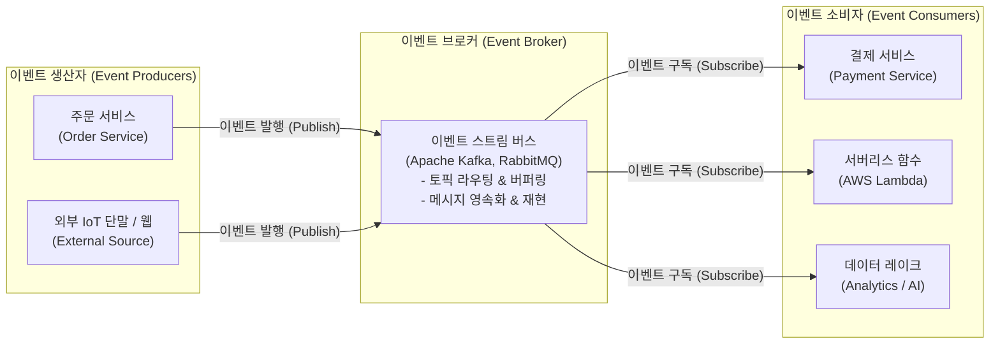

# EDA (Event-Driven Architecture)

---

## I. 느슨한 결합 기반의 비동기 분산 아키텍처, EDA의 개요

시스템 내의 유의미한 상태 변화(Event)를 감지하여 비동기적으로 메시지를 발행(Publish)하고, 이를 구독(Subscribe)하는 복수의 독립된 서비스들이 반응하여 비즈니스 로직을 처리하는 분산 소프트웨어 아키텍처이다.

| 구분 | 주요 내용 |
| --- | --- |
| **개념** | 이벤트 생산자(Producer)와 소비자(Consumer)가 이벤트 브로커(Broker)를 매개로 상호 비동기 통신을 수행하는 이벤트 중심 아키텍처 |
| **등장 배경** | 전통적인 동기식 RPC/REST 호출로 인한 서비스 간 결합도 증가, 연쇄 장애(Cascading Failure) 발생 및 실시간 대규모 데이터 스트리밍 처리 한계 극복 |
| **핵심 특징** | 서비스 간 느슨한 결합(Loose Coupling), 비동기 통신을 통한 탄력적 확장성(Scalability), 장애 격리성(Fault Isolation), 결과적 일관성 수용 |

---

## II. EDA의 아키텍처 및 핵심 기술 요소

### 가. EDA의 시스템 아키텍처 및 동작 원리

생산자는 소비자의 존재나 상태를 알 필요 없이 이벤트 브로커로 이벤트를 발행하며, 브로커는 토픽(Topic) 기반으로 메시지를 큐잉·보관하고, 복수의 구독자가 독립적으로 이를 소비하여 처리한다.

### 나. EDA의 핵심 기술 요소

| 분류 | 요소기술 (키워드) | 세부 설명 |
| --- | --- | --- |
| **핵심 구성원** | Event Producer / Consumer | 시스템 상태 변화를 이벤트 객체로 생성해 전송하는 주체와, 이를 수신해 실제 로직을 실행하는 주체 |
| **메시지 매개체** | Event Broker | 대규모 이벤트를 유실 없이 수집, 버퍼링, 파티셔닝하여 적절한 구독자에게 전달하는 미들웨어 (Kafka 등) |
| **상태 영속화** | Event Sourcing | 데이터의 최종 상태만을 저장하는 대신, 상태 변경을 일으킨 모든 도메인 이벤트를 순차적으로 영구 저장 |
| **책임 분리** | CQRS | 시스템의 상태를 변경하는 명령(Command) 모델과 데이터를 조회하는 쿼리(Query) 모델을 물리적으로 분리 |
| **분산 트랜잭션** | Saga 패턴 (Choreography) | 중앙 오케스트레이터 없이 각 서비스가 도메인 이벤트를 주고받으며 로컬 트랜잭션과 보상 트랜잭션을 연쇄 실행 |
| **상호 운용성** | CloudEvents 표준 | 클라우드 환경에서 이기종 플랫폼 간 이벤트 교환을 지원하기 위해 CNCF가 제정한 공통 메타데이터 규격 |
| **실시간 분석** | 스트림 프로세싱 (Stream Analytics) | 초당 수십만 건의 이벤트 스트림을 인메모리 상에서 실시간 윈도잉·필터링·집계하는 기술 (Flink, Spark) |

---

## III. 전통적 요청 기반 아키텍처와의 비교 및 최신 동향

### 가. 요청 기반 아키텍처(RDA) vs 이벤트 기반 아키텍처(EDA) 비교

| 비교 항목 | 요청 기반 아키텍처 (Request-Driven / REST) | 이벤트 기반 아키텍처 (Event-Driven / EDA) |
| --- | --- | --- |
| **통신 방식** | **동기식(Synchronous)** 점대점(P2P) 직접 호출 | **비동기식(Asynchronous)** 발행-구독(Pub/Sub) |
| **결합도** | 서비스 간 IP, 포트, API 규격 종속 (강결합) | 브로커를 매개로 논리적·시간적 분리 (**느슨한 결합**) |
| **장애 전파** | 피호출 서비스 장애 시 호출 서비스로 연쇄 전파 | 브로커 큐잉으로 **장애가 격리(Fault Isolation)**됨 |
| **트래픽 급증** | 순간 트래픽 폭주 시 서버 다운 및 병목 발생 | 브로커가 버퍼링하여 소비자가 가용 용량만큼 처리 |
| **데이터 정합성** | 2PC 등 강한 일관성(ACID) 구현에 유리 | **결과적 일관성(Eventual Consistency)** 모델 수용 |

### 나. 최신 기술 동향 및 발전 방향

* **서버리스(Serverless) 컴퓨팅과의 완전한 결합**: AWS EventBridge, GCP Eventarc 등 클라우드 네이티브 이벤트 라우터와 FaaS(Lambda)가 결합하여 유휴 자원 비용이 없는 완전 이벤트 반응형 아키텍처가 확산됨.
* **트랜잭셔널 아웃박스(Transactional Outbox) 패턴 채택**: 데이터베이스 업데이트와 메시지 발행 간의 원자성(Atomicity)을 보장하기 위해 CDC(Change Data Capture, Debezium) 기반의 아웃박스 패턴 적용이 표준화됨.

---

### 🔗 연관 토픽

- **소속 도메인**: [[00_소프트웨어공학_MOC|🏗️ 소프트웨어공학]]
- **세부 분류**: `4. 아키텍처 스타일 & 객체지향 설계 원리`
- **핵심 연관 토픽**:
  - [[MSA (Micro Service Architecture)]]
  - [[클라우드 네이티브]]
  - [[DDD (Domain Driven Design)]]
  - [[SAGA패턴]]
  - [[결합도]]
