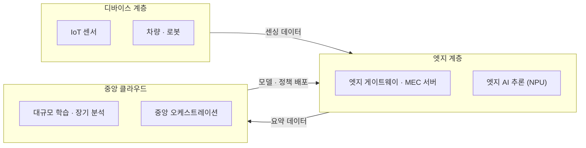

# 엣지 컴퓨팅 (Edge Computing)

---

## I. 데이터가 생기는 곳 가까이에서 처리하는, 엣지 컴퓨팅의 개요

### 가. 정의

- 데이터를 중앙 클라우드로 모두 보내지 않고 **단말·기지국·현장 서버 등 데이터 발생지 가까운 곳에서 수집·처리·분석**하는 분산 컴퓨팅 방식

### 나. 필요성 및 특징

| 구분 | 내용 |
| --- | --- |
| 저지연 | 왕복 거리를 줄여 자율주행·공장 제어 등 실시간 응답 |
| 대역폭 절감 | 현장에서 걸러 요약 데이터만 전송, [[백홀 트래픽]] 감소 |
| 프라이버시 | 원본 데이터를 현장에 두어 유출 위험·규제 부담 감소 |
| 자율성 | 네트워크 단절 시에도 로컬 동작 유지 |
| 제약 | 노드별 연산·전력·관리 자원 제한, 분산 노드 보안 관리 부담 |

---

## II. 구조 및 구성요소

### 가. 3계층 구조

- 실시간 판단은 엣지에서, 학습과 전체 관리는 클라우드에서 수행하는 협력 구조

### 나. 구성요소

| 구분 | 요소 | 설명 |
| --- | --- | --- |
| 네트워크 | [[Mobile Edge Computing\|MEC]] (Multi-access Edge Computing) | 기지국·UPF 가까이 서버를 두는 ETSI 표준 |
| | TSN (Time-Sensitive Networking) | 이더넷에서 지연 상한을 보장하는 IEEE 802.1 표준군 |
| 실행 환경 | 경량 쿠버네티스 | K3s, KubeEdge, OpenYurt 등 엣지용 [[컨테이너]] 오케스트레이션 |
| | WebAssembly | 이식성 높은 경량 [[바이너리 런타임]] |
| 엣지 AI | TinyML·[[온디바이스 AI]] | MCU·NPU에서 경량 모델 추론 |
| | [[연합 학습]] | 데이터를 모으지 않고 로컬 학습 후 모델 갱신값만 집계 |
| 데이터 | 이벤트 기반 처리 | MQTT 메시징, 스트림 처리 ([[EDA]]) |
| 보안 | [[제로 트러스트 보안모델\|제로 트러스트]] | 분산 노드마다 인증·암호화·네트워크 마이크로 세그멘테이션 |
| 운영 | 원격 관리 | OTA 업데이트, [[워치독 타이머]] 기반 자가 복구 |

---

## III. 비교 및 동향

### 가. 엣지 컴퓨팅 vs 클라우드 컴퓨팅

| 비교 항목 | 엣지 컴퓨팅 | [[클라우드 컴퓨팅]] |
| --- | --- | --- |
| 처리 위치 | 데이터 발생지 근처 | 중앙 데이터센터 |
| 역할 | 실시간 제어·판단, 전처리 | 대규모 학습·저장·분석 |
| 지연 | 수 ms 수준 가능 | 수십~수백 ms |
| 네트워크 부하 | 낮음 (로컬 필터링) | 높음 (원본 전송) |
| 연산 자원 | 제한적 | 탄력적 대규모 |
| 관리 | 다수 분산 노드 관리 부담 | 중앙 집중 관리 |

### 나. 동향

- **엣지 AI 확산**: NPU 탑재 단말·게이트웨이에서 sLLM·비전 모델을 직접 추론, [[Physical AI]](로봇·자율주행)로 확대
- **클라우드-엣지 연속체**: 같은 쿠버네티스 기반 도구로 클라우드부터 엣지까지 워크로드를 배치·이동하는 운영 모델 확산

---

### 🔗 연관 토픽

- **소속 도메인**: [[00_컴퓨터구조_MOC|💻 컴퓨터구조]]
- **세부 분류**: `3. 고성능 AI 가속기 & 입출력 시스템`
- **핵심 연관 토픽**:
  - [[Mobile Edge Computing|Mobile Edge Computing (MEC)]]
  - [[포그 컴퓨팅]]
  - [[클라우드 컴퓨팅|클라우드 컴퓨팅 (Cloud Computing)]]
  - [[온디바이스 AI]]
  - [[NPU|NPU(Neural Processing Unit)]]
