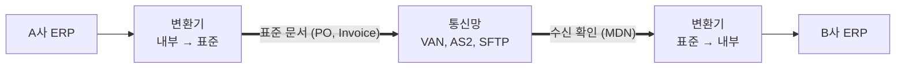

# EDI (Electronic Data Interchange)

---

## I. 기업 간 문서를 표준 형식으로 주고받는, EDI의 개요

### 가. 정의

- 거래 기업 간에 **합의된 표준 형식으로 주문서·송장 등 상거래 문서를 컴퓨터 간 전자적으로 교환**하는 체계

### 나. 필요성 및 특징

| 구분 | 내용 |
| --- | --- |
| 수작업 제거 | 우편·팩스·재입력에 따른 지연과 입력 오류 방지 |
| 비용 절감 | 문서 처리·보관 비용 감소 |
| 주기 단축 | 주문–출하–청구–결제 리드타임 단축 ([[SCM (Supply Chain Management)\|SCM]] 기반) |
| 표준 기반 | 업종·국가별 표준 문서와 통신 규약 사용 |

---

## II. EDI의 구조 및 구성요소

### 가. 처리 흐름

- 송신 측 변환기가 내부 데이터를 표준 문서로 바꿔 전송하고, 수신 측 변환기가 다시 내부 형식으로 바꿔 업무 시스템에 자동 반영

### 나. 구성요소

| 구분 | 요소 | 설명 |
| --- | --- | --- |
| 문서 표준 | UN/EDIFACT | UN 국제 표준, 무역·행정에 사용 |
| | ANSI ASC X12 | 북미 산업 표준 |
| | ebXML | [[XML]] 기반 개방형 전자상거래 표준 (UN/CEFACT·OASIS) |
| 변환 | 변환기 (Translator) | 내부 파일 ↔ 표준 문서 변환 |
| | 매퍼 (Mapper) | 필드·코드·날짜 형식 대응 규칙 |
| 통신 | [[VAN]] | 사서함·라우팅·변환 부가 서비스를 제공하는 제3자 통신망 |
| | AS2 / AS4 | 인터넷(HTTP/S) 기반 보안 문서 교환 [[프로토콜]] |
| 보안 | [[암호화]]·전자서명 | 기밀성, [[무결성]], 부인 방지 |

---

## III. 전통적 EDI vs 개방형 방식 및 동향

### 가. 비교

| 구분 | 전통적 EDI | ebXML·API 기반 연계 |
| --- | --- | --- |
| 통신 | VAN 중심 폐쇄망 | 인터넷 (HTTP/S) |
| 데이터 형식 | EDIFACT·X12 | XML·JSON |
| 비용 | 구축·VAN 이용료 높음 | 상대적으로 저렴 |
| 참여 | 대기업·고정 거래처 중심 | 중소기업 포함 다대다 연계 |
| 처리 | 배치 중심 | 실시간 호출 가능 |

### 나. 동향

- **EDI + API 병행**: 대량·정형 거래는 EDI, 실시간 조회·상태 갱신은 API로 처리하는 하이브리드 B2B 통합(iPaaS)
- **전자 세금계산서·무역 문서 전자화**: 국내 전자세금계산서 의무화, 전자 선하증권 등 디지털 무역 문서 확산
- **공급망 가시성**: EDI 거래 데이터를 재고·배송 예측 분석에 활용 ([[EAI]] 연계)

---

### 🔗 연관 토픽

- **소속 도메인**: [[00_경영전략_MOC|📈 경영전략]]
- **세부 분류**: `3. 비즈니스 프로세스 혁신 & 디지털 전환 (DX)`
- **핵심 연관 토픽**:
  - [[VAN]]
  - [[XML]]
  - [[CALS]]
  - [[EAI]]
  - [[SCM (Supply Chain Management)]]
