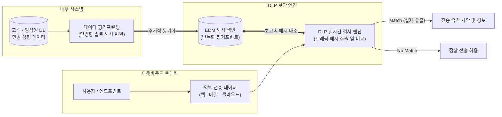

# EDM (Exact Data Match)

---

## I. 오탐 없는 정밀 데이터 유출 방지, EDM의 개요

### 가. 정의

- 기업이 보유한 실제 민감 정형 데이터(고객·임직원 DB 등)를 단방향 해시(Hash)로 핑거프린팅하여, **외부로 전송되는 데이터와 정확히 일치할 때만 실시간 차단하는 차세대 데이터 유출 방지([[DLP]]) 기술**

### 나. 특징 및 필요성

| 구분 | 내용 |
| --- | --- |
| 오탐률(False Positive) 최소화 | 정규식(Regex) 기반의 패턴 매칭이 유발하는 오탐과 보안팀 경고 피로도(Alert Fatigue) 극복 |
| 원본 데이터 보호 | DLP 서버에 원본 평문이 아닌 단방향 솔트 해시만 저장하여 DLP 시스템 해킹 시 2차 유출 원천 차단 |
| 다중 조건 결합 | "이름 + 주민번호 + 계좌번호" 등 복합 레코드가 동시에 일치할 때만 차단하여 업무 영향도 최소화 |
| 컴플라이언스 준수 | [[개인정보보호법]], GDPR 등에서 요구하는 실제 보유 개인정보의 유출 통제 및 감사 증적 확보 |

---

## II. 개념도 및 핵심 구성요소

### 가. 개념도

- 원본 DB의 식별 정보를 단방향 해시로 사전 색인해두고, 외부로 나가는 네트워크 트래픽에서 추출된 데이터와 실시간 고속 대조하여 정확히 일치하는 경우에만 즉각 차단

### 나. 핵심 기술 요소

| 구분 | 요소 | 설명 |
| --- | --- | --- |
| 데이터 수집 | 정형 데이터 추출 | RDBMS, CSV 등에서 고유 식별 필드(주민등록번호, 카드번호, 사번 등)를 주기적으로 덤프 |
| 데이터 난독화 | 핑거프린팅 | 원본 데이터를 역산할 수 없도록 고유 서명 값으로 변환하는 전처리 과정 |
| | 단방향 해시 | SHA-256 및 솔트(Salt)를 결합하여 레코드별 해시 테이블 생성 |
| 탐지 엔진 | 실시간 트래픽 파싱 | 웹(HTTP/HTTPS), 이메일(SMTP), 클라우드 업로드 트래픽에서 데이터 토큰 실시간 추출 |
| | 고속 매칭 알고리즘 | 수억 건의 해시 레코드와 트래픽 해시값을 지연 없이 대조하기 위한 인메모리 색인 |
| 통제 정책 | 복합 조건 트리거 | 단일 필드가 아닌 "성명 + 주민번호" 등 다중 필드가 동일 레코드 내에서 일치 시 차단 |
| | 정책 집행 | 일치 판정 시 패킷 리셋, 이메일 격리(Quarantine), 사용자 차단 및 관리자 감사 알람 |

---

## III. 탐지 기법 비교 및 동향

### 가. 패턴 매칭(Regex) vs EDM vs IDM

| 비교 항목 | 패턴 매칭 (Regex) | EDM (Exact Data Match) | IDM (Indexed Document Match) |
| --- | --- | --- | --- |
| 탐지 대상 | 데이터의 **형식/패턴** (16자리 숫자 등) | 실제 보유 **정형 데이터 값** | 비정형 문서 전체 (설계도, 소스코드) |
| 오탐률 | 높음 (유사 형식의 일반 데이터 오인) | **매우 낮음** (실제 보유 데이터만 감지) | 낮음 (문서 지문 대조) |
| 원본 파악 | 어떤 고객의 정보인지 식별 불가 | **정확한 유출 피해 레코드 특정 가능** | 유출된 원본 문서 파일 특정 가능 |
| 관리 부담 | 정규표현식 룰 튜닝 지속 필요 | 주기적 DB 해시 추출 및 동기화 필요 | 문서 변경 시 인덱스 재스캔 필요 |
| 주 활용 분야 | 불특정 민감 데이터 1차 광범위 탐지 | 고객 DB, 금융 거래 원장 정밀 유출 방지 | 기밀 보고서, 지식재산권(IP) 문서 통제 |

### 나. 동향

- **하이브리드 다계층 DLP 구축**: 광범위한 1차 필터링을 수행하는 정규식 패턴 매칭과, 오탐 없는 최종 차단을 집행하는 EDM을 파이프라인으로 결합해 효율화
- **클라우드 CASB / SASE 연동**: 엔드포인트뿐만 아니라 Microsoft 365, Google Workspace 등 클라우드 SaaS 업로드 트래픽에 EDM 검사를 수행하는 CASB 통합 솔루션 확산
- **비정형 문서 내 정형 데이터 실시간 파싱**: OCR(광학문자인식) 및 생성형 문서 분석 엔진을 결합하여 스캔 이미지나 PDF 내에 포함된 정형 개인정보까지 EDM으로 추출·차단

---

### 🔗 연관 토픽

- **소속 도메인**: [[00_데이터베이스_MOC|🗄️ 데이터베이스]]
- **세부 분류**: `5. 분산 데이터베이스 & NoSQL & 대용량`
- **핵심 연관 토픽**:
  - [[DLP]]
  - [[핑거프린팅]]
  - [[개인정보보호법]]
  - [[암호화]]
  - [[해시 테이블]]
