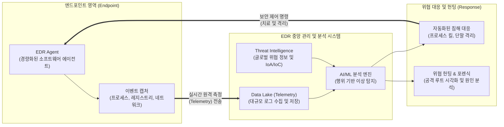

# EDR (Endpoint Detection and Response)

---

## I. 엔드포인트 보안의 최후 방어선, EDR의 개요

### 가. EDR(Endpoint Detection and Response)의 정의
엔드포인트(PC, 서버 등)에서 발생하는 악의적 행위를 실시간으로 탐지(Detection)하고 분석하여 신속하게 대응(Response)하는 사후 조치 중심의 차세대 엔드포인트 보안 솔루션이다.

### 나. EDR의 등장 배경 및 주요 특징
| 구분 | 내용 |
| --- | --- |
| **등장 배경** | 시그니처 기반 백신(EPP)을 우회하는 파일리스(Fileless), 제로데이, APT 공격 증가에 따른 행위 기반 방어 체계 필요 |
| **엔드포인트 가시성** | 침해 사고 원인 규명을 위한 파일·프로세스·네트워크 상세 텔레메트리(Telemetry) 로그 수집 및 공격 흐름 가시화 |
| **MTTD/MTTR 최소화** | 평균 탐지 시간(MTTD)과 평균 대응 시간(MTTR)을 단축하여 공격 측면 이동(Lateral Movement) 및 피해 확산 조기 차단 |
| **자동화 대응(Automated Response)** | 사전 정의된 플레이북 기반으로 악성 프로세스 종료, 단말 격리 등 보안 조치를 자동 수행 |

---

## II. EDR의 아키텍처 및 핵심 구성 요소

### 가. EDR의 아키텍처 및 동작 원리

* 엔드포인트에 설치된 에이전트가 단말의 모든 시스템 활동 이벤트를 수집하여 중앙 서버로 전송함
* 분석 엔진은 위협 인텔리전스(TI)와 행위 기반 분석을 통해 위협을 식별하고, 자동화된 단말 격리 및 보안 담당자의 포렌식 분석을 지원함

### 나. EDR의 핵심 기술 및 구성 요소

| 구분 | 요소기술(키워드) | 세부 설명 |
| --- | --- | --- |
| **데이터 수집** | Lightweight Agent | 시스템 성능 부하를 최소화하면서 [[커널]] 및 유저 레벨의 상세 이벤트를 캡처하는 단말 에이전트 |
| **데이터 수집** | Telemetry (원격 측정) | 엔드포인트에서 발생한 파일 생성, [[프로세스]] 실행, 네트워크 연결 등의 방대한 데이터를 실시간 스트리밍 |
| **위협 탐지** | Behavioral Analysis | 기존 시그니처 대신 시스템과 사용자의 '행위 패턴'을 분석하여 알려지지 않은 비정상적 악성 행위 식별 |
| **위협 탐지** | IoA (Indicator of Attack) | 단순한 침해 지표(IoC)를 넘어, 공격자의 전술과 목적을 파악할 수 있는 실시간 공격 지표 기반 탐지 |
| **위협 탐지** | [[MITRE ATT&CK (Adversarial Tactics, Techniques & Common Knowledge)\|MITRE ATT&CK]] 맵핑 | 글로벌 사이버 공격 전술/기법 프레임워크와 연동하여 공격의 현재 단계 및 위험도를 직관적으로 시각화 |
| **사고 대응** | Endpoint Isolation | 감염된 단말이 사내 네트워크를 통해 웜이나 랜섬웨어를 전파하지 못하도록 즉각적으로 논리적 망 분리 수행 |
| **사고 대응** | Automated Response | 사전 정의된 플레이북(Playbook)에 따라 악성 프로세스 종료, 파일 삭제 등을 자동화하여 신속하게 조치 |
| **위협 분석** | Threat Hunting | 침해 경고가 울리기 전이라도, 능동적으로 시스템 내부에 잠복한 보안 위협을 탐색하고 식별하는 지원 도구 |

---

## III. EDR과 EPP 비교 및 향후 보안 트렌드

### 가. 엔드포인트 보안 솔루션 비교 (EDR vs EPP)

| 비교 항목 | EPP (Endpoint Protection Platform) | EDR (Endpoint Detection and Response) |
| --- | --- | --- |
| **핵심 목적** | 위협의 '사전 예방 및 실행 차단' (Prevention) | 위협의 '사후 탐지, 원인 분석 및 대응' (Detection/Response) |
| **보안 가정** | 안티바이러스 룰에 따라 위협을 100% 막을 수 있음 | 어떠한 방어벽이든 뚫릴 수 있음 (Assume Breach) |
| **주요 기술** | 시그니처 기반(AV), [[샌드박스]], [[방화벽]] 통제 | 머신러닝, 행위 기반 분석, 포렌식, 텔레메트리 |
| **방어 대상** | [[랜섬웨어]], 트로이목마 등 기 알려진 악성코드 중심 | APT(지능형 지속 위협), 제로데이, 파일리스 공격 중심 |
| **가시성 제공** | 차단된 파일명 등 단편적 로그 제공에 그침 | 파일/네트워크/프로세스 트리 등 공격의 전체 흐름(Context) 가시화 |

### 나. 주요 동향 및 발전 전망
* **XDR(Extended Detection and Response)로의 확장**: 엔드포인트 단일 범위를 넘어 클라우드, 네트워크, 이메일 등 IT 인프라 전 영역의 텔레메트리를 통합 분석하는 [[XDR]] 패러다임으로 전환
* **MDR(Managed Detection and Response) 서비스 확산**: 내부 보안 인력이 부족한 기업을 대상으로 전문 SOC 운영자가 EDR 관제, [[위협 헌팅]], 사고 대응을 대행하는 아웃소싱 모델 급성장
* **AI 기반 자율 대응(Autonomous Response) 고도화**: 생성형 AI가 공격 컨텍스트를 실시간 분석하여 플레이북을 동적으로 생성하고, 사람의 개입 없이 감염 단말 격리부터 IOC 차단까지 자동 수행

---

### 🔗 연관 토픽

- **소속 도메인**: [[00_보안_MOC|🛡️ 보안]]
- **세부 분류**: `3. 네트워크 & 엔드포인트 · 인프라 보안`
- **핵심 연관 토픽**:
  - [[샌드박스|샌드박스 (Sandbox)]]
  - [[위협 헌팅|위협 헌팅(Threat Hunting)]]
  - [[랜섬웨어]]
  - [[XDR|XDR(eXtended Detection Response)]]
  - [[SIEM]]
