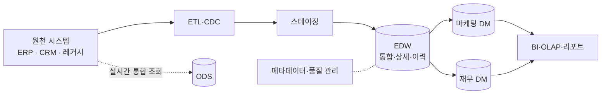

# EDW (Enterprise Data Warehouse)

---

## I. 전사 분석의 단일 기준, EDW의 개요

### 가. 정의

- 전사의 이기종 운영 데이터를 **ETL로 통합·정제해 주제 중심으로 이력과 함께 저장하고, 의사결정 분석에 제공하는 중앙 데이터 저장소**

### 나. 특징 (Inmon 4대 특성)

| 구분 | 내용 |
| --- | --- |
| 주제 지향 | 업무 처리 기능이 아닌 고객·상품·매출 등 주제 중심 |
| 통합 | 여러 원천의 코드·형식·단위를 일관되게 통합 |
| 시계열 | 시점별 이력 보관으로 추세 분석 |
| 비휘발 | 적재 후 갱신·삭제 없이 조회 위주 |

---

## II. 아키텍처 및 구성요소

### 가. EDW 구조

- 원천 데이터를 스테이징에서 정제해 EDW에 통합하고, 부서별 데이터 마트로 배포해 분석 도구에 제공

### 나. 구성요소

| 구분 | 요소 | 설명 |
| --- | --- | --- |
| 수집 | ETL·ELT | 추출–변환–적재, 클라우드에서는 적재 후 변환(ELT) 증가 |
| | CDC | 원천 로그 기반 변경분만 동기화 |
| 저장 | 스테이징 영역 | 정제 전 원천 데이터 임시 적재 |
| | ODS | 여러 운영 시스템의 현재 데이터를 통합한 운영 보고용 저장소 (단기·갱신 가능) |
| | EDW | 정제·통합된 상세 및 이력 데이터 |
| | 데이터 마트 | 부서·주제별 하위 저장소 |
| 모델 | 스타·스노우플레이크 스키마 | 팩트 + 차원 테이블 다차원 모델 |
| 활용 | [[OLAP]]·BI | Roll-up, Drill-down, Slice·Dice 분석 |
| 관리 | 메타데이터·품질 | 계보(Lineage), [[데이터 프로파일링]], 품질 규칙 |

---

## III. 비교 및 동향

### 가. EDW vs 데이터 레이크

| 비교 항목 | EDW | 데이터 레이크 |
| --- | --- | --- |
| 목적 | 정형 리포팅·분석 | 탐색·ML 학습 |
| 데이터 | 정형 | 정형·반정형·비정형 원시 데이터 |
| 스키마 | Schema-on-Write | Schema-on-Read |
| 사용자 | 현업·경영진·BI 분석가 | 데이터 과학자·엔지니어 |
| 강점 | 품질·성능·일관성 | 유연성·저비용 |

### 나. 동향

- **클라우드 DW**: Snowflake·BigQuery·Redshift가 스토리지–컴퓨팅 분리로 독립 확장
- **레이크하우스**: 레이크 위에서 DW 기능(ACID·거버넌스)을 제공하는 구조로 수렴 ([[데이터 레이크하우스]])
- **설계 방법론**: Inmon(정규화 EDW → 마트), Kimball(차원 모델 버스 아키텍처), Data Vault 병행

---

### 🔗 연관 토픽

- **소속 도메인**: [[00_데이터베이스_MOC|🗄️ 데이터베이스]]
- **세부 분류**: `4. 물리 저장 구조 & 인덱스 최적화`
- **핵심 연관 토픽**:
  - [[OLAP]]
  - [[데이터 레이크하우스|데이터 레이크하우스(Data Lakehouse)]]
  - [[EDM]]
  - [[데이터 프로파일링|데이터 프로파일링 (Data Profiling)]]
  - [[데이터베이스 반정규화]]
