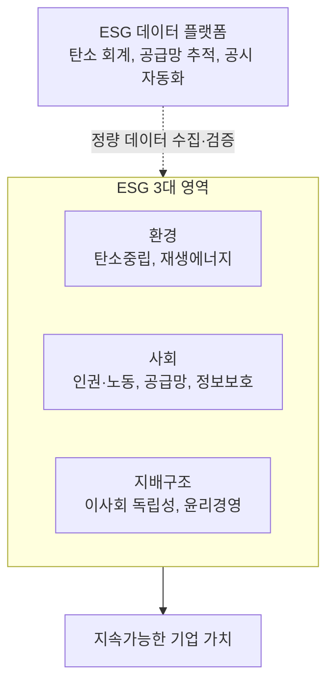

# ESG 경영 (Environmental, Social, Governance)

---

## I. 비재무 성과를 기업 가치에 반영하는, ESG 경영의 개요

### 가. 정의

- **환경(E)·사회(S)·지배구조(G)** 등 비재무 요소를 경영 전략과 의사결정에 통합해 장기적 기업 가치와 지속가능성을 높이는 경영 방식

### 나. 필요성 및 특징

| 구분 | 내용 |
| --- | --- |
| 투자자 요구 | 기관투자자가 투자 판단·스튜어드십에 ESG 정보 활용 (UN PRI, 2006) |
| 공시 제도화 | ISSB 기준(IFRS S1·S2) 제정, 국가별 지속가능성 공시 도입 |
| 이해관계자 관점 | 주주뿐 아니라 고객·임직원·협력사·지역사회 가치 고려 |
| 공급망 확장 | 자사뿐 아니라 협력사·물류 등 [[가치사슬]] 전체의 ESG 위험 관리 |

---

## II. ESG 경영의 구조 및 구성요소

### 가. ESG 체계와 IT 지원

- E·S·G 활동을 정량 데이터로 수집·검증해 공시하고 전략에 반영하는 구조로, IT는 데이터 신뢰성 확보 수단

### 나. 구성요소

| 구분 | 요소 | 설명 |
| --- | --- | --- |
| 환경 (E) | 탄소중립 (Net Zero) | 온실가스 순배출량 0 목표, RE100 등 재생에너지 전환 |
| | Scope 1·2·3 배출 | 직접 배출(1), 구매 전력 등 간접 배출(2), 가치사슬 전체 기타 간접 배출(3) |
| 사회 (S) | 인권·노동·다양성 | 공급망 인권 실사, 산업안전, DEI |
| | 정보보호·프라이버시 | 개인정보 보호와 사이버 보안을 사회적 책임으로 관리 |
| 지배구조 (G) | 이사회·윤리경영 | 이사회 독립성, 주주 권리, 부패 방지 |
| IT 지원 | ESG 데이터 플랫폼 | ERP·[[SCM (Supply Chain Management)\|SCM]] 연동으로 ESG 지표 수집·관리 |
| | 그린 IT | 데이터센터 PUE 개선, 액침냉각, 저전력 HW |

---

## III. CSR 비교 및 동향

### 가. CSR vs ESG

| 구분 | CSR | ESG |
| --- | --- | --- |
| 관점 | 기업의 윤리적·사회적 책임 | 투자 가치와 장기 위험 관리 |
| 동인 | 평판, 자발적 사회공헌 | 투자자 요구, 공시 규제 |
| 평가 | 자체 기준, 정성적 | 공시 기준(GRI, ISSB 등) 기반 정량 지표 |
| 사업 연계 | 본업과 분리된 활동 | 전략·공급망·제품에 통합 |

### 나. 동향

- **공시 기준 통합과 조정**: ISSB가 IFRS S1(일반)·S2(기후) 발표(2023), EU는 CSRD를 도입했으나 2025년 옴니버스 패키지로 적용 범위 축소·시기 연기
- **국내 공시**: 한국지속가능성기준위원회(KSSB)가 공시기준을 마련 중이며, 의무화 시기는 2026년 이후로 검토
- **그린워싱 규제**: EU 등에서 근거 없는 친환경 주장 규제 강화, 공시 데이터에 외부 검증(Assurance) 요구 확대

---

### 🔗 연관 토픽

- **소속 도메인**: [[00_경영전략_MOC|📈 경영전략]]
- **세부 분류**: `1. 경영 환경 분석 & 전략 수립 프레임워크`
- **핵심 연관 토픽**:
  - [[SCM (Supply Chain Management)]]
  - [[가치사슬|가치사슬(Value Chain)]]
  - [[Backcasting|Backcasting (백캐스팅)]]
  - [[PEST 분석]]
  - [[IT Compliance|IT-Compliance]]
