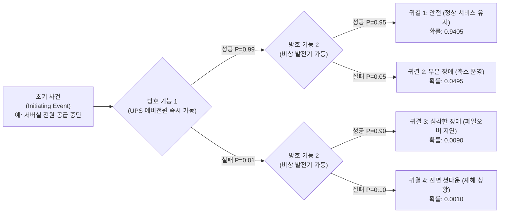

# ETA (Event Tree Analysis)

---

## I. 시나리오 기반의 전향적 위험성 평가 기법, ETA의 개요

시스템에 이상을 유발하는 특정 초기 사건(Initiating Event) 발생 시, 후속 대응 설비나 안전 기능의 성공 또는 실패 여부를 시간적 순서에 따라 분기 전개하여 최종 사고 귀결(Consequence)과 발생 확률을 도출하는 귀납적·전향적 위험성 분석 기법이다.

| 구분 | 주요 내용 |
| --- | --- |
| **개념** | 원인(초기 사건)에서 시작하여 결과(최종 귀결)로 이어지는 사고 전개 경로를 나뭇가지 형태로 시각화하고 정량적 확률을 산출하는 기법 |
| **등장 배경** | 복합 시스템에서 초기 장애 발생 시 다중 방호벽의 작동 여부에 따른 피해 규모 예측 및 확률론적 안전성 평가(PSA) 필요 |
| **핵심 특징** | 전향적(Forward-logic) 및 귀납적(Inductive) 분석, 이진 분기(Binary Branching: 성공/실패), 조건부 확률 곱연산을 통한 정량 평가 |

---

## II. ETA의 아키텍처 및 핵심 구성 요소

### 가. ETA의 분석 구조 및 동작 원리

초기 사건에서 시작하여 각 방호 단계의 성공(상단 분기)과 실패(하단 분기) 경로를 따라 전개되며, 각 분기의 조건부 확률을 곱하여 최종 귀결(Outcome)별 발생 확률을 정량적으로 산출한다.

### 나. ETA의 핵심 기술 및 구성 요소

| 분류 | 요소기술 (키워드) | 세부 설명 |
| --- | --- | --- |
| **시작점** | 초기 사건 (Initiating Event) | 분석의 시발점이 되는 비정상 장애나 사고로, 시스템 안전 장치 작동을 촉발하는 최초의 사건 |
| **방호벽** | 방호 기능 (Safety Barrier) | 초기 사건의 피해를 차단하거나 완화하기 위해 설계된 물리적·소프트웨어적 안전 대응 메커니즘 |
| **전개 구조** | 이진 분기 (Branching) | 각 방호 기능의 작동 성공(Success) 또는 실패(Failure)를 이분법적 나뭇가지 구조로 전개 |
| **최종 결과** | 사고 귀결 (Consequence) | 사건과 방호 장치 간 상호작용 결과로 도출되는 최종 시스템 상태 (안전, 경미, 치명적 등) |
| **논리 모델** | 귀납적 분석 (Inductive) | 특정 원인으로부터 파생될 수 있는 모든 미래 결과를 체계적으로 추적하는 순방향(Forward) 로직 |
| **정량화** | 확률 연산 (Probability) | 초기 사건 발생 빈도와 각 방호 기능의 실패율 곱을 통해 각 시나리오의 정량적 발생 확률 산출 |
| **결합 모델** | Bow-Tie (나비넥타이) 모델 | 중앙의 '핵심 위험 사건'을 기점으로 좌측은 원인 분석(FTA), 우측은 결과 분석(ETA)을 융합 |

---

## III. ETA와 FTA 비교 및 최신 동향

### 가. ETA vs FTA 비교

| 비교 항목 | ETA (Event Tree Analysis) | [[FTA (Fault Tree Analysis)]] |
| --- | --- | --- |
| **분석 방향** | **원인 $\rightarrow$ 결과 전개** (Forward-looking) | **결과 $\rightarrow$ 원인 역추적** (Backward-looking) |
| **논리적 접근** | **귀납적 (Inductive)**, 시계열 흐름 반영 | **연역적 (Deductive)**, 불 대수 논리 게이트 중심 |
| **분석 시작점** | 단일 초기 사건 (Initiating Event) | 단일 최상위 사고 (Top Event) |
| **최종 산출물** | 복수의 최종 귀결(Consequence) 시나리오 | 최상위 사고를 유발하는 최소 컷셋(Minimal Cut Set) |
| **주요 목적** | 사고 발생 시 시스템 대응 능력 및 피해 규모 평가 | 특정 시스템 사고의 근본 원인(RCA) 및 결함 조합 식별 |

### 나. 최신 기술 동향 및 발전 방향

* **동적 사건수 분석(Dynamic ETA) 도입**: 정적 확률 계산을 넘어 시간 경과에 따른 시스템 상태 변화(온도 상승, 네트워크 대역폭 고갈 등)를 실시간 반영하여 리스크를 동적으로 재계산하는 모델로 고도화됨.
* **자율주행 및 AI 시스템 SOTIF(ISO 21448) 적용**: 부품 고장이 아닌 AI 인지/판단 오작동 등 복합 환경에서 센서 이상이라는 초기 사건 발생 시 자율주행 차량의 최소위험상태(MRM) 달성 경로를 검증하는 핵심 기법으로 활용됨.

---

### 🔗 연관 토픽

- **소속 도메인**: [[00_소프트웨어공학_MOC|🏗️ 소프트웨어공학]]
- **세부 분류**: `6. 소프트웨어 테스팅 & 품질 보증 (QA/QC)`
- **핵심 연관 토픽**:
  - [[FTA (Fault Tree Analysis)]]
  - [[기능안전 표준]]
  - [[SW 안전성(SW Safety) 및 분석 개념]]
  - [[Smart Car(자율주행)]]
  - [[UAM]]
