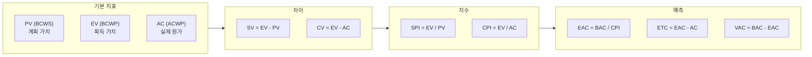

# EVM (Earned Value Management, 획득 가치 관리)

---

## I. 범위·일정·원가의 통합 성과 측정, EVM의 개요

### 가. 정의

- 범위·일정·원가를 **획득 가치(EV)** 라는 공통 금액 단위로 통합해 **현재 성과를 측정하고 완료 시점 원가·일정을 예측**하는 성과 관리 기법

### 나. 필요성 및 특징

| 구분 | 내용 |
| --- | --- |
| 계획 대비 실적의 한계 보완 | PV와 AC만 비교하면 실제 달성한 작업량을 알 수 없음, EV로 보완 |
| 조기 경보 | SPI·CPI로 지연·예산 초과 징후를 초기에 식별 |
| 예측 | 성과 측정 기준선(PMB) 대비 실적으로 ETC·EAC 산출 |
| 전제 조건 | WBS 기반 통제 계정, 승인된 기준선, 객관적 진척 측정 규칙 |

---

## II. 지표 체계

### 가. 개념도

- 측정일(Data Date) 기준으로 완료한 작업의 예산 가치(EV)를 계획(PV)·실제 원가(AC)와 비교

### 나. 핵심 지표

| 구분 | 요소 | 설명 |
| --- | --- | --- |
| 기본 지표 | PV (Planned Value) | 측정일까지 완료하기로 계획된 작업의 승인 예산 |
| | EV (Earned Value) | 측정일까지 실제 완료한 작업의 승인 예산 |
| | AC (Actual Cost) | 측정일까지 수행한 작업에 실제 발생한 원가 |
| | BAC (Budget at Completion) | 전체 작업의 총 승인 예산 |
| 차이 | SV = EV − PV | 음수면 일정 지연 (금액 단위) |
| | CV = EV − AC | 음수면 원가 초과 |
| 지수 | SPI = EV / PV | 1 미만이면 일정 지연 |
| | CPI = EV / AC | 1 미만이면 원가 초과 |
| 예측 | EAC | 현 CPI 지속 시 BAC/CPI, 잔여 작업이 계획대로면 AC+(BAC−EV), 일정 영향 반영 시 AC+(BAC−EV)/(CPI×SPI) |
| | ETC = EAC − AC | 잔여 작업 완료에 필요한 예상 원가 |
| | TCPI = (BAC−EV)/(BAC−AC) | 남은 예산으로 BAC를 지키려면 필요한 원가 효율 |

---

## III. 비교 및 동향

### 가. 지표 해석과 조치

| 상태 | 의미 | 조치 |
| --- | --- | --- |
| CV > 0, CPI > 1 | 예산 이하 집행 | 절감 요인 분석, 품질 저하 여부 확인 |
| CV < 0, CPI < 1 | 예산 초과 | 원가 통제 강화, 범위·자원 재검토 |
| SV > 0, SPI > 1 | 일정 앞섬 | 여유 자원을 지연 활동에 재배치 |
| SV < 0, SPI < 1 | 일정 지연 | 주공정 확인 후 크래싱·패스트 트래킹 ([[일정단축 기법]]) |

- SPI는 금액 기반이라 주공정 지연을 반영하지 못하고, 프로젝트 말기에는 완료 여부와 관계없이 1에 수렴하는 한계 → 시간 단위 획득 일정(Earned Schedule, SPI(t)) 보완

### 나. 동향

- **Agile EVM**: 릴리스 스토리 포인트를 기준선으로 삼아 완료 포인트 비율로 EV 산출, [[번다운차트|번업 차트]]와 병행
- **공공 사업 적용**: 대형 정보화 사업의 PMO·감리에서 진척률·EVM 지표로 사업 성과 점검
- **도구 자동화**: PMIS가 WBS 실적을 집계해 EVM 지표·S-Curve를 자동 산출

---

### 🔗 연관 토픽

- **소속 도메인**: [[00_프로젝트관리_MOC|📋 프로젝트관리]]
- **세부 분류**: `1. PMBOK 표준 & 프로젝트 거버넌스`
- **핵심 연관 토픽**:
  - [[WBS|WBS (Work Breakdown Structure)]]
  - [[프로젝트 관리 계획서]]
  - [[비용산정 일정관리 모델]]
  - [[일정단축 기법]]
  - [[번다운차트|번다운차트 (Burn Down Chart)]]
