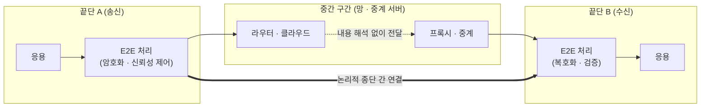

# End-to-End (E2E)

---

## I. 기능은 끝단에, 망은 단순하게, End-to-End의 개요

### 가. 정의

- 통신·처리의 **신뢰성·보안·최적화 같은 핵심 기능을 중간 노드가 아닌 양 끝단(시작점과 최종 목적지)에서 책임지도록 설계하는 원칙**과 이를 적용한 구조 (Saltzer·Reed·Clark, 1984 종단 간 원칙)

### 나. 특징 및 적용 분야

| 구분 | 내용 |
| --- | --- |
| 네트워크 | 인터넷은 코어를 단순한 Best-Effort 전달로 두고 신뢰성은 종단의 [[TCP]]가 담당 |
| 보안 | 종단 간 [[암호화]](E2EE)로 중간 서버도 내용 해독 불가 |
| AI | 단계별 모듈 대신 입력부터 출력까지 하나의 모델로 학습 |
| 테스트 | 사용자 관점에서 화면부터 DB까지 전체 시나리오 검증 |
| 5G | 단말–RAN–전송–코어 전 구간 품질을 하나의 슬라이스로 보장 |

---

## II. 구조 및 구성요소

### 가. 종단 간 구조

- 중간 구간은 전달만 하고, 검증·암복호화·재전송 같은 기능은 양 끝단이 수행

### 나. 분야별 핵심 기술

| 구분 | 요소 | 설명 |
| --- | --- | --- |
| 네트워크 | 종단 간 원칙 | 응용에 특화된 기능은 끝단에서만 완전하게 구현 가능 |
| | [[전송 계층]] | 종단 프로세스 간 신뢰성·흐름 제어 |
| 보안 | E2EE | 송신 단말 암호화, 수신 단말에서만 복호화 (Signal 프로토콜) |
| | PFS | 세션마다 임시 키를 써 장기 키가 유출돼도 과거 통신 보호 |
| AI | E2E 학습 | 원시 입력에서 최종 출력까지 단일 신경망을 [[역전파]]로 함께 최적화 |
| 테스트 | E2E 테스트 | Selenium, Cypress, Playwright로 실제 사용자 흐름 자동 검증 |
| 이동통신 | E2E [[네트워크 슬라이싱]] | 단말부터 코어까지 격리된 논리망으로 [[QoS]] 보장 |

---

## III. 비교 및 동향

### 가. 중간 처리 방식 vs 종단 간 방식

| 비교 항목 | 중간 처리 (구간별·모듈별) | 종단 간 |
| --- | --- | --- |
| 구조 | 단계별 모듈, 중간 노드에서 처리 | 끝단 중심, 단일 통합 |
| 장점 | 모듈별 개발·디버깅 용이, 중간 캐싱·검사 가능 | 중간 노드 신뢰 불필요, 전체 최적화 |
| 보안 | 중간 서버 침해 시 평문 노출 | 중간 서버 침해에도 내용 보호 (단, 키 검증 없으면 MITM 가능) |
| 한계 | 모듈 간 오차 누적 | 블랙박스화, 중간 보안 검사 어려움 |

### 나. 동향

- **E2E 자율주행**: 인지·판단·제어 모듈 대신 카메라 입력에서 조향·가속을 직접 출력하는 신경망 방식 확산 (예: Tesla FSD v12 이후)
- **E2E 멀티모달 모델**: 음성 인식·합성을 분리하지 않고 음성을 직접 입출력하는 모델 등장 (예: GPT-4o)
- **PQC 결합 E2EE**: Signal(PQXDH)·iMessage(PQ3) 등 메신저가 양자내성 키 교환을 하이브리드로 도입 ([[양자내성암호]])

---

### 🔗 연관 토픽

- **소속 도메인**: [[00_네트워크_MOC|🌐 네트워크]]
- **세부 분류**: `2. 네트워크 계층 & 라우팅 프로토콜 (L3)`
- **핵심 연관 토픽**:
  - [[전송 계층|전송 계층 (Transport Layer)]]
  - [[TCP]]
  - [[네트워크 슬라이싱]]
  - [[암호화|암호화 (Encryption)]]
  - [[프로토콜]]
