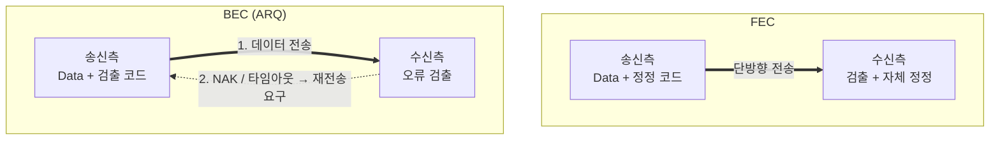
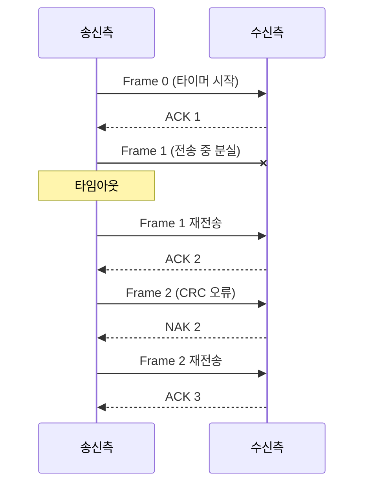

# FEC (Forward Error Correction)와 BEC (Backward Error Correction)

---

## I. 신뢰성 있는 데이터 전송을 위한 오류 제어, FEC와 BEC의 개요

### 가. 정의

- **FEC (전진 오류 수정)**: 송신측이 오류 정정용 잉여 비트를 붙여 보내고, **수신측이 스스로 오류를 검출·정정**하는 기법
- **BEC (후진 오류 수정)**: 수신측이 오류를 **검출만 하고 역방향 채널로 재전송을 요구**하여 복구하는 기법 → 대표 구현이 **ARQ(Automatic Repeat Request, 자동재송요구)**

### 나. 특징

| 구분 | FEC | BEC (ARQ) |
| --- | --- | --- |
| 역방향 채널 | 불필요 (단방향 가능) | 필수 (ACK/NAK 전송) |
| 오버헤드 | 정정용 잉여 비트 많음 | 검출용 비트만 포함 |
| 지연 | 재전송 없음 → 실시간에 유리 | 재전송·타임아웃 대기로 지연 발생 |

---

## II. 동작 원리 및 핵심 기술

### 가. 동작 개념도

### 나. ARQ 동작 (ACK·NAK·타임아웃)

### 다. 핵심 기술 요소

| 구분 | 기술 | 설명 |
| --- | --- | --- |
| FEC 정정 코드 | [[해밍코드\|해밍 코드]] | 패리티 비트로 1비트 오류의 위치를 찾아 정정 |
| | 리드-솔로몬 (RS) | 블록 단위 정정, 연속 오류(Burst Error)에 강함 |
| | LDPC / Turbo / Polar | 섀넌 한계에 근접하는 고성능 정정 코드 (5G: 데이터 LDPC, 제어 Polar) |
| BEC 검출 코드 | 패리티 검사 | 1비트 추가로 오류 유무 검출 (위치 파악 불가) |
| | [[CRC]] | 다항식 나눗셈으로 프레임 오류를 높은 확률로 검출 ([[CRC\|순환중복검사]]) |
| | Checksum | 데이터 합의 1의 보수로 검증 (L3 이상) |
| ARQ 제어 요소 | ACK / NAK, 타이머, 순서 번호 | 정상·오류 응답, 분실 감지, 중복·순서 역전 방지 |
| ARQ 방식 | Stop-and-Wait | 1개 전송 후 응답 대기, 단순하나 효율 최저 |
| | Go-Back-N | 오류 프레임부터 이후 프레임 전부 재전송 |
| | Selective Repeat | 오류 프레임만 재전송, 효율 최고·수신 버퍼 필요 |

---

## III. 기법 비교 및 동향

### 가. FEC vs BEC

| 비교 항목 | FEC | BEC (ARQ) |
| --- | --- | --- |
| 원리 | 수신측 자체 정정 | 재전송 요구 |
| 피드백 채널 | 불필요 | 필수 |
| 대역폭 효율 | 낮음 (잉여 비트 多) | 높음 |
| 실시간성 | 우수 | 취약 |
| 적용 분야 | 위성·심우주 통신, 방송, 실시간 스트리밍 | 유선 통신, [[TCP]] 기반 파일 전송 |

### 나. Go-Back-N vs Selective Repeat

| 비교 항목 | Go-Back-N | Selective Repeat |
| --- | --- | --- |
| 재전송 대상 | 오류 프레임 이후 전부 | 오류 프레임만 |
| 수신 윈도우 | 1 | 송신 윈도우와 동일 |
| 효율 | 오류율 높으면 중복 전송 많음 | 높음 |
| 구현 | 단순 | 재조립 버퍼 필요 |

### 다. 최신 동향: HARQ (Hybrid ARQ)

- FEC로 먼저 정정을 시도하고, 정정 불가 시에만 ARQ로 재전송하는 방식으로 **LTE·5G NR의 표준**
- **Chase Combining**: 오류 패킷을 버리지 않고 재전송 패킷과 결합해 디코딩 성공률 향상
- **Incremental Redundancy**: 재전송 시 추가 패리티만 보내 정정 능력을 점진적으로 높임
- URLLC 등 초저지연 환경에서는 재전송 지연을 줄이기 위해 고효율 FEC(Polar, LDPC) 의존도 증가

---

### 🔗 연관 토픽

- **소속 도메인**: [[00_네트워크_MOC|🌐 네트워크]]
- **세부 분류**: `1. OSI 7계층 & 데이터링크 계층 (L1/L2)`
- **핵심 연관 토픽**:
  - [[CRC|CRC(Cyclic Redundancy Check)]]
  - [[해밍코드]]
  - [[데이터 링크 계층|데이터 링크 계층 (Data Link Layer)]]
  - [[Sliding Window & 네이글(Nagle's) 알고리즘]]
  - [[TCP]]
