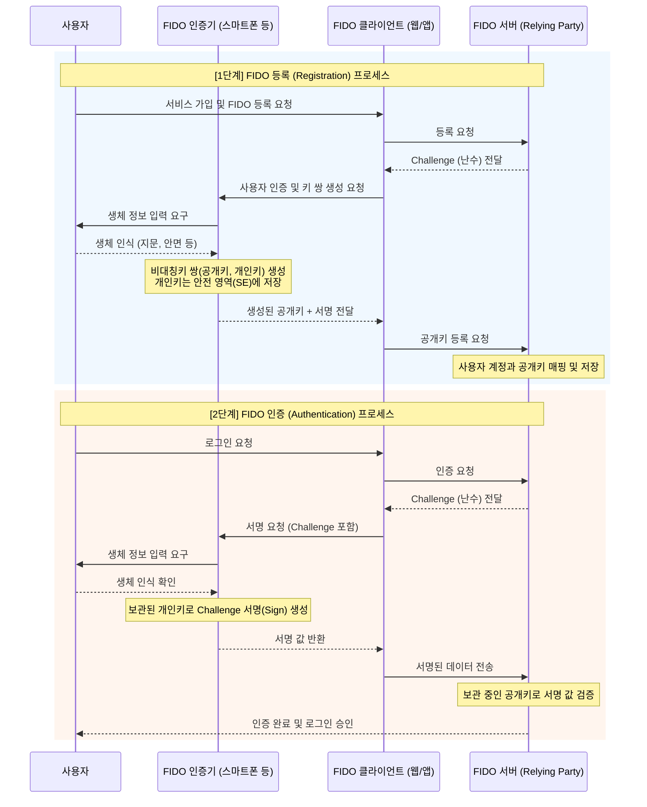

# FIDO (Fast Identity Online)

---

## I. 비밀번호 없는 안전하고 편리한 차세대 인증 표준, FIDO의 개요

### 가. FIDO(Fast Identity Online)의 정의
패스워드 기반 인증의 취약점을 해결하기 위해 생체인식 또는 하드웨어 보안키로 사용자 단말에서 로컬 인증을 수행하고, 서버와는 비대칭키(공개키) 암호화 방식으로 통신하는 글로벌 개방형 인증 표준이다.

### 나. FIDO의 등장 배경 및 주요 특징
| 구분 | 내용 |
| --- | --- |
| **패스워드리스(Passwordless)** | 기억에 의존하는 비밀번호를 배제하여 피싱, 크리덴셜 스터핑, 키로깅 등 자격증명 탈취 공격 원천 차단 |
| **프라이버시 보호(로컬 인증)** | 지문·얼굴 등 민감한 생체정보 원본을 서버로 전송하지 않고 개인 단말 보안 영역(TEE/SE) 내부에서만 검증 |
| **공개키 기반 상호 검증** | 개인키는 단말 하드웨어에 안전 보관하고 서버는 등록된 공개키로 서명(Challenge-Response) 검증 |
| **표준화 및 상호운용성** | FIDO Alliance 및 W3C를 주축으로 이기종 단말, 브라우저, 서비스 플랫폼 간 표준 인터페이스(WebAuthn, CTAP) 제공 |

---

## II. FIDO의 개념도 및 핵심 기술 요소

### 가. FIDO의 인증 메커니즘 개념도 및 동작 원리

* 사용자의 생체 정보는 인증기(Authenticator) 내부에서만 처리되며, 네트워크 구간으로는 오직 암호학적 서명(Signature)과 공개키(Public Key)만 전송됨

### 나. FIDO의 핵심 구성 및 기술 요소

| 구분 | 요소기술(키워드) | 세부 설명 |
| --- | --- | --- |
| **인증 개체** | Authenticator (인증기) | 생체정보/PIN 등을 통해 사용자를 식별하고 [[암호화]] 키 쌍(Key Pair)을 생성/관리하는 H/W 또는 S/W 모듈 |
| **인터페이스** | ASM (Authenticator Specific Module) | 다양한 제조사의 인증기(지문, 홍채 등)와 FIDO 클라이언트 간의 통신을 돕는 표준 API 인터페이스 |
| **중계 모듈** | FIDO Client | 사용자 단말(스마트폰 앱, 브라우저)에 탑재되어 서버와의 메시지 송수신 및 FIDO 프로토콜을 처리 |
| **서버 검증** | FIDO Server | 서비스 제공자(Relying Party) 쪽에 위치하며 사용자의 공개키를 등록하고 Challenge-Response 검증 수행 |
| **FIDO2 웹 표준** | WebAuthn (Web Authentication) | W3C와 FIDO 얼라이언스가 공동 제정한 표준으로, 웹 브라우저에서 FIDO 인증을 가능하게 하는 자바스크립트 API |
| **FIDO2 연동** | [[CTAP]] (Client to Auth. Protocol) | PC(클라이언트)와 외부 스마트폰/USB 보안키(인증기) 간을 블루투스, [[NFC]], USB 등으로 연결하는 [[프로토콜]] |
| **보안 기술** | 비대칭키 / TEE (Trusted Execution Env.) | 개인키 유출 방지를 위해 하드웨어 기반의 신뢰 실행 환경(TrustZone 등)에 키와 생체 템플릿을 격리 보관 |
| **보안 검증** | Challenge-Response | 서버가 매번 다른 난수(Challenge)를 보내고 단말이 이를 서명(Response)하여 재전송 공격(Replay Attack) 방어 |

---

## III. FIDO 아키텍처의 발전 과정 및 최근 동향

### 가. FIDO 버전별 표준 비교 (FIDO 1.0 vs FIDO2)

| 비교 항목 | [[FIDO 1.0 (Fast IDentity Online 1.0)\|FIDO 1.0]] (UAF / U2F) | FIDO2 |
| --- | --- | --- |
| **주요 목적** | 모바일 앱 중심의 패스워드 대체(UAF) 및 2차 인증(U2F) | **웹 브라우저 및 PC [[OS(운영체제)\|운영체제]]**로의 인증 환경 확장 |
| **핵심 프로토콜** | UAF (비밀번호 없음), U2F (비밀번호 + 보안키) | **WebAuthn** (웹 API) + **CTAP** (외부 기기 연동) |
| **지원 환경** | 모바일 네이티브 앱 중심 | 모바일 웹, PC 데스크톱 웹, 주요 OS (Windows, macOS) |
| **표준화 주체** | FIDO Alliance 단독 | FIDO Alliance + **W3C (World Wide Web Consortium)** |
| **기기 연동성** | 단일 기기 내 인증기 종속적 | PC에서 스마트폰을 외부 인증기로 활용 가능 (CTAP2) |

### 나. 주요 동향 및 발전 전망
* **멀티 디바이스 동기화 크리덴셜(Passkeys) 확산**: 단말 분실 시 복구 난제를 해결하기 위해 애플·구글·MS가 FIDO 키 쌍을 종단간 암호화(E2EE) 클라우드 키체인으로 동기화하는 [[패스키|패스키(Passkey)]] 체계 표준화
* **OS 및 웹 브라우저 네이티브 통합**: Windows Hello, Touch ID, Android 생체인증이 WebAuthn과 기본 연동되어 별도 플러그인 없는 패스워드리스 UX 구현
* **피싱 저항성 MFA(Phishing-Resistant MFA) 채택**: 리버스 프록시 피싱(AitM) 및 크리덴셜 스터핑 공격 방어를 위해 금융권 및 공공기관의 제로 트러스트([[제로 트러스트 보안모델|Zero Trust]]) 표준 인증 체계로 정착

---

### 🔗 연관 토픽

- **소속 도메인**: [[00_보안_MOC|🛡️ 보안]]
- **세부 분류**: `2. 현대 암호학 & 키 관리 · 전자서명`
- **핵심 연관 토픽**:
  - [[CTAP]]
  - [[패스키|패스키(Passkey)]]
  - [[FIDO 1.0 (Fast IDentity Online 1.0)]]
  - [[FIDO 2.0 (Fast IDentity Online 2.0)]]
  - [[IAM]]
