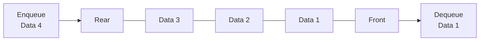

# FIFO (First-In, First-Out)

---

## I. 먼저 온 것이 먼저 나가는, FIFO의 개요

### 가. 정의

- **먼저 들어온 데이터·작업을 먼저 처리**하는 선입선출 원칙, [[Queue|큐]] 자료구조와 FCFS 스케줄링·FIFO 페이지 교체의 기반

### 나. 특징

| 구분 | 내용 |
| --- | --- |
| 순서 보장 | 도착 순서대로 처리해 공정하고 예측 가능 |
| 단순성 | 삽입·삭제 O(1), 구현 비용 낮음 |
| 한계 | 작업 길이·중요도를 고려하지 않음 → 호위 효과, [[Belady's Anomaly]] |
| 적용 범위 | CPU 스케줄링, 페이지 교체, 입출력 버퍼, 메시지 큐 |

---

## II. 동작 구조 및 적용 요소

### 가. 큐 동작

- 삽입은 Rear, 삭제는 Front에서만 일어나 가장 오래된 항목이 먼저 나감

### 나. 적용 요소

| 구분 | 요소 | 설명 |
| --- | --- | --- |
| 자료구조 | 큐 | Enqueue·Dequeue 기반 선형 구조 |
| | 원형 큐 | 배열 끝과 처음을 연결해 선형 큐의 공간 낭비 해결 |
| CPU [[스케줄링]] | FCFS | 준비 큐 도착 순서대로 할당, 비선점 |
| | 호위 효과 (Convoy Effect) | 긴 작업 뒤에서 짧은 작업들이 오래 대기 |
| 페이지 교체 | FIFO 교체 | 가장 먼저 적재된 페이지 교체, 구현 쉬움 |
| | [[Belady's Anomaly]] | 프레임 증가에도 페이지 부재가 늘 수 있음 |
| 입출력 | 파이프·FIFO 파일 | UNIX 파이프와 이름 있는 파이프는 바이트를 넣은 순서대로 전달 |
| 네트워크 | FIFO 큐잉 | 도착 순서대로 전송하는 기본 큐잉, 혼잡 시 Tail Drop |

---

## III. 비교 및 동향

### 가. FIFO vs LIFO

| 비교 항목 | FIFO | LIFO |
| --- | --- | --- |
| 자료구조 | 큐 | [[Stack\|스택]] |
| 원리 | 먼저 들어온 것이 먼저 나감 | 나중에 들어온 것이 먼저 나감 |
| 삽입·삭제 위치 | Rear 삽입, Front 삭제 | Top에서 모두 수행 |
| 시간 복잡도 | O(1) | O(1) |
| 활용 | 스케줄링, 버퍼, BFS, 인쇄 대기 | 함수 호출 스택, 되돌리기, DFS |

### 나. 동향

- **순서 보장 메시징**: Kafka는 파티션 안에서, AWS SQS FIFO는 메시지 그룹 ID 안에서 순서를 보장하고 그룹 간에는 병렬 처리
- **캐시 교체 재조명**: S3-FIFO 등 FIFO 큐 조합 정책이 LRU보다 단순하면서 높은 적중률을 보인 연구 등장
- **스케줄러 내 FIFO 클래스**: Linux `SCHED_FIFO` 실시간 정책은 같은 우선순위 안에서 선착순, 양보·블로킹 전까지 실행

---

### 🔗 연관 토픽

- **소속 도메인**: [[00_운영체제_MOC|⚙️ 운영체제]]
- **세부 분류**: `1. 프로세스 & 스레드 관리`
- **핵심 연관 토픽**:
  - [[Belady's Anomaly]]
  - [[LRU]]
  - [[비선점방식 유형]]
  - [[Queue]]
  - [[Stack]]
