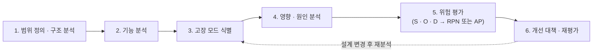

# FMEA (Failure Mode and Effects Analysis, 고장 모드 및 영향 분석)

---

## I. 부품 고장에서 시스템 영향으로, FMEA의 개요

### 가. 정의

- 시스템을 구성하는 **각 요소의 잠재적 고장 모드를 식별하고 그 원인과 상위 시스템에 미치는 영향을 분석해 위험 우선순위에 따라 대책을 수립**하는 상향식(Bottom-up) 귀납적 안전·신뢰성 분석 기법 (IEC 60812)

### 나. 특징

| 구분 | 내용 |
| --- | --- |
| 분석 방향 | 부품·기능 단위 고장에서 출발해 시스템 영향으로 상향 분석 |
| 예방 중심 | 설계·공정 단계에서 고장을 미리 찾아 설계 변경·검출 수단 마련 |
| 우선순위화 | 심각도·발생도·검출도로 위험을 정량 비교 |
| 한계 | 단일 고장 위주, 다중 고장 조합·SW 상호작용 결함 분석에 한계 |

---

## II. 분석 절차 및 구성요소

### 가. 분석 절차

- 구조·기능을 분해해 요소별 고장 모드를 찾고, 영향과 원인을 분석한 뒤 위험 점수로 우선순위를 정해 대책을 수립·재평가

### 나. 구성요소

| 구분 | 요소 | 설명 |
| --- | --- | --- |
| 분석 대상 | 고장 모드 | 요소가 기능을 수행하지 못하는 형태 (미출력, 오출력, 지연 등) |
| | 고장 영향 | 고장이 상위 시스템·사용자에 미치는 결과 |
| | 고장 원인 | 고장 모드를 일으키는 메커니즘 |
| 평가 척도 | 심각도 (S) | 영향의 치명도 (1~10) |
| | 발생도 (O) | 원인의 발생 가능성 (1~10) |
| | 검출도 (D) | 현재 관리 수단으로 사전 검출하기 어려운 정도 (1~10) |
| | RPN | S × O × D (1~1000), 높은 순으로 조치 |
| | AP (Action Priority) | AIAG-VDA 핸드북(2019)이 RPN 대신 도입한 조치 우선순위 (High·Medium·Low) |
| 유형 | DFMEA · PFMEA | 설계 FMEA, 공정 FMEA |
| | SW FMEA | SW 기능·변수 단위 고장 모드 분석 |
| | FMECA | 치명도(Criticality) 분석을 추가한 확장형 (MIL-STD-1629A) |

---

## III. 비교 및 동향

### 가. FMEA vs FTA

| 비교 항목 | FMEA | [[FTA (Fault Tree Analysis)\|FTA]] |
| --- | --- | --- |
| 분석 방향 | 상향식 (원인 → 결과) | 하향식 (정상 사상 → 원인) |
| 출발점 | 개별 요소의 고장 모드 | 특정 사고(Top Event) |
| 표현 | 표 형식 워크시트 | AND·OR 게이트 결함 트리 |
| 강점 | 단일 고장의 영향 망라 | 다중 고장 조합·발생 확률 계산 |
| 적용 시점 | 설계 초기~공정 설계 | 주요 위험 사상 정밀 분석 |

### 나. 동향

- 자동차 분야는 AIAG-VDA 7단계 FMEA와 AP 방식으로 전환, [[ISO 26262]] 안전 분석과 연계
- SW 집약 시스템에서는 상호작용 결함을 보완하기 위해 [[STPA]]와 병행
- 과거 FMEA·결함 데이터를 학습한 AI로 고장 모드 후보를 추천하는 시도

---

### 🔗 연관 토픽

- **소속 도메인**: [[00_소프트웨어공학_MOC|🏗️ 소프트웨어공학]]
- **세부 분류**: `2. 애자일(Agile) & 지속적 통합/배포(CI/CD)`
- **핵심 연관 토픽**:
  - [[FTA (Fault Tree Analysis)]]
  - [[ETA (Event Tree Analysis)]]
  - [[STPA|STPA (System-Theoretic Process Analysis)]]
  - [[HAZOP (Hazard and Operability Study)]]
  - [[SW 안전성(SW Safety) 및 분석 개념]]
