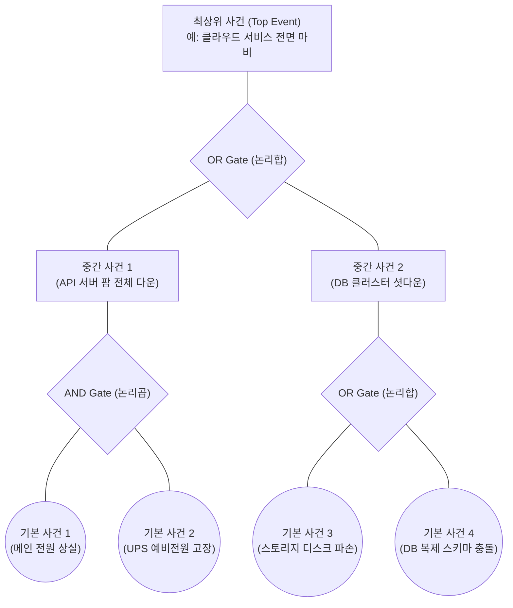

# FTA (Fault Tree Analysis)

---

## I. 하향식·연역적 시스템 결함 분석 기법, FTA의 개요

시스템에 발생할 수 있는 원하지 않는 최상위 사고(Top Event)를 먼저 정의하고, 이를 유발할 수 있는 하위 결함 원인들을 불 대수 논리 게이트(AND, OR 등)를 통해 하향식(Top-Down)으로 추적하여 근본 원인과 발생 확률을 도출하는 연역적 위험성 분석 기법이다.

| 구분 | 주요 내용 |
| --- | --- |
| **개념** | 시스템의 고장 또는 재해 상태로부터 부품 결함, 인적 오류 등 기본 사건(Basic Event)에 이르기까지 결함 전개 메커니즘을 역방향 트리 구조로 모델링하는 기법 |
| **등장 배경** | 복합 대규모 시스템에서 치명적 사고를 유발하는 고장 경로(Cut Set) 및 단일 장애점(SPOF)의 체계적 식별과 신뢰도 향상 필요 |
| **핵심 특징** | 연역적(Deductive) 및 하향식(Top-Down) 접근, 불 대수 기반의 정성적 최소 컷셋(MCS) 분석과 정량적 사고 발생 확률 산출 지원 |

---

## II. FTA의 아키텍처 및 핵심 구성 요소

### 가. FTA의 아키텍처 개념도 및 동작 원리

최상위 사고로부터 논리 게이트를 통해 하위 중간 사건들을 분해하며, 더 이상 분해할 수 없는 기본 사건(Basic Event)들의 조합을 규명한다. AND 게이트는 하위 사건이 모두 발생해야 상위 사건이 발생하며(확률 곱), OR 게이트는 하나만 발생해도 상위 사건이 발생한다(확률 합).

### 나. FTA의 핵심 기술 및 구성 요소

| 분류 | 요소기술 (키워드) | 세부 설명 |
| --- | --- | --- |
| **사건 요소** | 최상위 사건 (Top Event) | 분석의 최종 목적이 되는 시스템의 치명적인 고장, 장애 또는 사고 상태 (트리의 최상단) |
| **사건 요소** | 기본 사건 (Basic Event) | 더 이상 원인을 분해할 수 없는 시스템 부품 고장, 환경 요인, 인적 실수 등 결함의 최소 단위 |
| **사건 요소** | 중간 사건 (Intermediate Event) | 기본 사건들의 논리 게이트 조합으로 유발되어 상위 사건을 촉발하는 중간 단계 고장 상태 |
| **논리 기호** | AND Gate (논리곱) | 입력되는 하위 사건들이 **동시에 모두 발생**해야만 상위 사건을 유발 ($P = P_A \times P_B$) |
| **논리 기호** | OR Gate (논리합) | 입력되는 하위 사건 중 **어느 하나라도 발생**하면 상위 사건을 유발 ($P \approx P_A + P_B$) |
| **정성 분석** | Cut Set (컷셋) | 최상위 사건(Top Event)을 유발할 수 있는 기본 사건들의 집합 |
| **정성 분석** | 최소 컷셋 (Minimal Cut Set) | 상위 사건을 일으키기 위한 **최소한의 필요충분 조건**을 갖춘 기본 사건의 집합 (시스템 취약 경로 식별) |
| **정량 연산** | 불 대수 (Boolean Algebra) | 결함 트리의 논리 게이트 수식을 대수학적으로 간소화하고 시스템 전체의 고장 확률을 수치화 |

---

## III. FTA와 ETA 비교 및 최신 동향

### 가. FTA vs ETA 비교

| 비교 항목 | FTA (Fault Tree Analysis) | [[ETA (Event Tree Analysis)]] |
| --- | --- | --- |
| **분석 방향** | **결과 $\rightarrow$ 원인 역추적** (Backward-looking) | **원인 $\rightarrow$ 결과 전개** (Forward-looking) |
| **논리 전개** | **연역적 (Deductive)**, 하향식(Top-Down) | **귀납적 (Inductive)**, 상향식(Bottom-Up) |
| **구조 형태** | 불 대수 논리 게이트(AND, OR) 중심 트리 | 안전 설비의 성공/실패 분기 중심 트리 |
| **시작점 및 결과** | 단일 사고(Top Event)로부터 복수 원인(MCS) 도출 | 단일 원인(초기 사건)으로부터 복수 귀결 시나리오 도출 |
| **주요 목적** | 시스템 고장의 근본 원인(RCA) 및 단일 장애점(SPOF) 식별 | 사고 발생 시 다중 방호벽의 대응 능력 및 피해 규모 평가 |

### 나. 최신 기술 동향 및 발전 방향

* **동적 결함 트리 분석(DFTA, Dynamic FTA) 도입**: 기존 정적 Boolean 논리의 한계를 넘어, 부품 간 고장 발생 순서(Priority-AND)나 예비 부품 전환 등 시간 의존적 고장 메커니즘을 마르코프 모델과 연계하여 정밀 분석함.
* **디지털 트윈 및 MBSE 연계**: 시스템 아키텍처 모델(SysML)로부터 결함 트리를 자동으로 추출하고 시뮬레이션 환경에서 결함 주입 테스트를 자동화하는 모델 기반 안전 엔지니어링이 정착됨.

---

### 🔗 연관 토픽

- **소속 도메인**: [[00_소프트웨어공학_MOC|🏗️ 소프트웨어공학]]
- **세부 분류**: `6. 소프트웨어 테스팅 & 품질 보증 (QA/QC)`
- **핵심 연관 토픽**:
  - [[ETA (Event Tree Analysis)]]
  - [[기능안전 표준]]
  - [[SW 안전성(SW Safety) 및 분석 개념]]
  - [[Smart Car(자율주행)]]
  - [[UAM]]
