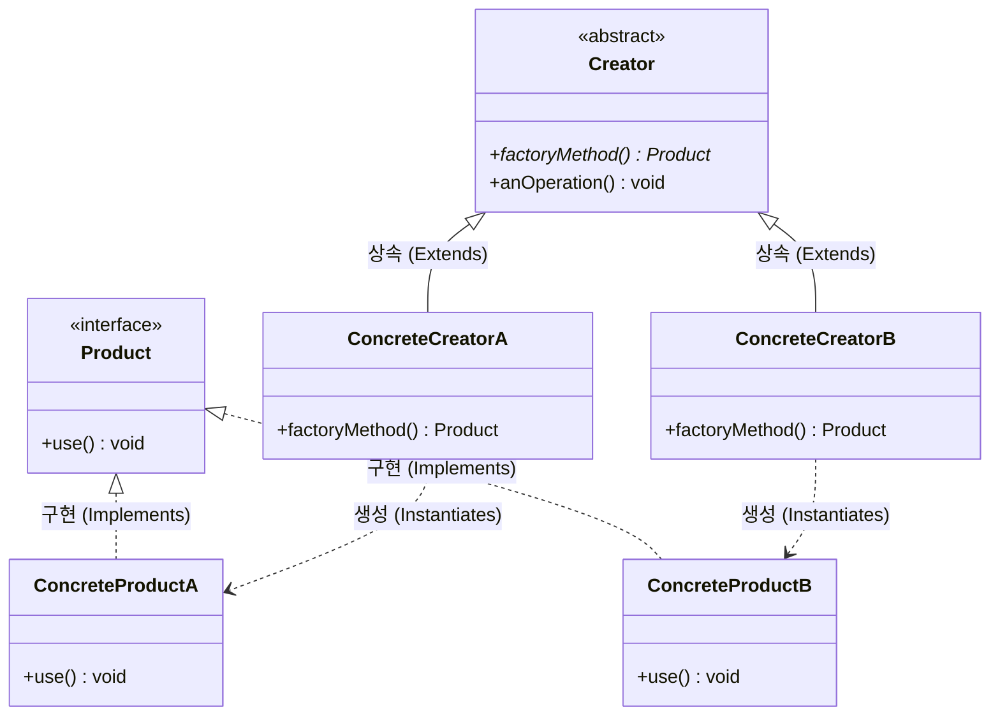

# Factory Method (생성 위임)

---

## I. 객체 생성의 캡슐화와 유연성 확장을 위한, Factory Method의 개요

상위 클래스(Creator)에서 객체 생성을 위한 인터페이스(메서드)를 정의하되, 실제 어떤 클래스의 인스턴스를 생성할지는 하위 클래스(Subclass)에게 위임하는 GoF 생성 디자인 패턴이다.

| 구분 | 주요 내용 |
| --- | --- |
| **개념** | 객체 생성 코드를 클라이언트 비즈니스 로직과 분리하여 캡슐화하고, 상속과 다형성을 통해 런타임에 구체적인 객체 생성을 유연하게 결정하는 패턴 |
| **등장 배경** | 구체 클래스(Concrete Class)를 직접 생성(`new`)함으로써 발생하는 강한 결합도와 새로운 제품군 추가 시 기존 코드 수정(OCP 위반) 문제 해결 |
| **핵심 특징** | 개방-폐쇄 원칙(OCP) 및 의존성 역전 원칙(DIP) 준수, 가상 생성자(Virtual Constructor) 메커니즘, 프레임워크 템플릿과의 결합성 우수 |

---

## II. Factory Method의 아키텍처 및 핵심 구성 요소

### 가. Factory Method의 클래스 다이어그램 및 동작 원리

상위 클래스 `Creator`의 비즈니스 메서드 `anOperation()`에서는 직접 `new` 연산자를 쓰지 않고 추상 팩토리 메서드를 호출하며, 하위의 `ConcreteCreator`가 이를 오버라이딩하여 알맞은 `ConcreteProduct` 인스턴스를 반환한다.

### 나. Factory Method의 핵심 기술 및 구성 요소

| 분류 | 구성 요소 (키워드) | 세부 설명 및 역할 |
| --- | --- | --- |
| **제품 인터페이스** | Product | 팩토리 메서드에 의해 생성될 객체들이 공통으로 가져야 할 메서드를 규정한 인터페이스 또는 추상 클래스 |
| **구체적 제품** | ConcreteProduct | Product 인터페이스를 실제로 구현하여 클라이언트 비즈니스 기능을 수행하는 실제 객체 |
| **생성자 추상화** | Creator | Product 타입의 객체를 반환하는 팩토리 메서드(`factoryMethod()`)를 선언하고 핵심 업무 흐름을 제어하는 상위 클래스 |
| **구체적 생성자** | ConcreteCreator | 부모 클래스의 팩토리 메서드를 구체화하여 상황에 맞는 ConcreteProduct의 인스턴스를 직접 생성해 반환 |
| **핵심 원리** | 생성 위임 (Delegation) | 상위 클래스는 인스턴스화 규칙만 선언하고, 실제 어떤 객체를 생성할지에 대한 세부 결정 권한을 하위 클래스에 양도 |
| **설계 원칙** | 개방-폐쇄 원칙 (OCP) | 신규 제품 클래스가 추가되어도 기존 Creator 코드의 수정 없이 새로운 구체 팩토리 클래스 추가만으로 수용 |
| **설계 원칙** | 의존성 역전 원칙 (DIP) | 고수준 모듈과 저수준 모듈이 구체 클래스가 아닌 추상화된 Product 인터페이스에 의존하도록 유도 |

---

## III. 유사 패턴 비교 및 최신 동향

### 가. Factory Method vs Abstract Factory 비교

| 비교 항목 | Factory Method (팩토리 메서드) | Abstract Factory (추상 팩토리) |
| --- | --- | --- |
| **생성 목적** | **단일 객체(Product)**의 생성 책임 분리 및 위임 | 연관된 **제품군(Family of Products)**의 일괄 생성 |
| **구현 방식** | 클래스 **상속(Inheritance)** 및 메서드 오버라이딩 | 객체 **합성(Composition)** 및 인터페이스 다형성 |
| **초점 (Focus)** | 단일 인스턴스 생성 알고리즘의 유연한 교체 | 복수 객체들 간의 상호 호환성 및 일관성 보장 |
| **클래스 복잡도** | 상대적으로 단순하며 단일 제품군에 최적 | 제품군이 늘어날수록 인터페이스 및 팩토리 계층 복잡 |
| **적용 사례** | 프레임워크 템플릿 메서드 내의 동적 객체 생성 | 크로스 플랫폼 GUI(Windows/Mac 버튼, 텍스트박스 세트) 생성 |

### 나. 최신 기술 동향 및 발전 방향

* **IoC 컨테이너 및 DI 프레임워크 내재화**: 현대의 Spring, Guice 등 백엔드 프레임워크에서 `BeanFactory` 및 의존성 주입(DI) 엔진의 내부 아키텍처로 Factory Method 패턴이 완전히 내재화됨.
* **함수형 프로그래밍과의 결합**: 클래스 상속을 통한 복잡한 계층 구조 생성(클래스 폭발) 대신, 고차 함수(Higher-Order Function)와 람다식을 활용한 경량 팩토리 함수(Factory Function) 패턴으로 진화함.

---

### 🔗 연관 토픽

- **소속 도메인**: [[00_소프트웨어공학_MOC|🏗️ 소프트웨어공학]]
- **세부 분류**: `5. 디자인 패턴`
- **핵심 연관 토픽**:
  - [[디자인 패턴]]
  - [[객체지향 설계 원리]]
  - [[추상화]]
  - [[다형성]]
  - [[결합도]]
