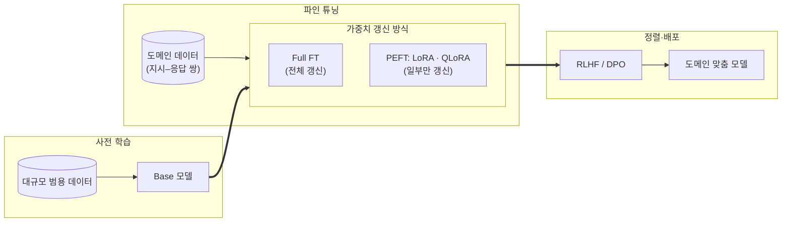

# Fine-Tuning (파인 튜닝)

---

## I. 사전 학습 모델의 도메인 특화 최적화, 파인 튜닝의 개요

### 가. 정의

- 대규모 데이터로 사전 학습(Pre-training)된 [[파운데이션 모델]]의 가중치를 출발점으로, **특정 도메인·작업 데이터로 추가 학습하여 모델을 최적화**하는 [[전이학습]] 기법

### 나. 필요성 및 특징

| 구분 | 내용 |
| --- | --- |
| 비용 절감 | 처음부터 학습(From Scratch)하는 막대한 [[GPU]]·데이터 비용 대신 소규모 데이터로 최적화 |
| 도메인 특화 | 의료·법률·금융·사내 문서의 용어, 어투, 출력 양식에 맞춤 |
| 효율화 추세 | 전체 가중치 갱신에서 일부 파라미터만 학습하는 [[PEFT]](LoRA 등)가 주류 |
| 부작용 | 파국적 망각(Catastrophic Forgetting): 새 데이터 학습 중 기존 일반 지식 손실 |

---

## II. 파인 튜닝 절차 및 핵심 기술

### 가. 개념도

### 나. 핵심 기술 요소

| 구분 | 기술 | 설명 |
| --- | --- | --- |
| 방식 | Full Fine-Tuning | 모든 층의 가중치 갱신, 성능은 높지만 자원 소모 큼 |
| | PEFT | 기존 가중치는 동결하고 소수 파라미터만 학습 |
| PEFT 기법 | [[LoRA(Low-rank adaptation)\|LoRA]] | 가중치 변화량을 두 개의 저랭크 행렬 곱으로 근사해 어댑터만 학습 |
| | QLoRA | 베이스 모델을 4-bit로 양자화한 상태에서 LoRA 적용, 단일 GPU로도 [[초거대 언어 모델\|LLM]] 튜닝 |
| | [[프롬프트 튜닝]] | 가중치는 고정하고 입력의 Soft Prompt 임베딩만 학습 |
| 데이터 | Instruction Tuning | (지시, 응답) 쌍으로 지시 수행 능력과 제로샷 성능 향상 |
| 정렬 | RLHF | 인간 선호로 보상 모델을 만들고 [[강화학습]]으로 정렬 |
| | DPO | 보상 모델·강화학습 없이 선호/비선호 쌍을 직접 학습 |

---

## III. 도메인 최적화 기법 비교 및 동향

### 가. 사전 학습 vs 파인 튜닝 vs RAG

| 비교 항목 | 사전 학습 | 파인 튜닝 | [[RAG (Retrieval Augmented Generation) 검색 증강 생성 AI\|RAG]] |
| --- | --- | --- | --- |
| 원리 | 기반 지식을 처음부터 형성 | 내부 가중치를 도메인에 맞게 갱신 | 외부 지식을 검색해 프롬프트에 주입 |
| 지식 갱신 | 전체 재학습 | 재학습 필요 | [[벡터 데이터베이스]]만 갱신 |
| 강점 | 범용 언어 능력 | 어투·출력 양식·도메인 추론 내재화 | 최신·정확한 사실 제공, 출처 제시 |
| [[할루시네이션]] | 높음 | 존재 (지식을 가중치에 압축) | 근거 기반으로 감소 |
| 비용 | 막대함 | 학습 시 GPU 비용 | 학습 불필요, 검색 비용 |

### 나. 동향

- **LoRA/QLoRA 표준화**: 전체 파라미터의 1% 미만만 학습해도 유사 성능 → 오픈소스 LLM 튜닝의 표준
- **하이브리드 (RAFT)**: 어투·양식·용어는 파인 튜닝, 최신 규정·수치는 RAG로 보완하는 투트랙 전략
- **프라이빗 sLLM**: 보안 때문에 외부 API 대신 오픈소스 모델을 온프레미스에서 QLoRA로 튜닝 ([[sLLM (Smaller Large Language Model)\|sLLM]])

---

### 🔗 연관 토픽

- **소속 도메인**: [[00_인공지능_MOC|🤖 인공지능]]
- **세부 분류**: `4. 거대언어모델 (LLM) & 생성형 AI`
- **핵심 연관 토픽**:
  - [[PEFT|PEFT(Parameter-Efficient Fine-Tuning)]]
  - [[LoRA(Low-rank adaptation)]]
  - [[파운데이션 모델|파운데이션 모델(Foundation Model)]]
  - [[전이학습]]
  - [[sLLM (Smaller Large Language Model)]]
