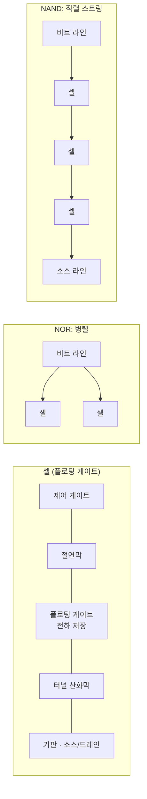

# 플래시 메모리 (Flash Memory)

---

## I. 전기로 지우고 쓰는 비휘발성 메모리, 플래시 메모리의 개요

### 가. 정의

- **블록 단위로 전기적 일괄 소거가 가능한 EEPROM 계열 비휘발성 메모리**로, 플로팅 게이트 또는 전하 트랩(CTF)에 전자를 저장해 데이터를 기억 (도시바 마스오카 후지오, 1980년대)

### 나. 특징

| 구분 | 내용 |
| --- | --- |
| 비휘발성 | 전원 없이 데이터 유지 |
| 내충격·저전력 | 기계 구동부가 없어 HDD보다 충격에 강하고 빠름 |
| Erase-before-Write | 덮어쓰기 불가, 블록 소거 후 페이지 기록 |
| 수명 제한 | 셀당 프로그램/소거(P/E) 횟수 제한 |
| 셀 배열 | 병렬 연결 NOR(코드 실행)와 직렬 연결 NAND(대용량 저장)로 구분 |

---

## II. 구조 및 구성요소

### 가. 셀 구조와 NOR·NAND 배열

- F-N 터널링(또는 NOR는 열전자 주입)으로 전자를 플로팅 게이트에 넣고 빼서 문턱 전압을 바꿔 0·1을 구분

### 나. 구성요소

| 구분 | 요소 | 설명 |
| --- | --- | --- |
| 셀 구조 | 플로팅 게이트 | 도체(폴리실리콘)에 전자 저장 |
| | CTF (Charge Trap Flash) | 절연체(질화막)에 전자를 가둬 셀 간 간섭 감소, 3D NAND의 주류 |
| 물리 현상 | F-N 터널링 | 고전압으로 전자를 얇은 산화막 너머로 주입·방출 |
| 집적 | 3D NAND (V-NAND) | 셀을 수직 적층 (300단 안팎 양산) |
| | 주변 회로 하부 배치 | 셀 아래에 주변 회로를 두는 COP·PUC 구조로 면적 절감 |
| 저장 방식 | SLC / MLC / TLC / QLC | 셀당 1·2·3·4비트, 비트가 늘수록 용량·원가 유리, 속도·수명 저하 |
| 제어 계층 | FTL | 논리 주소→물리 페이지 매핑, Erase-before-Write를 숨김 |
| | Wear Leveling | 쓰기를 블록 전체에 고르게 분산해 수명 연장 |
| | Garbage Collection | 무효 페이지가 많은 블록을 정리해 빈 블록 확보 |
| | ECC | LDPC 등 오류 정정으로 다치 셀의 오류 보정 |

---

## III. 비교 및 동향

### 가. NOR vs NAND

| 비교 항목 | NOR | NAND |
| --- | --- | --- |
| 셀 연결 | 병렬 (셀마다 비트 라인 접점) | 직렬 스트링 |
| 접근 | 바이트 단위 임의 읽기 | 페이지 단위 읽기·쓰기, 블록 단위 소거 |
| 읽기 | 빠름 | 상대적으로 느림 |
| 쓰기·소거 | 느림 | 빠름 |
| 집적도·단가 | 낮음, GB당 비쌈 | 높음, GB당 저렴 |
| 활용 | 펌웨어·부트 코드, XIP(eXecute In Place) | SSD, UFS, SD 카드, USB |

### 나. 동향

- **고단 적층 경쟁**: 300단대 양산(SK hynix 321단 등)에 이어 400단 이상 개발, 웨이퍼 본딩·PUC로 원가 절감
- **QLC 대용량 SSD**: AI 데이터센터의 학습 데이터 저장용으로 수십~100TB급 QLC eSSD 확대
- **CXL 기반 메모리-스토리지 융합**: DRAM 캐시와 NAND를 CXL로 묶은 메모리 시맨틱 SSD(예: 삼성 CMM-H) 등 [[CXL]] 계층 확장 연구

---

### 🔗 연관 토픽

- **소속 도메인**: [[00_컴퓨터구조_MOC|💻 컴퓨터구조]]
- **세부 분류**: `2. 캐시 & 메모리 계층 구조 · 스토리지`
- **핵심 연관 토픽**:
  - [[메모리 반도체|메모리 반도체 (Memory Semiconductor)]]
  - [[스토리지 유형|스토리지 유형 (블록, 파일, 오브젝트 스토리지)]]
  - [[RAID]]
  - [[CXL|CXL (Compute Express Link)]]
  - [[멤리스터]]
