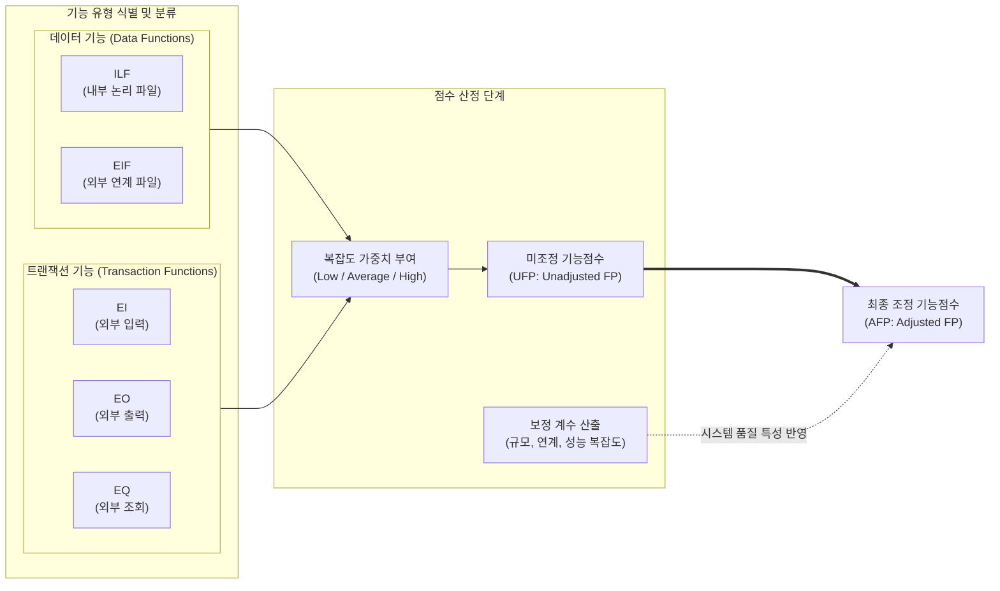

# Function Point (기능 점수)

---

## I. 사용자 관점의 객관적 소프트웨어 규모 산정 표준, Function Point의 개요

소프트웨어가 사용자에게 제공하는 논리적 기능의 규모를 정량적으로 측정하여 개발 비용, 적정 사업 대가 및 소요 공수를 객관적으로 산정하는 소프트웨어 규모 측정 기법(ISO/IEC 14143 표준)이다.

| 구분 | 주요 내용 |
| --- | --- |
| **개념** | 물리적인 코드 라인 수(LOC)나 파일 수가 아닌, 사용자가 요구하고 체감하는 비즈니스 기능(데이터 기능 및 트랜잭션 기능)을 기준으로 규모를 수치화하는 기법 |
| **등장 배경** | 프로그래밍 언어 및 개발자 숙련도에 따라 변동하는 LOC 방식의 한계 극복, 요구사항 분석 단계에서 프로젝트 조기 예산 산정 및 공정한 대가 산정 체계 요구 |
| **핵심 특징** | 기술 및 언어 독립성, 사용자 관점의 논리적 규모 측정, 대한민국 'SW사업 대가산정 가이드'의 법적 표준 기준 채택 |

---

## II. Function Point의 개념도 및 핵심 구성 요소

### 가. 기능 점수 산정 프로세스 및 분류 아키텍처

사용자 요구사항을 5대 기능 유형(ILF, EIF, EI, EO, EQ)으로 분해하고 각 기능의 복잡도(DET, RET, FTR)에 따른 가중치를 합산하여 미조정 기능점수(UFP)를 구한 후, 시스템 보정 계수(VAF)를 반영하여 최종 점수(AFP)를 확정한다.

### 나. Function Point의 5대 핵심 기능 및 측정 요소

| 분류 | 요소기술 (키워드) | 세부 설명 |
| --- | --- | --- |
| **데이터 기능** | 내부 논리 파일 (ILF) | 애플리케이션 경계 내부에서 유지·관리되는 논리적으로 연관된 사용자 데이터 그룹 (예: 회원 마스터 테이블) |
| **데이터 기능** | 외부 연계 파일 (EIF) | 시스템 내부에서 참조만 수행되며, 다른 타 시스템 경계에서 유지·관리되는 데이터 그룹 (예: 공공기관 신용조회 파일) |
| **트랜잭션 기능** | 외부 입력 (EI) | 시스템 외부에서 데이터나 제어 정보를 입력받아 내부 논리 파일(ILF)을 생성·수정·삭제하는 기능 |
| **트랜잭션 기능** | 외부 출력 (EO) | 연산, 통계 집계, 파생 데이터 생성 등 수학적·논리적 가공 과정을 거쳐 사용자에게 정보를 제공하는 기능 |
| **트랜잭션 기능** | 외부 조회 (EQ) | 내부/외부 파일을 단순 검색하여 가공 없이 사용자에게 원형 그대로 데이터를 조회해 주는 기능 |
| **복잡도 요소** | DET (Data Element Type) | 사용자가 식별할 수 있는 고유하고 반복되지 않는 논리적 데이터 필드의 수 (예: 사번, 성명, 부서 = 3 DET) |
| **복잡도 요소** | RET (Record Element Type) | 하나의 ILF 또는 EIF 내에 존재하는 사용자 식별 가능한 데이터 서브그룹의 수 (서브 엔티티) |
| **복잡도 요소** | FTR (File Type Referenced) | 트랜잭션 기능(EI, EO, EQ) 실행 중 참조되거나 갱신되는 ILF 및 EIF의 개수 |

---

## III. 규모 산정 기법 비교 및 최신 동향

### 가. 기능 점수(FP) vs 코드 라인 수(LOC) 비교

| 비교 항목 | Function Point (기능 점수) | Lines of Code (코드 라인 수) |
| --- | --- | --- |
| **측정 관점** | **사용자 요구 기능 중심** (논리적 규모) | 개발자 구현 소스코드 라인 수 (물리적 규모) |
| **언어 종속성** | **완전 독립** (Java, Python, C에 무관하게 동일) | 언어 및 개발자 숙련도에 따라 편차 극심 |
| **산정 시점** | **요구사항 분석 및 설계 초기 단계** 산정 가능 | 구현 코딩이 완료된 이후 사후 측정만 가능 |
| **리팩토링 영향** | 코드 구조 최적화 시 점수 불변 (안정적) | 최적화로 코드 라인이 줄면 규모가 감소하는 모순 |
| **주요 활용처** | 공공/금융 SI 사업 예산 수립 및 계약 대가 산정 | 레거시 유지보수 생산성, 오픈소스 기여도 측정 |

### 나. 최신 기술 동향 및 발전 방향

* **간이 기능점수법(Estimated FP)의 정착**: 초기 상세 설계가 나오기 전 기획 단계에서 과거 통계적 평균 복잡도 가중치(기능당 평균 점수)를 적용해 신속하고 객관적으로 발주 예산을 산정하는 간이법이 공공 소프트웨어 시장의 표준으로 안착됨.
* **COSMIC 기능점수 및 클라우드/AI 규모 산정 대두**: 데이터 이동(Data Movement) 중심으로 측정하는 COSMIC 기능점수(ISO/IEC 19761)와, 데이터 구축비 및 모델 학습비를 투입공수(M/M)와 하이브리드로 결합하는 AI 사업비 산정 체계가 확산됨.

---

### 🔗 연관 토픽

- **소속 도메인**: [[00_소프트웨어공학_MOC|🏗️ 소프트웨어공학]]
- **세부 분류**: `2. 소프트웨어 개발 프로젝트 관리 & 품질 거버넌스`
- **핵심 연관 토픽**:
  - [[SW 규모산정]]
  - [[AI 개발비 산정]]
  - [[공공소프트웨어사업 과업심의 가이드]]
  - [[트랜잭션]]
  - [[데이터베이스]]
