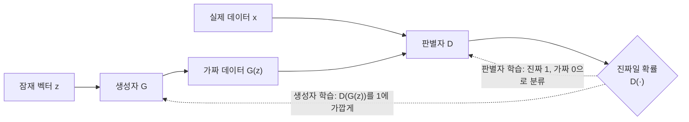

# GAN (Generative Adversarial Network)

---

## I. 경쟁하며 배우는 생성 모델, GAN의 개요

### 가. 정의

- **생성자(Generator)와 판별자(Discriminator)가 미니맥스 게임으로 경쟁하며** 실제 데이터 분포를 닮은 데이터를 생성하는 생성 모델 (Ian Goodfellow, 2014)

### 나. 특징

| 구분 | 내용 |
| --- | --- |
| 적대적 학습 | 생성자는 판별자를 속이려 하고, 판별자는 진짜·가짜를 구분하려 하며 함께 발전 |
| 선명한 생성 | 픽셀 단위 재구성 손실을 쓰는 [[VAE]]보다 선명한 이미지 |
| 빠른 생성 | 잠재 벡터 하나를 1회 순전파해 생성 |
| 잠재 공간 | 잠재 벡터 보간으로 속성을 연속적으로 변화 |
| 한계 | 학습 불안정, 모드 붕괴, 우도 직접 평가 불가 |

---

## II. 구조 및 구성요소

### 가. 개념도

- 판별자와 생성자를 번갈아 학습하며, 이상적으로는 생성 분포가 실제 분포와 같아지고 판별자 출력이 0.5로 수렴(내시 균형)

### 나. 구성요소

| 구분 | 요소 | 설명 |
| --- | --- | --- |
| 신경망 | 생성자 | 잠재 벡터를 데이터로 변환 (전치 합성곱 등) |
| | 판별자 | 진짜·가짜를 구분하는 이진 분류기 |
| 목적 함수 | 미니맥스 손실 | $\min_G \max_D \; E[\log D(x)] + E[\log(1 - D(G(z)))]$, 최적 판별자에서 JS 발산 최소화와 동치 |
| 학습 문제 | 모드 붕괴 | 생성자가 판별자를 잘 속이는 소수 패턴만 생성 |
| | 기울기 소실 | 판별자가 너무 강하면 생성자 기울기가 사라짐 (Non-saturating 손실로 완화) |
| 안정화 | WGAN·WGAN-GP | Wasserstein 거리와 기울기 패널티로 학습 안정화 |
| | 스펙트럴 정규화 | 판별자의 립시츠 상수 제한 |
| 파생 모델 | [[DCGAN]] | 합성곱 구조와 설계 지침으로 이미지 생성 안정화 |
| | CycleGAN·Pix2Pix | 짝 없는 / 짝 있는 도메인 간 이미지 변환 |
| | StyleGAN | 스타일 기반 생성자로 속성 분리 제어 (NVIDIA) |

---

## III. 비교 및 동향

### 가. GAN vs VAE vs Diffusion

| 비교 항목 | GAN | [[VAE]] | [[Diffusion 모델\|Diffusion]] |
| --- | --- | --- | --- |
| 학습 | 적대적 경쟁 | ELBO 최대화 | 단계별 노이즈 예측 |
| 품질 | 선명 | 흐릿한 경향 | 매우 높음 |
| 다양성 | 모드 붕괴 위험 | 높음 | 높음 |
| 생성 속도 | 빠름 | 빠름 | 느림 (반복 추론) |
| 안정성 | 낮음 | 높음 | 높음 |
| 활용 | 초해상도, 영상 변환, 데이터 증강 | 표현 학습, 이상 탐지, 잠재 확산의 압축기 | 텍스트-이미지·영상 생성 |

### 나. 동향

- **역할 변화**: 텍스트-이미지 생성의 주류는 확산 모델로 이동, GAN은 초해상도(ESRGAN)·실시간 영상 변환·확산 모델 증류의 판별자 손실 등으로 활용
- **[[딥페이크]] 대응**: GAN·확산 생성물의 주파수·지문 흔적을 찾는 탐지 모델과 워터마크 기술 병행
- **합성 데이터**: 정형 데이터 CTGAN 등으로 개인정보 보호·불균형 보완용 데이터 생성 ([[합성 데이터]])

---

### 🔗 연관 토픽

- **소속 도메인**: [[00_인공지능_MOC|🤖 인공지능]]
- **세부 분류**: `1. 수학 · 통계학 & 데이터 전처리`
- **핵심 연관 토픽**:
  - [[DCGAN]]
  - [[VAE|VAE(Variational Autoencoder)]]
  - [[Diffusion 모델]]
  - [[딥페이크|딥페이크(Deepfake)]]
  - [[합성 데이터|합성 데이터(Synthetic Data)]]
