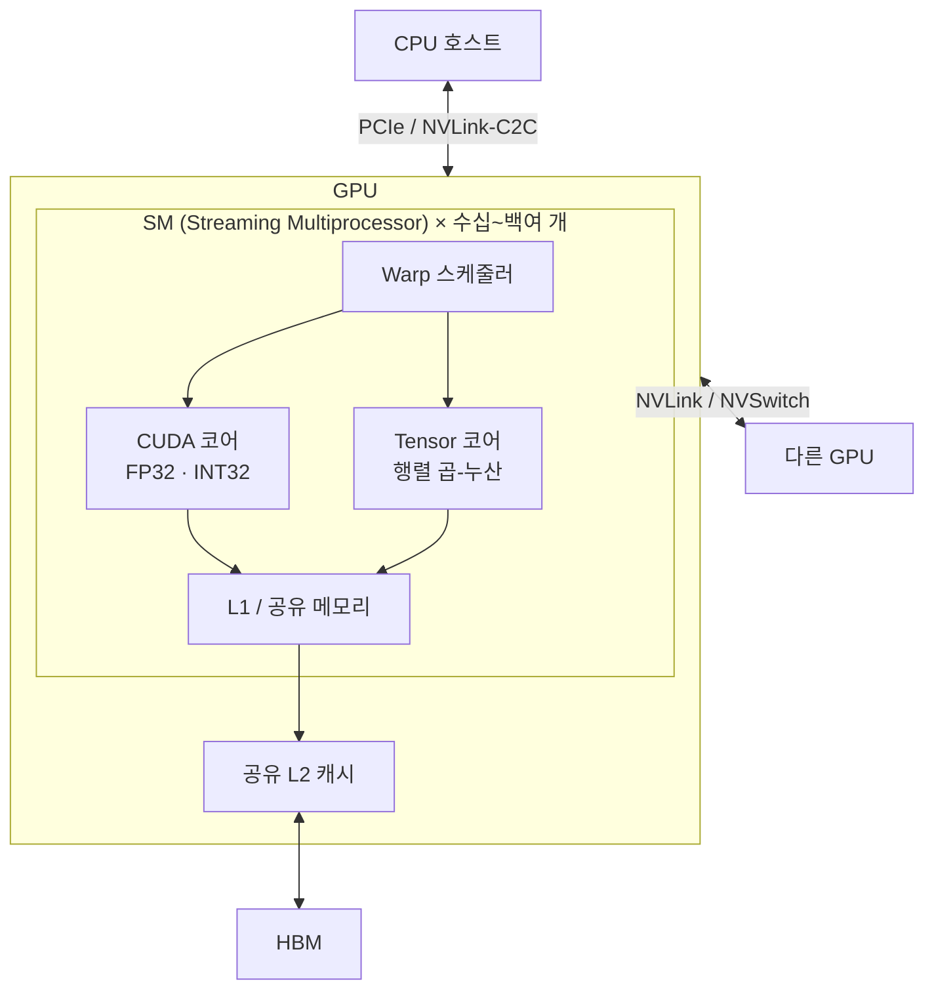

# GPU (Graphics Processing Unit)

---

## I. 대규모 병렬 연산 가속기, GPU의 개요

### 가. 정의

- 수천 개의 단순 코어로 **같은 연산을 많은 데이터에 동시에 적용(SIMT)하는 병렬 프로세서**로, 그래픽 처리에서 시작해 AI 학습·추론 등 범용 연산(GPGPU)으로 확장

### 나. 특징

| 구분 | 내용 |
| --- | --- |
| 처리량 중심 | 지연 시간보다 [[처리량]] 극대화, 칩 면적 대부분을 연산 유닛에 배분 |
| SIMT | 스레드 32개(NVIDIA Warp)를 묶어 같은 명령 실행 |
| 지연 은닉 | 많은 Warp를 번갈아 실행해 메모리 대기 시간 숨김 |
| 고대역폭 메모리 | [[HBM]]·GDDR로 TB/s급 대역폭 제공 |

---

## II. 구조 및 구성요소

### 가. 구조 (NVIDIA 기준)

- [[CPU]]가 커널을 실행 요청 → 스레드 블록이 SM에 배정 → Warp 단위로 코어에서 병렬 실행

### 나. 구성요소

| 구분 | 요소 | 설명 |
| --- | --- | --- |
| 연산 | CUDA 코어 | 범용 부동소수점·정수 연산 |
| | Tensor 코어 | 행렬 곱-누산 전용, FP16·BF16·FP8·FP4 지원 (세대별 상이) |
| | RT 코어 | 광선 추적 가속 |
| 실행 모델 | SIMT / Warp | 32 [[쓰레드\|스레드]] 단위 실행, 분기 발산 시 효율 저하 |
| 메모리 | 레지스터·공유 메모리·L2 | SM 내부 고속 메모리 계층 |
| | HBM3E / HBM4 | 데이터센터 GPU의 적층 메모리 |
| 연결 | NVLink 5 | GPU당 1.8TB/s (Blackwell), NVSwitch로 랙 단위 연결 |
| 패키징 | 2.5D (CoWoS) | GPU 다이와 HBM을 인터포저에 집적, 다이 2개를 결합하기도 함 (B200) |
| 소프트웨어 | CUDA, ROCm | 병렬 프로그래밍 모델과 라이브러리 (cuDNN, cuBLAS 등) |

---

## III. 비교 및 동향

### 가. GPU vs NPU

| 비교 항목 | GPU | [[NPU]] |
| --- | --- | --- |
| 설계 목표 | 범용 병렬 처리 | 신경망 연산 전용 |
| 코어 구조 | 수천 개 SIMT 코어 + 텐서 코어 | [[MAC 배열]]·[[시스톨릭 어레이]] |
| 유연성 | 높음 (프로그래밍 가능) | 낮음 ([[딥러닝]] 연산 특화) |
| 전력 효율 | 중간 | 높음 |
| 주요 용도 | AI 학습·대규모 추론, 그래픽 | [[온디바이스 AI]] 추론 |

### 나. 동향

- **랙 스케일 시스템**: NVIDIA GB200 NVL72처럼 GPU 72개를 NVLink로 묶어 하나의 대형 가속기로 운용
- **액체 냉각 확산**: GPU당 1kW 안팎의 전력으로 직접 액체 냉각(DLC)과 액침 냉각 도입
- **저정밀 연산**: FP8·FP4 등 저정밀 포맷과 Transformer Engine으로 [[초거대 언어 모델|LLM]] 학습·추론 효율 향상

---

### 🔗 연관 토픽

- **소속 도메인**: [[00_컴퓨터구조_MOC|💻 컴퓨터구조]]
- **세부 분류**: `1. CPU 프로세서 & 마이크로아키텍처`
- **핵심 연관 토픽**:
  - [[CPU]]
  - [[NPU|NPU(Neural Processing Unit)]]
  - [[TPU (Tensor Processing Unit)]]
  - [[HBM|HBM (High Bandwidth Memory)]]
  - [[초거대 언어 모델|초거대 언어 모델(Large Language Model)]]
