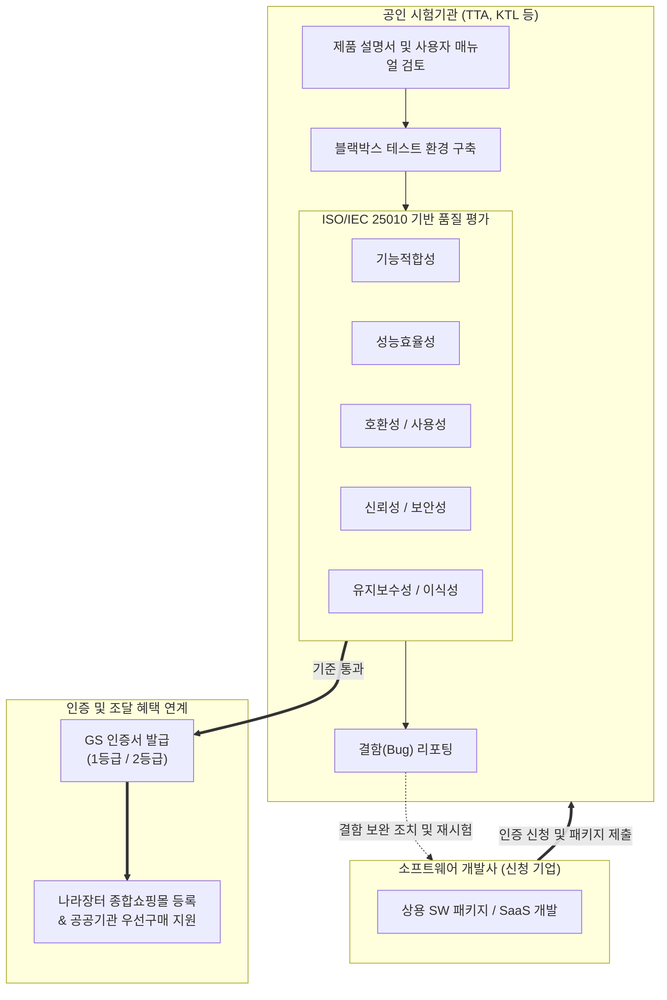

# GS 인증 (Good Software Certification)

---

## I. 국산 소프트웨어 품질 검증 및 공공 판로 지원, GS 인증의 개요

국산 소프트웨어의 품질 완성도와 신뢰성을 보증하기 위해 국제 표준(ISO/IEC 25023, 25051 등)에 근거하여 제품의 기능성, 신뢰성, 효율성 등 종합적 품질을 평가하고 국가 공인 시험기관이 인증을 부여하는 소프트웨어 품질 인증 제도이다.

| 구분 | 주요 내용 |
| --- | --- |
| **개념** | 상용 소프트웨어 패키지 및 SaaS를 대상으로 실제 운영 환경에서 블랙박스 테스트를 거쳐 일정 수준 이상의 품질을 공인하는 국가 인증 제도 |
| **등장 배경** | 국산 소프트웨어의 대외 경쟁력 제고, 미검증 외산 솔루션 의존도 탈피, 공공기관 도입을 위한 공정하고 객관적인 품질 평가 기준 마련 |
| **핵심 특징** | ISO/IEC 25010 기반 8대 품질 특성 검증, 결함 조치 피드백, 조달청 제3자 단가계약 등록 및 공공기관 우선구매 지원 혜택 부여 |

---

## II. GS 인증의 평가 체계 및 핵심 구성 요소

### 가. GS 인증 평가 절차 및 프로세스

시험기관은 실제 운영 환경과 유사한 테스트베드를 구축하고 사용자 관점에서 블랙박스 테스트를 수행하며, 발견된 결함에 대해 수정·보완 조치를 거쳐 최종 기준 통과 시 인증서를 발급한다.

### 나. GS 인증의 핵심 기준 및 구성 요소

| 분류 | 요소기술 및 기준 (키워드) | 세부 설명 |
| --- | --- | --- |
| **평가 기준 표준** | ISO/IEC 25010 | 소프트웨어 제품의 8대 품질 모델(기능적합성, 신뢰성, 사용성, 효율성 등)을 규정한 국제 표준 |
| **평가 모듈 표준** | ISO/IEC 25051 | 상용 패키지 소프트웨어(COTS)의 제품 품질 요구사항 및 시험(Test) 지침을 규정한 표준 |
| **인증 등급** | 1등급 (Grade 1) | 제품 설명서, 사용자 매뉴얼, 프로그램이 품질 기준을 완벽히 충족하는 최고 등급 (주요 공공 조달 혜택) |
| **인증 등급** | 2등급 (Grade 2) | 필수 기능과 기본 신뢰성을 충족하여 1등급 대비 완화된 기준을 적용받는 기본 품질 등급 |
| **평가 방법론** | [[블랙박스 테스트]] | 소스코드 내부 구조를 참조하지 않고 기능명세서를 기반으로 입력에 따른 올바른 출력과 예외 처리를 검증 |
| **시험 평가 기관** | TTA, KTL, KTC | 한국정보통신기술협회(TTA), 한국산업기술시험원(KTL) 등 KOLAS 인정 국가 공인 시험 인증기관 |
| **품질 결함 관리** | 결함 보고서 (Bug Report) | 시험 과정에서 식별된 오작동, 문서 불일치, UI 오류를 개발사에 피드백하여 품질 개선 유도 |

---

## III. 공공 IT 인증 제도 비교 및 최신 동향

### 가. GS 인증 vs CC 인증 비교

| 비교 항목 | GS 인증 (Good Software) | CC 인증 (Common Criteria) |
| --- | --- | --- |
| **인증 목적** | 범용 소프트웨어의 **종합적인 완성도 및 품질 보증** | 정보보호 제품의 **보안 기능 및 무결성 보증** |
| **적용 대상** | 일반 상용 SW, SaaS, 업무용 ERP, 데이터베이스 등 | [[방화벽]], [[VPN]], 침입탐지(IDS), EDR 등 보안 전문 제품 |
| **기반 국제 표준** | **ISO/IEC 25010 / 25051** (품질 평가) | **ISO/IEC 15408** (정보보호 시스템 공통 평가 기준) |
| **평가 방식** | 사용자 관점의 블랙박스 기능·성능·사용성 테스트 | 보안 보증 수준(EAL) 기반 소스코드 취약점 및 메커니즘 분석 |
| **공공 조달 혜택** | 조달청 우수조달물품 지정 및 공공기관 우선구매 | 국가·공공기관 도입 보안 제품의 필수 법정 요건 |

### 나. 최신 기술 동향 및 발전 방향

* **클라우드 SaaS 전용 GS 인증 평가 체계 강화**: 기존 온프레미스 패키지 설치 파일 중심 시험에서 벗어나, 멀티테넌시 데이터 격리, 자동 확장성(Auto-scaling), 오픈 API 호환성 등을 중점 검증하는 클라우드 네이티브 SaaS 인증 트랙이 정착됨.
* **AI 소프트웨어 품질 검증(ISO/IEC 25059) 융합**: AI 엔진이 탑재된 소프트웨어에 대해 알고리즘의 동작 신뢰성, 결과 재현성 및 설명가능성(XAI) 요구사항을 연계 검증하는 품질 평가 모델 도입이 활성화됨.

---

### 🔗 연관 토픽

- **소속 도메인**: [[00_소프트웨어공학_MOC|🏗️ 소프트웨어공학]]
- **세부 분류**: `6. 소프트웨어 테스팅 & 품질 보증 (QA/QC)`
- **핵심 연관 토픽**:
  - [[ISO IEC 25010 2023]]
  - [[SP 인증]]
  - [[블랙박스 테스트]]
  - [[블록체인]]
  - [[신뢰성]]
