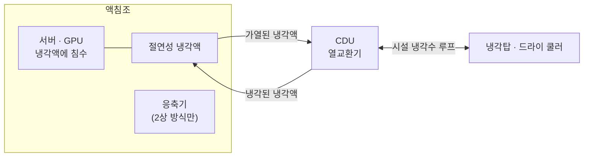

# Green Data Center (액침 냉각, Immersion Cooling)

---

## I. 서버를 액체에 담가 식히는, 액침 냉각의 개요

### 가. 정의

- 서버 등 IT 장비를 **전기가 통하지 않는 절연성(Dielectric) 냉각액에 직접 담가 열을 제거**하는 데이터센터 냉각 방식으로, 그린 데이터센터의 핵심 기술

### 나. 필요성 및 특징

| 구분 | 내용 |
| --- | --- |
| 고밀도 발열 | AI GPU 랙 전력이 수십~100kW 이상으로 증가, 공랭 한계 |
| 에너지 효율 | 서버 팬·항온항습기 전력 절감, PUE를 1.0에 가깝게 낮춤 |
| 공간 절감 | 핫·콜드 아일, 이중마루 불필요, 랙 집적도 향상 |
| 장비 보호 | 먼지·습기 차단, 온도 편차 감소 |
| 과제 | 초기 비용, 유지보수 방식 변경, 냉각액 관리 |

---

## II. 구조 및 구성요소

### 가. 구조

- 1차 루프(냉각액)가 서버 열을 흡수하고, CDU에서 2차 루프(시설 냉각수)로 열을 넘겨 외부로 방출

### 나. 구성요소

| 구분 | 요소 | 설명 |
| --- | --- | --- |
| 냉각 매질 | 절연성 냉각액 | 합성유·미네랄 오일(1상), 불소계 유체(2상) |
| 방식 | 1상 (Single-phase) | 액체 상태로 순환, 구조 단순, 증발 손실 없음 |
| | 2상 (Two-phase) | 냉각액이 끓으며 증발 잠열로 열 제거, 응축기로 재액화, 효율 높으나 불소계 유체 규제(PFAS) 부담 |
| 설비 | CDU (Coolant Distribution Unit) | 1차·2차 루프 간 열교환과 유량·온도 제어 |
| | 액침조 (Tank) | 서버를 세로로 꽂는 밀폐형 수조 |
| 지표 | PUE | 데이터센터 총 전력 / IT 장비 전력, 1.0에 가까울수록 효율적 |
| 하드웨어 | 팬리스 서버 | 팬 제거, 방열판·부품을 액침 환경에 맞게 최적화 |
| 표준 | OCP | 액침 냉각 요구사항·유체 호환성 등 개방형 사양 |

---

## III. 비교 및 동향

### 가. 냉각 방식 비교 (일반적인 범위)

| 비교 항목 | 공랭 | 직접 액체 냉각 (D2C, Cold Plate) | 액침 냉각 |
| --- | --- | --- | --- |
| 냉각 대상 | 공기 → 방열판 | 냉각수 → 칩 위 콜드 플레이트 | 냉각액 → 서버 전체 |
| 랙 전력 밀도 | 약 20kW 이하 | 수십~100kW 이상 | 100kW 이상 |
| PUE 수준 | 약 1.4~1.6 | 약 1.1~1.2 | 약 1.03~1.1 |
| 유지보수 | 쉬움 | 누수 감시 필요 | 장비 인양·냉각액 처리 필요 |
| 도입 비용 | 낮음 | 중간 | 높음 |

### 나. 동향

- **AI 랙은 D2C가 주류**: NVIDIA GB200 NVL72 등 고전력 AI 랙은 직접 액체 냉각(콜드 플레이트)을 표준으로 채택, 액침 냉각은 일부 고밀도·엣지 환경에서 확대
- **산업 협업**: 국내 통신사·데이터센터 사업자와 정유사(예: SK텔레콤–SK엔무브)가 냉각유 개발·실증 추진
- **[[ESG 경영]]**: 데이터센터 전력 급증으로 PUE·WUE(물 사용 효율) 관리와 폐열 재활용 요구 강화

---

### 🔗 연관 토픽

- **소속 도메인**: [[00_컴퓨터구조_MOC|💻 컴퓨터구조]]
- **세부 분류**: `2. 캐시 & 메모리 계층 구조 · 스토리지`
- **핵심 연관 토픽**:
  - [[GPU]]
  - [[ESG 경영]]
  - [[HA(High Availability)]]
  - [[지능형 반도체]]
  - [[HBM|HBM (High Bandwidth Memory)]]
