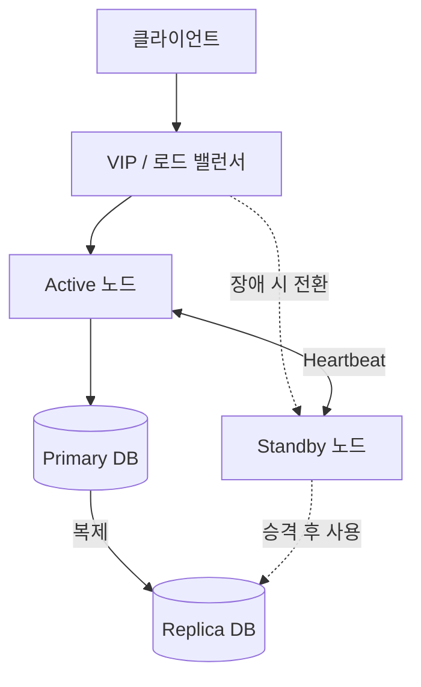

# HA (High Availability, 고가용성)

---

## I. 장애가 나도 서비스는 계속, HA의 개요

### 가. 정의

- **이중화(Redundancy)와 자동 장애 조치(Failover)로 단일 장애점을 없애** 시스템이 오랜 기간 정상 서비스를 유지하는 능력 (예: 가용률 99.99% 이상)

### 나. 필요성 및 특징

| 구분 | 내용 |
| --- | --- |
| SPOF 제거 | 서버·네트워크·스토리지·전원 등 모든 경로를 다중화 |
| 자동 복구 | 장애 감지 후 대기 노드가 서비스 IP·역할을 넘겨받아 다운타임 최소화 |
| 업무 연속성 | 금융·전자상거래 등 미션 크리티컬 서비스의 [[BCP\|비즈니스 연속성 계획]] 기반 |

---

## II. 구조 및 구성요소

### 가. Active-Standby 클러스터

- Heartbeat가 끊기면 Standby가 VIP를 인수(Takeover)하고 Active로 승격, Replica DB도 Primary로 승격

### 나. 구성요소

| 구분 | 요소 | 설명 |
| --- | --- | --- |
| 설계 원칙 | SPOF 제거 | 하나만 고장 나도 전체가 멈추는 지점을 찾아 다중화 |
| 운영 방식 | Active-Standby | 한 노드만 서비스, 장애 시 대기 노드 투입 (구성 쉬움, 자원 유휴) |
| | Active-Active | 모든 노드가 동시에 서비스, 부하 분산 겸용 (데이터 정합성 관리 복잡) |
| 장애 조치 | Failover / Failback | 대기 시스템으로 전환 / 복구 후 원래 시스템으로 복귀 |
| 감시 | Heartbeat | 노드 간 주기적 생존 신호 |
| | Split-Brain 방지 | 통신 단절 시 양쪽이 모두 Active가 되지 않도록 쿼럼·펜싱(STONITH) 적용 |
| 네트워크 | VIP 인수 | 가상 IP를 넘겨받고 Gratuitous ARP로 MAC 주소 갱신 |
| 지표 | 가용률 | MTBF / (MTBF + MTTR) |
| | Nines | 99.9% 연 약 8.8시간, 99.99% 약 53분, 99.999% 약 5.26분 다운타임 |

---

## III. 비교 및 동향

### 가. HA vs FT vs DR

| 비교 항목 | HA (고가용성) | FT (결함 허용) | DR (재해 복구) |
| --- | --- | --- | --- |
| 목적 | 다운타임 최소화 | 장애 중에도 무중단 | 재해 시 서비스 복구 |
| 중단 시간 | 수 초~수 분 전환 시간 | 사실상 0 | RTO 기준 (분~일) |
| 구현 | 클러스터링, 페일오버 | 하드웨어 락스텝, 다중 부품 동시 처리 | 원격지 백업 센터·리전 |
| 비용 | 중간 | 매우 높음 | 높음 |
| 적용 | 대부분의 상용 서비스 | 항공, 원자력, 일부 금융 | 금융, 공공, 대기업 |

### 나. 동향

- **Multi-AZ 기본화**: 퍼블릭 클라우드에서 서로 다른 가용 영역에 인스턴스·DB(예: Amazon RDS Multi-AZ)를 분산해 데이터센터 단위 장애 대비
- **[[쿠버네티스]] 자가 치유**: 파드·노드 장애 시 컨트롤 플레인이 선언된 상태를 유지하도록 재스케줄링, [[MSA (Micro Service Architecture)|MSA]]의 기본 HA 수단

---

### 🔗 연관 토픽

- **소속 도메인**: [[00_컴퓨터구조_MOC|💻 컴퓨터구조]]
- **세부 분류**: `2. 캐시 & 메모리 계층 구조 · 스토리지`
- **핵심 연관 토픽**:
  - [[결함허용 컴퓨터|결함허용 컴퓨터(FTS)]]
  - [[RAID]]
  - [[DRS (Disaster Recovery System)]]
  - [[스위치 이중화]]
  - [[클라우드 네이티브]]
