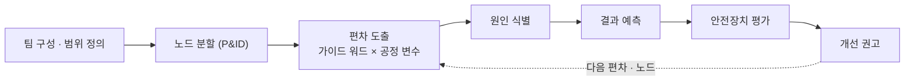

# HAZOP (Hazard and Operability Study)

---

## I. 가이드 워드로 편차를 찾는 위험 분석, HAZOP의 개요

### 가. 정의

- 다분야 전문가 팀이 시스템을 노드로 나누고 **가이드 워드와 공정 변수를 결합해 설계 의도로부터의 편차를 찾고, 그 원인·결과·안전장치를 검토**하는 정성적 위험성 평가 기법 (IEC 61882)

### 나. 특징

| 구분 | 내용 |
| --- | --- |
| 체계적 브레인스토밍 | 모든 노드·변수에 가이드 워드를 빠짐없이 적용해 누락 방지 |
| 원인-결과-방호 구조 | 편차의 원인, 최악 결과, 기존 안전장치를 함께 검토 |
| 운전성 포함 | 위험뿐 아니라 운전·조작상 문제도 도출 |
| 적용 분야 | 석유화학·플랜트 공정위험성평가(PSM) 대표 기법, SW·제어 시스템으로 확장 |

---

## II. 분석 절차 및 구성요소

### 가. 분석 절차

- 노드마다 '가이드 워드 + 변수'로 편차(예: No Flow, More Pressure)를 만들고 원인·결과·안전장치를 검토해 부족하면 개선 권고

### 나. 구성요소

| 구분 | 요소 | 설명 |
| --- | --- | --- |
| 분석 단위 | 노드 (Node) | 일정한 설계 의도를 가진 공정 구간 (P&ID 배관·용기) |
| | 공정 변수 | 유량·압력·온도·수위·조성 등 |
| 가이드 워드 | No / None | 설계 의도 전혀 미달성 (No Flow) |
| | More · Less | 양적 증가·감소 (More Pressure, Less Temperature) |
| | As well as · Part of | 추가 물질 혼입, 일부 성분 누락 |
| | Reverse · Other than | 역방향, 전혀 다른 상태 (역류, 다른 물질) |
| | Early · Late · Before · After | 시점·순서 편차 (제어·SW 분석에 활용) |
| 결과 처리 | 안전장치 (Safeguard) | 편차를 예방·감지·완화하는 장치 (안전밸브, 경보, 인터록) |
| | 권고 사항 | 설계 변경, 절차 보완, 추가 방호 계층 |

---

## III. 비교 및 동향

### 가. HAZID vs HAZOP

| 비교 항목 | HAZID | HAZOP |
| --- | --- | --- |
| 수행 시기 | 개념 설계·기본 설계 초기 | 상세 설계 (P&ID 확정 후) |
| 분석 수준 | 시스템·구역 단위의 거시적 위험 | 노드 단위 상세 편차 |
| 도구 | 위험 체크리스트 | 가이드 워드 × 공정 변수 |
| 결과 | 주요 위험·배치 결정 | 운전 오류·고장 시나리오, 인터록 설계 검증 |

### 나. 동향

- HAZOP에서 도출한 고위험 시나리오를 LOPA(방호계층분석)로 정량화해 SIL 등급 결정 ([[기능안전 표준]] 연계)
- 제어 시스템 대상 CHAZOP(Computer HAZOP), 사이버 위협까지 다루는 Cyber PHA로 확장
- SW 분야에서는 데이터 흐름·메시지에 가이드 워드를 적용하는 SW HAZOP 활용

---

### 🔗 연관 토픽

- **소속 도메인**: [[00_소프트웨어공학_MOC|🏗️ 소프트웨어공학]]
- **세부 분류**: `2. 애자일(Agile) & 지속적 통합/배포(CI/CD)`
- **핵심 연관 토픽**:
  - [[기능안전 표준|기능안전 표준 (Functional Safety Standards)]]
  - [[SW 안전성(SW Safety) 및 분석 개념]]
  - [[FMEA (Failure Mode and Effects Analysis)]]
  - [[FTA (Fault Tree Analysis)]]
  - [[STPA|STPA (System-Theoretic Process Analysis)]]
