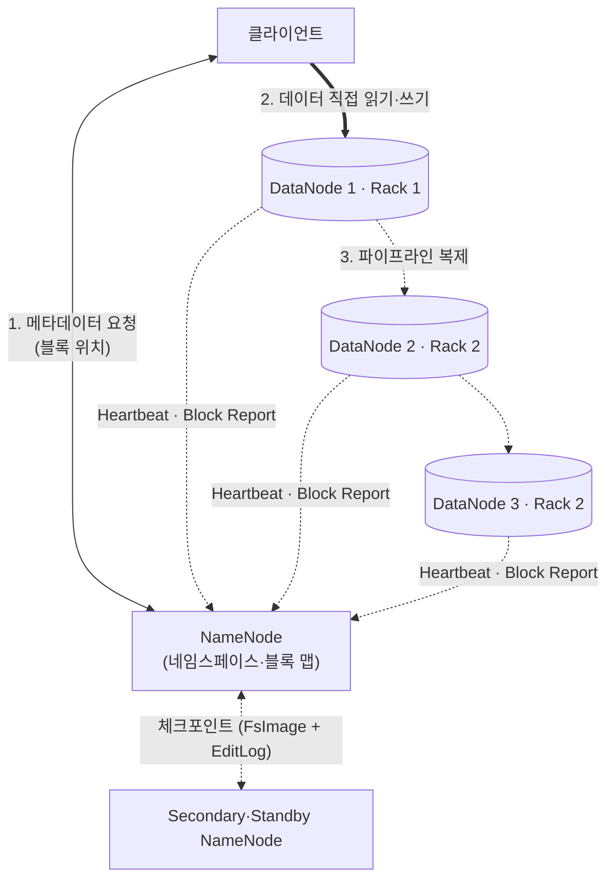

# HDFS (Hadoop Distributed File System)

---

## I. 대용량 파일의 분산 저장, HDFS의 개요

### 가. 정의

- 범용 서버 클러스터에 **대용량 파일을 큰 블록으로 나눠 여러 노드에 복제 저장하고, 높은 처리량으로 순차 접근하도록 설계된 [[하둡]]의 분산 파일 시스템** (Google GFS 논문 기반)

### 나. 특징

| 구분 | 내용 |
| --- | --- |
| 내결함성 | 하드웨어 고장을 정상 상황으로 가정, 블록 복제(기본 3중)로 데이터 보호 |
| 처리량 중심 | 대용량 파일의 순차 읽기에 최적, 지연 시간보다 처리량 우선 |
| Write-Once-Read-Many | 수정 불가, 추가(Append)만 허용 |
| 데이터 지역성 | 연산을 데이터가 있는 노드로 이동해 네트워크 전송 감소 ([[지역성]]) |

---

## II. 아키텍처 및 구성요소

### 가. Master–Worker 구조

- 클라이언트는 NameNode에서 위치만 받고 데이터는 DataNode와 직접 주고받아 마스터 병목을 피함

### 나. 구성요소

| 구분 | 요소 | 설명 |
| --- | --- | --- |
| 마스터 | NameNode | 디렉터리 구조와 파일–블록–DataNode 매핑을 메모리에 관리 |
| | Secondary NameNode | FsImage와 EditLog를 주기적으로 병합(체크포인트), 장애 대체 노드는 아님 |
| | Standby NameNode (HA) | QJM·ZooKeeper 기반 자동 장애 조치로 NameNode SPOF 제거 |
| 워커 | DataNode | 블록 저장·전송, Heartbeat와 블록 리포트 전송 |
| 저장 | 블록 | 기본 128MB, 큰 블록으로 탐색 오버헤드 감소 |
| 보호 | 복제 | 기본 복제 계수 3, 파이프라인 방식 쓰기 |
| | Rack Awareness | 복제본을 다른 랙에도 배치해 랙 장애 대비 ([[HA(High Availability)\|가용성]]) |
| | 이레이저 코딩 | Hadoop 3부터 패리티 기반 저장으로 공간 절감 ([[이레이저 코딩]]) |

---

## III. 비교 및 동향

### 가. HDFS vs 클라우드 객체 스토리지

| 비교 항목 | HDFS | 객체 스토리지 (S3, ADLS, GCS) |
| --- | --- | --- |
| 구조 | 컴퓨팅과 스토리지가 같은 노드 | 컴퓨팅과 스토리지 분리 |
| 네임스페이스 | 계층형 디렉터리 | 평면 버킷·키 (ADLS Gen2는 계층형 지원) |
| 확장 한계 | NameNode 메모리(파일·블록 수) | 사실상 무제한 |
| 수정 | Append만 | 객체 단위 덮어쓰기·버전 관리 |
| 주 사용처 | 온프레미스 빅데이터 | 클라우드 데이터 레이크·[[데이터 레이크하우스]] |

### 나. 동향

- **객체 스토리지 전환**: Spark·Trino가 S3A 등 커넥터로 객체 스토리지를 직접 사용
- **Apache Ozone**: 소형 파일·메타데이터 확장 한계를 해결하는 하둡 호환 분산 객체 저장소
- **작은 파일 문제 대응**: 파일 병합, HAR·시퀀스 파일, 테이블 포맷의 Compaction 활용

---

### 🔗 연관 토픽

- **소속 도메인**: [[00_데이터베이스_MOC|🗄️ 데이터베이스]]
- **세부 분류**: `4. 물리 저장 구조 & 인덱스 최적화`
- **핵심 연관 토픽**:
  - [[Hadoop 3.0]]
  - [[하둡]]
  - [[이레이저 코딩|이레이저 코딩(erasure coding)]]
  - [[지역성|지역성(Locality)]]
  - [[데이터 레이크하우스]]
