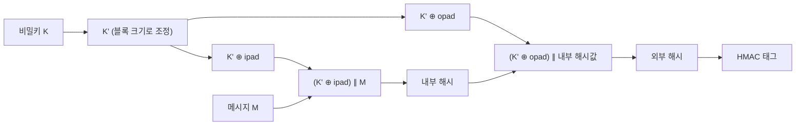

# HMAC (Hash-based Message Authentication Code)

---

## I. 해시에 비밀키를 더한 인증, HMAC의 개요

### 가. 정의

- **암호학적 해시 함수와 공유 비밀키를 결합하여 메시지의 [[무결성]]과 출처를 검증**하는 메시지 인증 코드 ([[MAC]]) 방식 (RFC 2104, FIPS 198-1)

### 나. 특징

| 구분 | 내용 |
| --- | --- |
| 무결성 + 인증 | 키를 아는 당사자만 올바른 태그 생성 가능 |
| 길이 확장 공격 방어 | 단순 $H(K \parallel M)$의 약점을 이중 해시로 해결 |
| 해시 교체 용이 | SHA-256, SHA-3 등 내부 해시를 바꿔 적용 |
| 고속 | 공개키 서명보다 훨씬 빠름 |
| 부인방지 불가 | 송·수신자가 같은 키를 가져 누가 만들었는지 제3자에게 증명 불가 |

---

## II. 동작 구조 및 구성요소

### 가. 이중 해시 구조

- $\text{HMAC}(K, M) = H((K' \oplus opad) \parallel H((K' \oplus ipad) \parallel M))$, 키를 두 개의 파생 키로 나눠 내부·외부 두 번 해시

### 나. 구성요소

| 구분 | 요소 | 설명 |
| --- | --- | --- |
| 입력 | 비밀키 K | 송·수신자가 공유하는 대칭키, 블록보다 길면 해시로 축약 |
| | 해시 함수 H | SHA-256, SHA-512, SHA-3 등 |
| 상수 | ipad | 0x36을 블록 크기만큼 반복 |
| | opad | 0x5C를 블록 크기만큼 반복 |
| 처리 | 내부 해시 | 메시지와 내부 키 결합 해시 |
| | 외부 해시 | 내부 결과를 외부 키로 다시 해시해 길이 확장 차단 |
| 검증 | 상수 시간 비교 | 타이밍 공격 방지를 위해 태그를 일정 시간에 비교 |

---

## III. 비교 및 동향

### 가. HMAC vs 전자서명

| 비교 항목 | HMAC | 전자서명 |
| --- | --- | --- |
| 키 | 대칭 (공유 비밀키) | 비대칭 (개인키 서명, 공개키 검증) |
| 무결성·인증 | 제공 | 제공 |
| 부인방지 | 불가 | 가능 |
| 속도 | 매우 빠름 | 상대적으로 느림 |
| 검증 주체 | 키를 공유한 당사자만 | 공개키를 가진 누구나 |
| 활용 | API 인증, JWT(HS256), [[IP Sec\|IPsec]], TLS 1.3 HKDF | 인증서, 코드 서명, 블록체인 거래 |

### 나. 동향

- **API 요청 서명**: AWS Signature V4 등 클라우드 API가 요청 내용·타임스탬프를 HMAC-SHA256으로 서명
- **키 유도**: TLS 1.3과 Signal 프로토콜이 HMAC 기반 HKDF(RFC 5869)로 세션 키 유도
- **AEAD 대체**: 암호화와 인증을 함께 하는 AES-GCM·ChaCha20-Poly1305가 별도 HMAC을 대체하는 추세

---

### 🔗 연관 토픽

- **소속 도메인**: [[00_보안_MOC|🛡️ 보안]]
- **세부 분류**: `1. 정보보안 원칙 & 거버넌스 · 인증`
- **핵심 연관 토픽**:
  - [[MAC]]
  - [[MDC]]
  - [[해시함수|해시함수(알고리즘 측면)]]
  - [[해시 함수의 안전성]]
  - [[IP Sec]]
