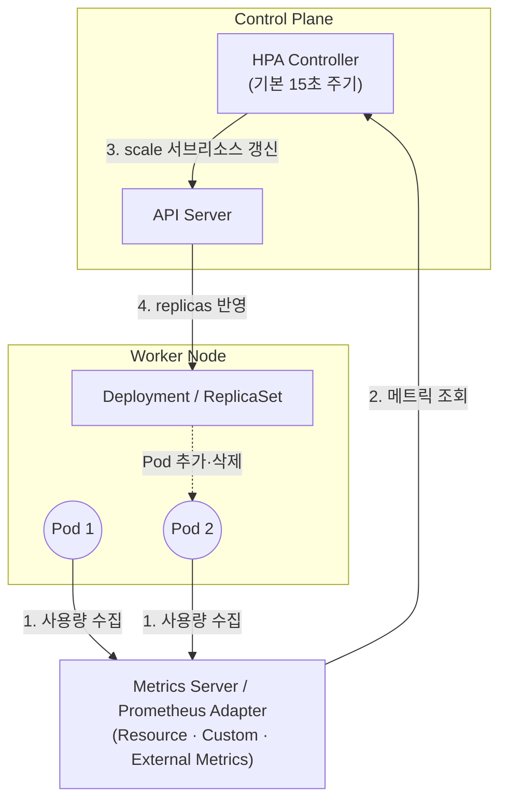

# HPA (Horizontal Pod Autoscaler)

---

## I. 쿠버네티스 수평 확장, HPA의 개요

### 가. 정의

- [[쿠버네티스]]에서 CPU·메모리 또는 사용자 정의 지표를 주기적으로 측정하여 **Deployment·StatefulSet의 Pod 복제 수를 자동으로 늘리고(Scale-out) 줄이는(Scale-in)** 컨트롤러

### 나. 특징

| 구분 | 내용 |
| --- | --- |
| 탄력성 | 트래픽 급증 시 Pod 복제로 지연·장애 방지 |
| 비용 절감 | 유휴 시간대 Pod 회수로 자원 낭비 최소화 |
| 다양한 지표 | Resource(CPU·메모리), Custom(RPS 등), External(큐 길이 등) 지표 지원 |
| 간접 제어 | Pod를 직접 만들지 않고 상위 워크로드의 replicas 값만 변경 |

---

## II. 동작 구조 및 구성요소

### 가. 동작 구조

- 컨트롤러가 15초마다 메트릭 API를 조회해 목표 복제 수를 계산하고, scale 서브리소스를 갱신하면 ReplicaSet이 Pod를 생성·삭제

### 나. 구성요소

| 구분 | 요소 | 설명 |
| --- | --- | --- |
| [[알고리즘]] | 복제 수 계산식 | `desired = ⌈현재 복제 수 × (현재 지표 / 목표 지표)⌉`, 비율 차이가 허용 오차(기본 10%) 이내면 유지 |
| 지표 수집 | Metrics Server | Pod·노드의 CPU·메모리를 수집해 Resource Metrics API 제공 |
| | Custom · External Metrics API | Prometheus Adapter 등으로 애플리케이션·외부 지표 연결 |
| 안정화 | Stabilization Window | 최근 구간의 권고값 중 보수적인 값을 택해 진동(Flapping) 방지, 축소 기본 300초 |
| | Scaling Policy (behavior) | 단위 시간당 증감 가능한 Pod 수·비율 제한 |
| 대상 | Scale Target | Deployment, StatefulSet 등 scale 서브리소스를 가진 워크로드 |
| | min / maxReplicas | 복제 수 하한·상한 (기본적으로 최소 1) |

---

## III. 비교 및 동향

### 가. HPA vs VPA vs Cluster Autoscaler

| 비교 항목 | HPA | VPA | Cluster Autoscaler |
| --- | --- | --- | --- |
| 방식 | 수평 (Scale-out/in) | 수직 (Scale-up/down) | 수평 (노드 수) |
| 조절 대상 | Pod 개수 | Pod의 CPU·메모리 requests/limits | 워커 노드 개수 |
| 트리거 | 지표가 목표치 초과·미달 | 실제 사용량 대비 요청량 부적정 | 자원 부족으로 Pod Pending |
| 한계 | 노드 자원 부족 시 Pod Pending | 기본 모드에서 Pod 재생성 필요, 같은 지표로 HPA와 병행 금지 | 노드 추가에 수 분 소요 |

- 일반적으로 HPA(Pod 수) + Cluster Autoscaler(노드 수)를 함께 구성 ([[Auto Scale Up Auto Scale Out]])

### 나. 동향

- **KEDA**: Kafka·SQS 등 이벤트 소스 기반 확장, HPA가 못하는 0개 축소(Scale-to-Zero) 지원 (CNCF 졸업 프로젝트)
- **Karpenter**: Pending Pod의 요구사항에 맞는 인스턴스를 직접 골라 노드를 프로비저닝, 노드 그룹 기반 CA보다 빠르고 유연 (Kubernetes SIG Autoscaling 프로젝트)
- **In-place Pod Resize**: Pod 재생성 없이 CPU·메모리 변경이 가능해져 수직 확장 제약 완화

---

### 🔗 연관 토픽

- **소속 도메인**: [[00_디지털서비스_MOC|🚀 디지털서비스]]
- **세부 분류**: `1. 클라우드 컴퓨팅 & 가상화 인프라`
- **핵심 연관 토픽**:
  - [[쿠버네티스|쿠버네티스(Kubernetes)]]
  - [[Auto Scale Up Auto Scale Out]]
  - [[컨테이너|컨테이너 (Container)]]
  - [[클라우드 네이티브]]
  - [[처리량]]
