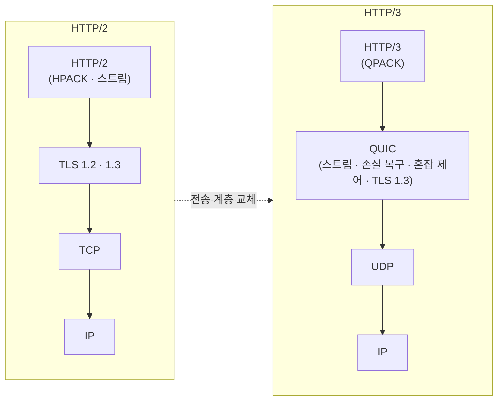

# HTTP/3

---

## I. TCP를 떠나 QUIC으로, HTTP/3의 개요

### 가. 정의

- [[TCP]] 대신 **UDP 기반 전송 프로토콜 QUIC 위에서 동작하는 HTTP 3번째 주요 버전** (RFC 9114, QUIC은 RFC 9000)

### 나. 필요성 및 특징

| 구분 | 내용 |
| --- | --- |
| TCP HOL Blocking | HTTP/2는 한 TCP 연결에 여러 스트림을 [[다중화]]해 패킷 하나 손실 시 모든 스트림이 대기 |
| 연결 지연 | TCP 핸드셰이크 + TLS 핸드셰이크로 왕복 지연 누적 |
| 스트림 독립 | QUIC 스트림별로 손실 복구, 다른 스트림은 계속 진행 |
| 빠른 연결 | 최초 1-RTT, 재연결 시 0-RTT 데이터 전송 |
| 연결 이동 | Connection ID로 IP·포트 변경(Wi-Fi ↔ LTE) 시에도 연결 유지 |
| 암호화 필수 | TLS 1.3 내장, 전송 헤더 대부분 암호화 |

---

## II. 구조 및 구성요소

### 가. HTTP/2와 HTTP/3 프로토콜 스택

- QUIC이 TCP의 신뢰성·혼잡 제어와 TLS를 한 계층에 통합하고, 사용자 공간에서 구현되어 개선 배포가 빠름

### 나. 구성요소

| 구분 | 요소 | 설명 |
| --- | --- | --- |
| 전송 | QUIC | UDP 위 신뢰 전송, 패킷 번호 단조 증가로 재전송 모호성 제거 |
| 연결 | 1-RTT · 0-RTT | 전송·암호 핸드셰이크 통합, 0-RTT는 재전송 공격(Replay) 위험이 있어 멱등 요청에 한정 |
| 다중화 | 독립 스트림 | 스트림 단위 순서 보장, 스트림 간 HOL 없음 |
| 이동성 | Connection ID | 4-튜플 대신 ID로 연결 식별, 경로 변경 시 유지 |
| 보안 | TLS 1.3 내장 | 평문 모드 없음, 헤더 보호(Header Protection) |
| 헤더 압축 | QPACK | 순서가 바뀌어 도착해도 동작하도록 HPACK을 재설계 |
| 혼잡 제어 | 플러그형 | [[TCP 혼잡제어\|CUBIC]]·BBR 등을 구현체가 선택 |
| 발견 | Alt-Svc · HTTPS 레코드 | HTTP/3 지원을 헤더나 DNS로 알림 |

---

## III. 비교 및 동향

### 가. HTTP/1.1 vs HTTP/2 vs HTTP/3

| 비교 항목 | HTTP/1.1 | HTTP/2 | HTTP/3 |
| --- | --- | --- | --- |
| 전송 | TCP | TCP | QUIC (UDP) |
| 다중화 | 없음 (연결 여러 개) | 스트림 다중화 | 스트림 다중화 |
| HOL Blocking | HTTP·TCP 계층 | TCP 계층에 남음 | 전송 계층 HOL 해소 (스트림 내부 순서 대기는 남음) |
| TLS | 선택 | 브라우저는 TLS 필수 | TLS 1.3 필수 |
| 연결 이동 | 불가 | 불가 | 가능 |
| 헤더 압축 | 없음 | HPACK | QPACK |

### 나. 동향

- **보급**: 주요 브라우저·CDN·대형 플랫폼이 기본 지원, 전체 웹 요청 중 상당 비중(수십 %)이 HTTP/3
- **UDP 차단 대응**: 기업 방화벽이 UDP 443을 막으면 HTTP/2(TCP)로 자동 폴백
- **확장**: MASQUE(QUIC 기반 프록시·VPN), WebTransport, Multipath QUIC 표준화

---

### 🔗 연관 토픽

- **소속 도메인**: [[00_네트워크_MOC|🌐 네트워크]]
- **세부 분류**: `1. OSI 7계층 & 데이터링크 계층 (L1/L2)`
- **핵심 연관 토픽**:
  - [[TCP 와 UDP 비교]]
  - [[전송 계층|전송 계층 (Transport Layer)]]
  - [[TCP 혼잡제어]]
  - [[네트워크 프로토콜|네트워크 프로토콜 (Network Protocol)]]
  - [[CDN|CDN(Contents Delivery Network)]]
