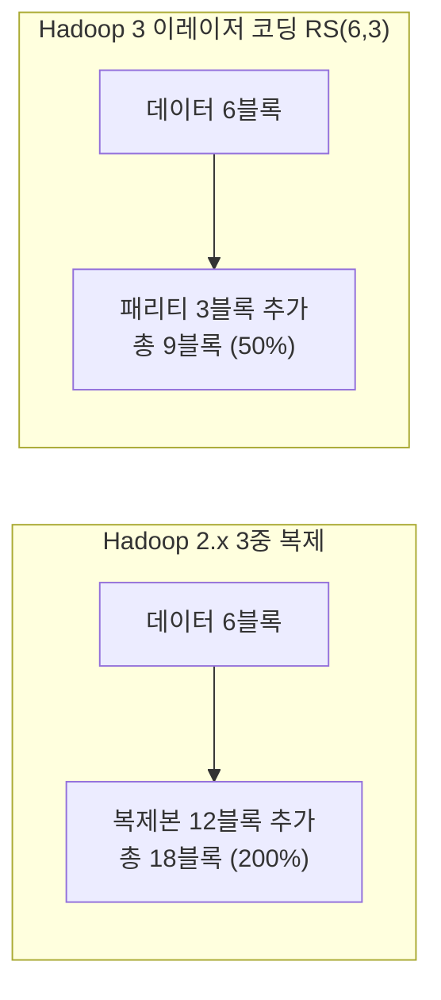

# Hadoop 3.0

---

## I. 저장 효율과 확장성 개선, Hadoop 3.0의 개요

### 가. 정의

- [[HDFS]] **이레이저 코딩, 다중 Standby NameNode, YARN 확장 기능을 도입해 저장 효율과 클러스터 확장성을 높인 Apache [[하둡]] 메이저 버전** (3.0 GA 2017.12, 이후 3.x로 발전)

### 나. 특징

| 구분 | 내용 |
| --- | --- |
| 저장 효율 | 3중 복제(오버헤드 200%) → 이레이저 코딩(RS 6+3 기준 50%) |
| 가용성 | Active 1개 + Standby 2개 이상 NameNode 구성 |
| 확장성 | YARN Federation으로 여러 서브 클러스터를 하나처럼 운영 |
| 플랫폼 | Java 8 이상 필수, 클라우드 객체 스토리지 커넥터 강화 |

---

## II. 핵심 구조 및 구성요소

### 가. 3중 복제 vs 이레이저 코딩

- RS(6,3)은 9개 블록 중 임의 3개가 손실돼도 복원 가능하며, 대신 복원 시 CPU·네트워크 비용이 커서 주로 냉(Cold) 데이터에 적용 ([[이레이저 코딩]])

### 나. 구성요소

| 구분 | 요소 | 설명 |
| --- | --- | --- |
| HDFS | 이레이저 코딩 | 스트라이핑 + Reed-Solomon 패리티로 저장 공간 절감 (3.0) |
| | 다중 Standby NameNode | 2개 이상 Standby로 마스터 장애 허용도 향상 (3.0) |
| | 디스크 간 밸런서 | 한 DataNode 내 디스크 사용량 균형 (Intra-DataNode Balancer) |
| YARN | Federation | 라우터가 여러 서브 클러스터를 단일 클러스터처럼 연결 |
| | 타임라인 서비스 v2 | 확장 가능한 작업 이력 저장 (HBase 기반) |
| | GPU·FPGA 스케줄링 | 가속기 자원 할당 (3.1부터 지원) |
| | Docker 컨테이너 실행 | YARN에서 [[도커\|Docker]] 기반 애플리케이션 실행 (3.1에서 강화) |
| 연계 | 객체 스토리지 커넥터 | S3A, ABFS 등 클라우드 스토리지 연동 개선 |

---

## III. 비교 및 동향

### 가. Hadoop 2.x vs 3.x

| 비교 항목 | Hadoop 2.x | Hadoop 3.x |
| --- | --- | --- |
| 데이터 보호 | 3중 복제 | 3중 복제 + 이레이저 코딩 선택 |
| NameNode | Active 1 + Standby 1 | Active 1 + Standby 다수 |
| 자원 유형 | CPU·메모리 | + GPU·FPGA (3.1~) |
| Java | Java 7 | Java 8 이상 (3.3부터 Java 11 실행 지원) |
| 기본 포트 | 임시 포트 범위와 충돌 가능 | NameNode 등 기본 포트 변경 |

### 나. 동향

- **클라우드·레이크하우스 전환**: 온프레미스 하둡 대신 S3 등 객체 스토리지 + Spark·Trino on Kubernetes 구조 확산 ([[데이터 레이크하우스]])
- **스토리지–컴퓨팅 분리**: 데이터 지역성(Data Locality)보다 탄력적 확장이 우선시됨
- **유지 버전**: Hadoop 3.4 계열(2024)로 지속 업데이트, 기존 클러스터는 클라우드 관리형(EMR 등)으로 이관

---

### 🔗 연관 토픽

- **소속 도메인**: [[00_데이터베이스_MOC|🗄️ 데이터베이스]]
- **세부 분류**: `4. 물리 저장 구조 & 인덱스 최적화`
- **핵심 연관 토픽**:
  - [[HDFS]]
  - [[하둡]]
  - [[이레이저 코딩|이레이저 코딩(erasure coding)]]
  - [[데이터 레이크하우스|데이터 레이크하우스(Data Lakehouse)]]
  - [[클라우드 네이티브]]
