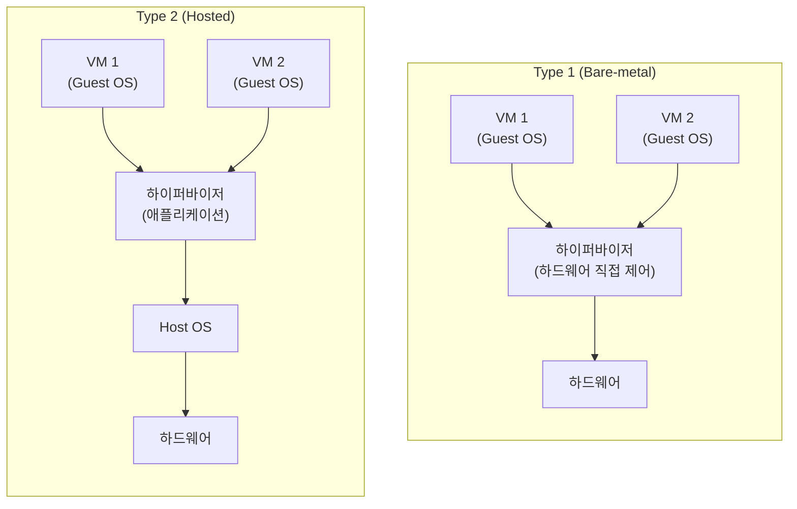

# 하이퍼바이저 (Hypervisor / VMM)

---

## I. 가상 머신을 만드는 계층, 하이퍼바이저의 개요

### 가. 정의

- 물리 서버의 [[CPU]]·메모리·I/O를 **추상화·분할하여 여러 가상 머신(VM)을 생성·실행·격리**하는 시스템 소프트웨어 (Virtual Machine Monitor, VMM)

### 나. 특징

| 구분 | 내용 |
| --- | --- |
| 자원 활용 | 여러 VM을 한 서버에 통합(Consolidation)해 이용률 향상, 클라우드의 기반 |
| 격리성 | VM별 독립 Guest OS·메모리 공간, 한 VM 장애가 다른 VM에 전파되지 않음 |
| 이동성 | 스냅샷, 실행 중 VM을 다른 호스트로 옮기는 Live Migration |
| 하드웨어 독립 | Guest OS는 가상 하드웨어만 인식, 이기종 서버 간 이동 용이 |

---

## II. 구조 및 핵심 기술

### 가. Type 1 / Type 2 구조

- Type 1은 하드웨어 위에 직접 설치되어 오버헤드가 작고(서버용), Type 2는 [[OS(운영체제)|Host OS]] 위 애플리케이션으로 동작해 설치가 쉽지만 성능 손실이 있음(개인·테스트용)

### 나. 핵심 기술

| 구분 | 요소 | 설명 |
| --- | --- | --- |
| CPU 가상화 | 전가상화 (Full) | Guest OS 무수정, 특권 명령을 이진 변환(Binary Translation) 또는 트랩으로 처리 |
| | 반가상화 (Para) | Guest OS 커널을 수정해 Hypercall로 하이퍼바이저 호출, 오버헤드 감소 (Xen) |
| | 하드웨어 지원 가상화 | Intel VT-x, AMD-V가 하이퍼바이저용 실행 모드(VMX root, 흔히 Ring -1) 제공 |
| [[메모리 관리]] | Shadow Page Table | Guest [[가상 메모리]] 주소 → 호스트 물리 주소 변환표를 하이퍼바이저가 유지 |
| | EPT / NPT | 2단계 주소 변환을 하드웨어(MMU)가 처리, Shadow Page Table 부담 제거 |
| I/O 가상화 | 에뮬레이션 / virtio | 장치 에뮬레이션 또는 반가상화 드라이버로 I/O 처리 |
| | SR-IOV | 물리 NIC를 여러 가상 기능(VF)으로 나눠 VM이 하이퍼바이저를 거치지 않고 직접 I/O |

---

## III. 비교 및 동향

### 가. Type 1 vs Type 2

| 비교 항목 | Type 1 (Bare-metal) | Type 2 (Hosted) |
| --- | --- | --- |
| 설치 위치 | 하드웨어 위 직접 | Host OS 위 애플리케이션 |
| 성능 | 오버헤드 작음 | Host OS 경유로 오버헤드 큼 |
| 보안 · 안정성 | 계층이 얇아 공격 표면 작음 | Host OS 취약점이 모든 VM에 영향 |
| 대표 제품 | VMware ESXi, Hyper-V, Xen, KVM | VMware Workstation, VirtualBox, Parallels |
| 활용 | 데이터센터, 퍼블릭 클라우드 | 개인 PC 개발·테스트 |

### 나. 동향

- **하드웨어 오프로딩**: AWS Nitro처럼 네트워크·스토리지·보안 기능을 전용 칩(DPU/IPU)으로 분리해 호스트 CPU·메모리를 대부분 고객에게 제공
- **MicroVM**: Firecracker·Cloud Hypervisor 등 불필요한 장치 에뮬레이션을 제거한 경량 VMM이 AWS Lambda 등 서버리스·보안 [[컨테이너]](Kata Containers) 기반으로 사용
- **VMware 대체**: Broadcom 인수(2023) 후 라이선스 변경으로 KVM 기반 솔루션(Proxmox, OpenShift Virtualization 등) 검토 증가

---

### 🔗 연관 토픽

- **소속 도메인**: [[00_디지털서비스_MOC|🚀 디지털서비스]]
- **세부 분류**: `1. 클라우드 컴퓨팅 & 가상화 인프라`
- **핵심 연관 토픽**:
  - [[가상화]]
  - [[컨테이너|컨테이너 (Container)]]
  - [[가상 메모리]]
  - [[오픈 스택 프로젝트]]
  - [[CSP|CSP (Cloud Service Provider)]]
