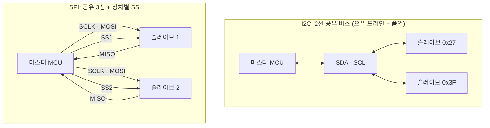

# I2C (Inter-Integrated Circuit)와 SPI (Serial Peripheral Interface)

---

## I. 보드 위 칩 간 직렬 통신, I2C와 SPI의 개요

### 가. 정의

- MCU와 센서·메모리·디스플레이 등 주변 칩을 **보드 위에서 연결하는 동기식 직렬 통신 인터페이스**로, I2C는 2선 주소 기반 버스(필립스, 1982), SPI는 4선 전이중 버스(모토로라)

### 나. 특징

| 구분 | 내용 |
| --- | --- |
| 동기식 | 마스터(컨트롤러)가 클록을 공급해 송수신 시점 동기화 |
| I2C | SDA·SCL 2선으로 여러 장치 연결, 주소로 대상 선택, 반이중 |
| SPI | SCLK·MOSI·MISO·SS 4선, 전이중, 고속 |
| 선택 기준 | 핀 절약·다수 장치 연결은 I2C, 속도·대역폭은 SPI |

---

## II. 구조 및 구성요소

### 가. 연결 구조

- I2C는 주소로 대상을 논리적으로 선택하고, SPI는 SS(CS) 선을 Low로 내려 물리적으로 선택

### 나. 구성요소

| 구분 | 요소 | 설명 |
| --- | --- | --- |
| I2C | SDA | 양방향 데이터 선 (반이중) |
| | SCL | 마스터가 생성하는 클록 |
| | 주소 지정 | 7비트 또는 10비트 주소를 첫 바이트에 실어 대상 선택 |
| | START·STOP / ACK·NACK | 전송 시작·종료 조건, 바이트마다 수신 확인 비트 |
| | 중재·클록 스트레칭 | 멀티 마스터 충돌 해결, 슬레이브가 SCL을 붙잡아 대기 요청 |
| SPI | MOSI / MISO | 마스터→슬레이브 / 슬레이브→마스터 전용 선, 동시 송수신 |
| | SCLK | 마스터가 생성하는 클록 |
| | SS (CS) | 장치별 선택 선, Low 활성 |
| | 모드 (CPOL·CPHA) | 클록 극성·위상 조합 0~3 모드 |

---

## III. 비교 및 동향

### 가. I2C vs SPI

| 비교 항목 | I2C | SPI |
| --- | --- | --- |
| 통신 방식 | 반이중, 데이터 선 1개 | 전이중, 데이터 선 2개 |
| 선 수 | 2개 (장치 수와 무관) | 3개 + 장치당 SS 1개 |
| 토폴로지 | 멀티 마스터·멀티 슬레이브 | 단일 마스터·멀티 슬레이브 |
| 속도 | 100kbps·400kbps·1Mbps(Fm+)·3.4Mbps(HS) | 수십 MHz 이상 (장치 따라 상이) |
| 신뢰성 기능 | ACK 응답 있음 | 표준 응답·오류 검출 없음 |
| 구동 | 오픈 드레인, 풀업 저항 필요 | 푸시-풀, 풀업 불필요 |
| 적용 | 온도·습도 센서, EEPROM, RTC, 터치 IC | 디스플레이, SD 카드, SPI 플래시, ADC |

### 나. 동향

- **MIPI I3C**: I2C와 같은 2선으로 푸시-풀 구동, SDR 12.5MHz(HDR 모드 더 빠름), 동적 주소 할당·인밴드 인터럽트 지원, I2C 장치와 하위 호환 (2017년 공개)
- **용어 변경**: NXP I2C 사양(2021)부터 Master/Slave 대신 Controller/Target 용어 사용
- **고속 플래시 인터페이스**: Quad·Octal SPI로 데이터 선을 늘려 XIP 플래시 대역폭 확대

---

### 🔗 연관 토픽

- **소속 도메인**: [[00_컴퓨터구조_MOC|💻 컴퓨터구조]]
- **세부 분류**: `2. 캐시 & 메모리 계층 구조 · 스토리지`
- **핵심 연관 토픽**:
  - [[PCI Express (Peripheral Component Interconnect Express)]]
  - [[DMA(Direct Memory Access)]]
  - [[워치독 타이머|워치독 타이머(WDT, Watchdog timer)]]
  - [[Flash Memory(NOR, NAND)]]
  - [[프로토콜]]
