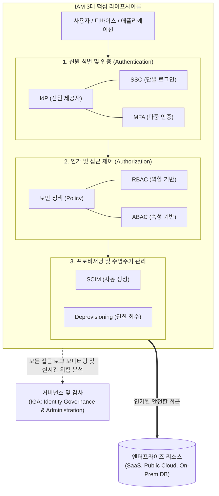

# IAM (Identity and Access Management)

---

## I. 제로 트러스트 아키텍처의 근간이자 통합 신원/권한 통제 체계, IAM의 개요

### 가. IAM(Identity and Access Management)의 정의
기업의 IT 자원(클라우드, 온프레미스, SaaS)에 대해 적절한 주체가 적절한 권한으로 규정된 조건 하에 접근할 수 있도록 신원(Identity)과 접근 권한(Access)의 전 생애주기를 통합 통제하는 보안 관리 [[프레임워크]]이다.

### 나. IAM의 등장 배경 및 주요 특징
| 구분 | 내용 |
| --- | --- |
| **등장 배경** | 클라우드 전환과 재택근무로 전통적 네트워크 경계가 붕괴됨에 따라 신원(Identity)을 새로운 보안 경계로 설정하는 [[제로 트러스트 보안모델\|Zero Trust]] 구현 필수화 |
| **단일 인증 및 편의성** | SSO(Single Sign-On)와 다중 요소 인증(MFA/[[FIDO]])을 결합하여 자격증명 피로도를 낮추고 계정 탈취 공격 차단 |
| **동적 접근 제어** | 역할 기반([[RBAC]]) 및 속성 기반(ABAC) 정책을 활용하여 사용자 위치, 기기 상태, 위험도에 따른 동적 권한 부여 |
| **계정 수명주기 거버넌스** | SCIM 기반의 입·퇴사자 계정 자동 프로비저닝/디프로비저닝 및 IGA(신원 거버넌스) 감사를 통한 컴플라이언스 준수 |

---

## II. IAM의 개념도 및 핵심 기술 요소

### 가. IAM 프레임워크의 동작 라이프사이클 개념도

* 사용자의 요청은 신원 검증(Authentication)과 권한 검증(Authorization)을 거치며, 직무 변경 시 [[프로비저닝]](SCIM)을 통해 리소스 접근 권한이 자동 동기화됨
* 모든 라이프사이클 과정은 거버넌스(IGA) 체계에 의해 로깅되고, 이상 행위 탐지 시 즉각적인 [[세션]] 차단 및 추가 인증(MFA)을 요구함

### 나. IAM의 핵심 기술 및 프로토콜 구성 요소

| 구분 | 요소기술 및 [[프로토콜]] (키워드) | 세부 설명 |
| --- | --- | --- |
| **신원 연동** | Federation (페더레이션) | 서로 다른 신뢰 도메인 간에 사용자 인증 정보를 안전하게 공유하여, 외부 파트너사나 다른 클라우드 서비스에서도 동일한 자격 증명 사용 가능 |
| **인증 프로토콜** | SAML 2.0 / OAuth 2.0 / OIDC | **SAML**: 엔터프라이즈 SSO의 표준 ([[XML]] 기반) **OAuth 2.0**: 리소스 접근 권한 인가(Delegation)의 표준 **OIDC (OpenID Connect)**: OAuth 2.0 기반의 신원 인증(Authentication) 표준 ([[JSON]]/JWT 기반) |
| **접근 인가** | [[RBAC]] / ABAC | **RBAC (Role-Based)**: 사용자의 부서/직급 등 '역할' 기반 접근 통제 **ABAC (Attribute-Based)**: 접속 시간, 위치, 디바이스 보안 상태 등 다양한 '속성'을 동적으로 평가하는 동적 접근 통제 |
| **계정 동기화** | SCIM (System for Cross-domain Identity Management) | 클라우드 환경(SaaS) 간에 사용자 계정의 생성, 갱신, 삭제를 자동화하고 동기화하기 위한 REST API 기반 개방형 표준 프로토콜 |
| **인증 강화** | MFA (Multi-Factor Authentication) | 지식(비밀번호), 소유(스마트폰/OTP), 생체(지문/FaceID) 중 2가지 이상을 결합하여 크리덴셜 스터핑 등을 방어 |
| **거버넌스** | IGA (Identity Governance & Admin) | 계정의 접근 권한이 규정(Compliance)에 맞게 부여되었는지 주기적으로 리뷰(Access Review)하고 위험을 분석하는 거버넌스 확장 체계 |

---

## III. IAM 진화 모델 비교 및 최신 산업 동향

### 가. 대상과 목적에 따른 IAM 유형 비교 (B2E vs B2C vs B2B)

| 비교 항목 | 엔터프라이즈 IAM (EIAM) | 고객용 CIAM (Customer IAM) | 특권 권한 관리 (PAM) |
| --- | --- | --- | --- |
| **주요 대상** | 내부 임직원 (B2E) | 외부 소비자 및 회원 (B2C) | 시스템 관리자, Root 계정, 서드파티 |
| **핵심 목적** | 내부 보안 강화, 업무 생산성 증대 | UX 향상, 회원 가입 전환율 제고, 개인정보 보호 | 최고위 권한 오남용 방지 및 세션 녹화 |
| **사용자 규모** | 수백 ~ 수만 명 수준 | 수백만 ~ 수천만 명 (초고도 확장성 필수) | 소수의 핵심 인력 |
| **주요 기능** | SSO, RBAC, SCIM 기반 계정 동기화 | 소셜 로그인, 마케팅 데이터 연동, 동의(Consent) 관리 | 일회성 비밀번호 발급, 명령어 통제 및 감사 |
| **대표 벤더** | Microsoft Entra ID(구 Azure AD), Okta | Auth0 (Okta 인수), AWS Cognito | CyberArk, BeyondTrust |

### 나. 주요 동향 및 발전 전망
* **신원 중심 보안(Identity-First Security) 확립**: 물리적 네트워크 경계 붕괴에 따라 IAM이 방화벽을 대체하는 제1차 방어선으로 부상하며, CARTA(지속적 적응형 위험/신뢰 평가) 기반 동적 최소 권한(PoLP) 강제
* **AI 기반 리스크 적응형 인증(RBA) 및 마찰 없는 UX**: 로그인 국가, 기기 무결성, 접속 패턴 이상 징후([[Anomaly(이상현상)|Anomaly]])를 ML 엔진이 실시간 평가하여 위험 세션에만 선택적 MFA를 요구하는 인텔리전트 보안 도입
* **CIEM(Cloud Infrastructure Entitlement Management) 확장**: 멀티 클라우드 환경에서 과도하게 부여된 미사용 IAM 역할과 권한을 자동 탐지·회수하는 클라우드 권한 거버넌스 필수화

---

### 🔗 연관 토픽

- **소속 도메인**: [[00_보안_MOC|🛡️ 보안]]
- **세부 분류**: `2. 현대 암호학 & 키 관리 · 전자서명`
- **핵심 연관 토픽**:
  - [[RBAC]]
  - [[프로비저닝]]
  - [[FIDO]]
  - [[패스키|패스키(Passkey)]]
  - [[SSRF(Server-Side Request Forgery)]]
