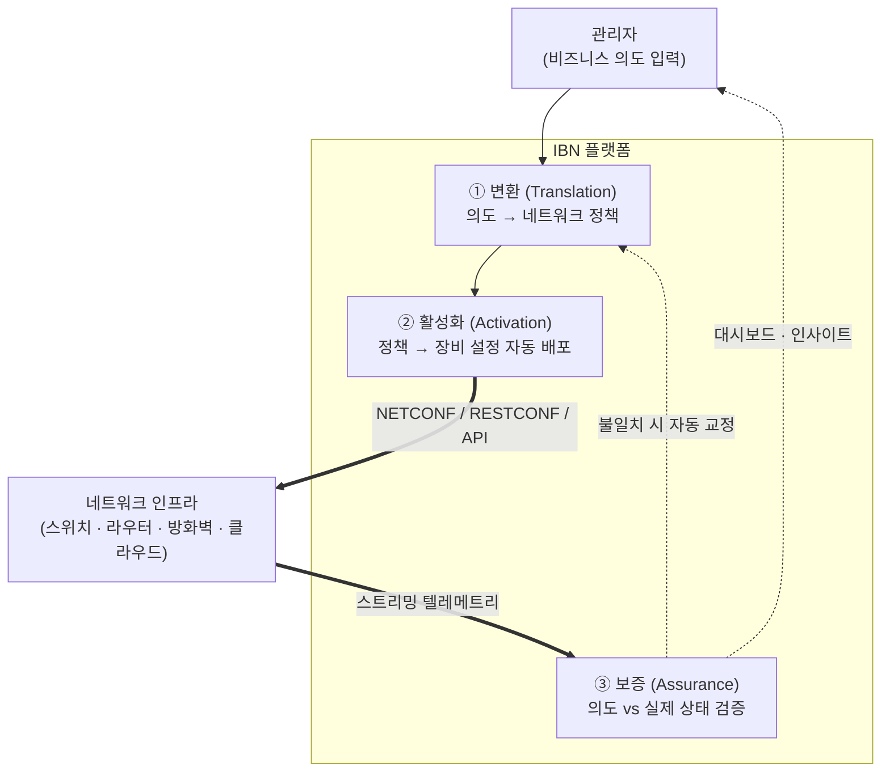

# IBN (Intent-Based Networking, 인텐트 기반 네트워킹)

---

## I. 비즈니스 의도를 스스로 구현·보장하는 네트워크, IBN의 개요

### 가. IBN의 정의

- 관리자가 장비 설정(How) 대신 **달성할 비즈니스 의도(What)를 선언**하면, AI와 오케스트레이션 SW가 이를 정책으로 변환·배포하고 **실제 상태가 의도와 일치하는지 지속 검증·자동 교정**하는 폐쇄 루프(Closed-loop) 네트워크

### 나. 등장 배경 및 특징

| 구분 | 내용 |
| --- | --- |
| 등장 배경 | [[SDN(Software Defined Network)\|SDN]]으로 제어는 프로그래밍화됐지만 여전히 수동 설정과 복잡성 존재 |
| 선언적 제어 | "재무팀은 인사 서버에 접근 불가"처럼 의도만 입력하면 VLAN·ACL 등으로 자동 변환 |
| 지속적 보증 | 텔레메트리로 의도와 실제 상태의 일치 여부를 상시 검증 |
| 자가 치유 | 불일치 발견 시 사람 개입 없이 정책을 재적용 |
| AIOps | 정상 패턴 학습, 이상 탐지, 원인 분석(RCA), 장애 예측 |

---

## II. IBN 아키텍처 및 핵심 기술

### 가. 폐쇄 루프 아키텍처

### 나. 핵심 기술 요소

| 단계 | 기술 | 설명 |
| --- | --- | --- |
| 변환 | NLP / 의도 해석 | 자연어·선언적 요구를 보안·[[QoS]] 정책으로 매핑 |
| | 정책 엔진 | 기존 정책과의 충돌 여부를 What-if 시뮬레이션·정형 검증 |
| 활성화 | SDN 컨트롤러 | 정책을 [[OpenFlow]], NETCONF, API로 [[스위치]]·[[라우터]]에 자동 [[프로비저닝]] |
| | YANG 데이터 모델 | 벤더 중립적인 설정·상태 데이터 표준 모델 |
| 보증 | 스트리밍 텔레메트리 | SNMP 폴링 대신 장비가 상태를 실시간 Push |
| | 지속적 상태 검증 | 의도된 상태(Desired)와 실제 상태(Actual)를 상시 비교 |
| 지능화 | AIOps / Self-Healing | 이상 예측, 원인 분석, 자율 정책 수정 |
| 보안 | 마이크로 [[세그멘테이션]] | 사용자·단말 컨텍스트에 따른 동적 격리 ([[제로 트러스트 보안모델\|Zero Trust]]) |

---

## III. SDN과의 비교 및 동향

### 가. SDN vs IBN

| 비교 항목 | SDN | IBN |
| --- | --- | --- |
| 목적 | 제어부·데이터부 분리, 프로그래밍화 | 비즈니스 의도 달성과 지속적 보증 |
| 접근 방식 | 명령적 (어떻게 설정할지) | 선언적 (무엇을 달성할지) |
| 제어 구조 | 개방 루프, 별도 모니터링 필요 | 폐쇄 루프, 자동 보정 |
| 지능 수준 | 소프트웨어 룰 기반 | AI/ML 기반 추론·예방·자율 복구 |
| 관계 | IBN 구현을 위한 기반 기술 (수단) | SDN 위의 지능 계층 (목표) |

### 나. 동향

- **생성형 AI 결합**: [[초거대 언어 모델\|LLM]] 기반 대화형 인터페이스로 정책 입력·트러블슈팅 ("오후 3시 임원 화상회의 트래픽 최우선")
- **예측형 AIOps**: 품질 저하를 예측해 QoS를 선제적으로 조정하는 벤더 플랫폼 확산
- **Zero Trust·[[SASE(Secure Access Service Edge)\|SASE]] 융합**: 단말 보안 상태 변화 시 격리 정책을 망 전체에 자동 적용
- 이동통신망의 의도 기반 관리는 [[NWDAF(Network Data Analytics Function)\|NWDAF]]·[[네트워크 지능]]과 연계

---

### 🔗 연관 토픽

- **소속 도메인**: [[00_네트워크_MOC|🌐 네트워크]]
- **세부 분류**: `5. 통신 인프라 & 차세대 네트워크 기술`
- **핵심 연관 토픽**:
  - [[SDN(Software Defined Network)]]
  - [[OpenFlow]]
  - [[네트워크 슬라이싱]]
  - [[디지털 트윈 네트워크]]
  - [[제로 트러스트 보안모델|제로 트러스트 (Zero Trust) 보안모델]]
