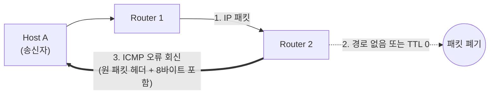

# ICMP (Internet Control Message Protocol)

---

## I. IP의 오류를 알려주는 전령, ICMP의 개요

### 가. 정의

- 신뢰성을 보장하지 않는 IP를 보완해 **전달 과정의 오류를 송신자에게 보고하고 네트워크 상태를 진단(질의)하는** [[네트워크 계층]] 제어 [[프로토콜]] (RFC 792)

### 나. 특징

| 구분 | 내용 |
| --- | --- |
| 오류 보고 | 목적지 도달 불가, TTL 초과, 단편화 필요 등 폐기 사유 통지 |
| 진단 | ping(Echo), traceroute(TTL 초과 응답) 기반 |
| IP 캡슐화 | IP 페이로드로 전송 (IPv4 프로토콜 번호 1), 포트 없음 |
| 오류 처리 한계 | 오류를 보고만 하고 복구는 상위 계층 담당 |
| 루프 방지 | ICMP 오류 메시지·브로드캐스트·비첫 조각에 대해서는 오류 메시지를 만들지 않음 |

---

## II. 동작 구조 및 구성요소

### 가. 오류 보고 흐름

- 패킷을 폐기한 라우터나 목적지가 원 패킷의 헤더 일부를 담아 송신자에게 사유를 알림

### 나. 주요 메시지

| 구분 | 요소 | 설명 |
| --- | --- | --- |
| 질의 | Type 8 / 0 (Echo Request / Reply) | ping, 도달성·왕복 시간 확인 |
| 오류 | Type 3 (Destination Unreachable) | 네트워크·호스트·포트 도달 불가 (Code로 세분) |
| | Type 3 Code 4 (Fragmentation Needed) | DF 설정 패킷이 MTU 초과, Path MTU Discovery에 사용 |
| | Type 11 (Time Exceeded) | TTL 0 도달, traceroute 원리 |
| | Type 5 (Redirect) | 같은 서브넷의 더 나은 다음 홉 [[라우터]] 안내 |
| | Type 12 (Parameter Problem) | 헤더 필드 오류 |
| 헤더 | Type · Code · Checksum | 메시지 종류, 세부 사유, 오류 검출 |

---

## III. 비교 및 동향

### 가. ICMPv4 vs ICMPv6

| 비교 항목 | ICMPv4 | ICMPv6 |
| --- | --- | --- |
| 식별 | IPv4 Protocol 1 | IPv6 Next Header 58 |
| 역할 | 오류 보고, 진단 | 오류 보고, 진단 + 이웃 탐색 + 멀티캐스트 관리 |
| 주소 해석 | 별도 [[ARP]] | NDP (NS/NA) |
| 멀티캐스트 관리 | 별도 [[IGMP]] | MLD |
| 필터링 | 일부 차단 가능 | 필수 메시지 차단 시 IPv6 통신 불가 (RFC 4890) |

### 나. 동향

- **공격 악용**: ICMP Flood, Smurf(브로드캐스트 증폭), Ping Sweep 정찰에 악용 → 속도 제한과 외부 Echo 제한 ([[DDOS|DDoS]])
- **선별 허용**: 전면 차단 시 PMTUD 실패로 연결이 멈추는 문제(Black Hole)가 생기므로 Type 3·11 등 필수 메시지는 허용
- **클라우드**: 보안 그룹 기본 정책은 인바운드 차단, 모니터링 대역만 Echo 허용

---

### 🔗 연관 토픽

- **소속 도메인**: [[00_네트워크_MOC|🌐 네트워크]]
- **세부 분류**: `1. OSI 7계층 & 데이터링크 계층 (L1/L2)`
- **핵심 연관 토픽**:
  - [[IP]]
  - [[IGMP]]
  - [[ARP]]
  - [[네트워크 계층|네트워크 계층 (Network Layer)]]
  - [[DDOS]]
