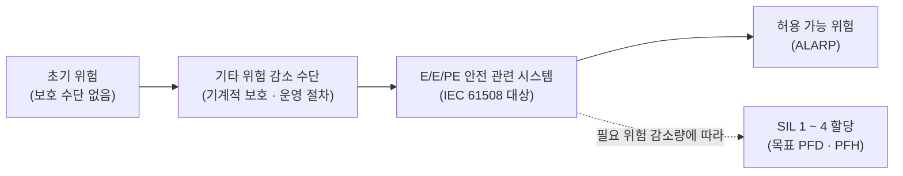

# IEC 61508

---

## I. 기능안전의 모체 표준, IEC 61508의 개요

### 가. 정의

- 전기·전자·프로그래머블 전자(E/E/PE) **안전 관련 시스템이 요구될 때 안전 기능을 올바르게 수행하도록 전체 안전 수명주기와 SIL 요구사항을 규정한 기능안전 기본 국제 표준** (1998~2000 초판, 2010 2판, 7개 Part)

### 나. 특징

| 구분 | 내용 |
| --- | --- |
| 기능안전 개념 | 입력에 대해 시스템이 올바르게 동작해 위험을 줄이는 능력 (예: 과압 시 밸브 자동 차단) |
| 위험 수용 | 위험을 0으로 만들 수 없으므로 허용 가능 위험(Tolerable Risk)까지 합리적으로 감소 (ALARP) |
| SIL | 안전 기능이 달성해야 할 위험 감소 수준을 SIL 1~4로 등급화 |
| 수명주기 | 개념·위험 분석부터 설계·운영·변경·폐기까지 전 단계 관리 |
| 범용성 | 산업 공통 기본 표준, 분야별 파생 표준의 기반 |

---

## II. 위험 감소 구조 및 구성요소

### 가. 위험 감소와 SIL 할당

- 초기 위험에서 다른 수단으로 줄이고 남은 위험 감소량을 E/E/PE 안전 기능이 담당하며, 그 크기에 따라 SIL 결정

### 나. 구성요소

| 구분 | 요소 | 설명 |
| --- | --- | --- |
| 등급 | SIL (Safety Integrity Level) | 1~4, 숫자가 클수록 엄격 |
| 고장 지표 | PFD (저빈도 요구 모드) | 요구 시 평균 고장 확률, SIL 1: 10⁻²~10⁻¹ … SIL 4: 10⁻⁵~10⁻⁴ |
| | PFH (고빈도·연속 모드) | 시간당 위험 고장 확률, SIL 1: 10⁻⁶~10⁻⁵ … SIL 4: 10⁻⁹~10⁻⁸ |
| 고장 유형 | 랜덤 하드웨어 고장 | 부품 열화 등 확률적 고장, 이중화·진단으로 대응 |
| | 체계적 고장 | 설계·SW 결함, 수명주기 프로세스·검증으로 대응 |
| 하드웨어 제약 | SFF · HFT | 안전 고장 비율, 하드웨어 고장 허용도로 달성 가능 SIL 제한 |
| 위험 기준 | ALARP | 위험 감소 비용이 효익에 비해 과도해지기 전까지 감소 |
| 확인 | 기능안전 평가 (FSA) | 독립성 수준에 따른 안전 활동·산출물 평가 |

---

## III. 비교 및 동향

### 가. IEC 61508과 분야별 파생 표준

| 비교 항목 | IEC 61508 | [[ISO 26262]] | IEC 61511 | EN 50128 / 50129 |
| --- | --- | --- | --- | --- |
| 분야 | 전 산업 공통 | 도로 차량 | 공정 산업 (석유화학) | 철도 신호 |
| 등급 | SIL 1~4 | [[ASIL]] QM, A~D | SIL 1~4 (실무상 SIL 3 이하) | SIL 0~4 |
| 위험 평가 | 위험 그래프, 정량 분석 | HARA (S·E·C) | [[HAZOP (Hazard and Operability Study)\|HAZOP]], LOPA | 위험 분석 후 SIL 할당 |
| 특징 | 파생 표준의 기반 | 양산 차량 V-모델, OEM-공급사 분담 | 센서·로직 솔버·최종 요소로 된 SIS 구축 | 철도 SW·안전 시스템 인증 |

- 기타 파생: IEC 62061(기계), IEC 61513(원자력 계측제어)

### 나. 동향

- **SOTIF 보완**: 고장이 없어도 기능 한계로 생기는 위험은 기능안전 범위 밖이므로 ISO 21448(SOTIF)로 보완
- **안전·보안 통합**: 연결된 제어 시스템의 사이버 공격이 안전 기능을 위협하므로 [[IEC 62443]]과 함께 적용하는 Safety & Security Co-engineering
- **AI 적용**: ISO/IEC TR 5469(AI와 기능안전, 2024) 등 학습 기반 구성요소를 안전 시스템에 쓰기 위한 지침 마련

---

### 🔗 연관 토픽

- **소속 도메인**: [[00_디지털서비스_MOC|🚀 디지털서비스]]
- **세부 분류**: `5. 기능안전 (Functional Safety) & 신뢰성 표준`
- **핵심 연관 토픽**:
  - [[ISO 26262]]
  - [[ASIL|ASIL (Automotive Safety Integrity Level)]]
  - [[기능안전 표준|기능안전 표준 (Functional Safety Standards)]]
  - [[SW 안전성(SW Safety) 및 분석 개념]]
  - [[IEC 62443]]
