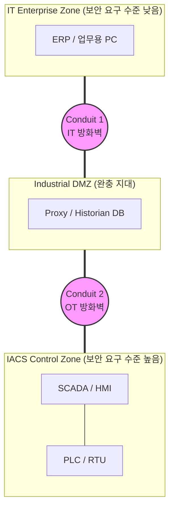

# IEC 62443

---

## I. 산업 제어 시스템(IACS)과 OT 환경을 위한 사이버 보안 국제 표준, IEC 62443의 개요

### 가. IEC 62443의 정의
산업 자동화 및 제어 시스템(IACS)과 운영 기술(OT) 환경의 사이버 보안을 보장하기 위해 IEC와 ISA가 공동 제정한 위험 기반 다계층 보안 프레임워크이자 국제 표준 시리즈이다.

### 나. IEC 62443의 등장 배경 및 주요 특징
| 구분 | 내용 |
| --- | --- |
| **등장 배경** | 스마트팩토리 및 IT-OT 융합으로 폐쇄망 제어 시스템에 대한 랜섬웨어·APT 공격 급증 및 산업 인프라 안전 위협 증대 |
| **가용성·안전성 최우선** | 기밀성을 우선하는 일반 IT 보안과 달리 산업 현장의 무중단 가동([[HA(High Availability)\|가용성]])과 인명·환경 안전(Safety)을 최우선 설계 |
| **Zone & Conduit 심층 방어** | 동일 보안 수준 자산을 Zone(구역)으로 묶고, 경계 간 통신을 암호화·방화벽이 적용된 Conduit(도관)으로만 통제 |
| **전 수명주기 표준화** | 자산 소유자(운영), 시스템 통합자(구축), 제품 공급자(개발) 전 주체별 요구사항을 4개 파트(General, Policy, System, Component)로 규정 |

---

## II. IEC 62443의 개념도 및 핵심 기술 요소

### 가. Zone 및 Conduit 기반의 네트워크 분할(Segmentation) 개념도

* 전체 인프라를 유사한 보안 요구사항을 가진 자산들의 논리적/물리적 그룹인 Zone(구역)으로 나누고, Zone 간의 모든 통신은 반드시 보안 통제가 적용된 Conduit(도관)을 통해서만 이루어지도록 설계하여 위험의 확산을 차단함

### 나. IEC 62443의 핵심 개념 및 구성 요소

| 구분 | 요소(키워드) | 세부 설명 |
| --- | --- | --- |
| **핵심 아키텍처** | Zone (구역) | 동일한 보안 요구사항(Security Level)을 공유하는 물리적 장치, 데이터 시스템, 애플리케이션의 논리적/물리적 집합 |
| **핵심 아키텍처** | Conduit (도관) | 서로 다른 Zone 간의 통신을 허용하는 유일한 경로로, [[방화벽]], [[암호화]] 터널 등 강력한 보안 통제 기능이 적용된 연결 통로 |
| **보안 등급** | SL 1 (Security Level 1) | 우연하거나 의도치 않은(Accidental) 실수나 노출로부터 시스템을 보호하는 기본 수준 |
| **보안 등급** | SL 2 (Security Level 2) | 낮은 리소스와 일반적인 해킹 기술을 가진 공격자의 **의도적인 공격**을 방어하는 수준 |
| **보안 등급** | SL 3 (Security Level 3) | 제어 시스템(IACS)에 대한 전문 지식과 적당한 리소스를 갖춘 해커 그룹의 정교한 공격을 방어하는 수준 |
| **보안 등급** | SL 4 (Security Level 4) | 막대한 자원과 고도의 전문 지식을 갖춘 국가 주도(Nation-state) 공격 그룹의 끈질긴 위협(APT)을 방어하는 최고 수준 |
| **성숙도 모델** | ML (Maturity Level) | 보안 정책 및 절차의 성숙도를 평가하는 지표로, 비공식적 대응(ML 0)부터 지속적 개선이 이루어지는 최적화 단계(ML 3)까지 분류 |

---

## III. 산업 보안 표준 비교 및 최신 동향

### 가. 기업 보안 표준 비교 (ISO/IEC 27001 vs IEC 62443)

| 비교 항목 | ISO/IEC 27001 | IEC 62443 |
| --- | --- | --- |
| **주요 적용 대상** | **엔터프라이즈 IT 환경** (정보 시스템, 데이터센터) | **산업 제어 및 OT 환경** (공장, 발전소, 정유 시설) |
| **핵심 보호 가치 (우선순위)** | 기밀성 (Confidentiality) > [[무결성]] > 가용성 | **가용성 (Availability) 및 안전성 (Safety)** > 무결성 > 기밀성 |
| **보호 대상** | 기업의 핵심 데이터 및 정보 (Data) | 사람의 생명, 환경, 제어 시스템의 물리적 프로세스 |
| **패치 및 업데이트** | 정기적이고 신속한 패치 권장 (재부팅 허용) | 공정 중단 방지를 위해 매우 보수적으로 패치 적용 (계획된 [[유지보수]] 기간 활용) |
| **보안 통제 방식** | 정보보호 관리체계(ISMS) 기반의 관리적 통제 중심 | Zone & Conduit 기반의 물리적/네트워크 심층 방어 및 하드웨어 컴포넌트 제어 중심 |

### 나. 주요 동향 및 발전 전망
* **EU NIS 2 및 CRA 법적 규제 연계**: EU 사이버복원력법(CRA) 및 핵심 기반시설 보호 지침(NIS 2) 발효에 따라 글로벌 시장 납품 산업 제어 장비 및 스마트팩토리 운영의 필수 인증(Pass)으로 자리매김
* **OT 제로 트러스트 아키텍처 융합**: IT-OT 연계 확장으로 인한 경계 보안 한계를 극복하기 위해 Zone 내부 필드버스/PLC 통신에도 상호 인증 및 최소 권한을 부여하는 제로 트러스트([[제로 트러스트 보안모델|Zero Trust]]) 구현 가속화
* **SW 공급망 보안(SBOM) 통합 의무화**: IEC 62443-4-1/4-2 규격 개정을 통해 산업용 컨트롤러 펌웨어 및 SCADA 소프트웨어의 보안 개발 수명주기 내 SBOM([[SBOM]]) 검증 요구사항 강화

---

### 🔗 연관 토픽

- **소속 도메인**: [[00_보안_MOC|🛡️ 보안]]
- **세부 분류**: `6. 개인정보보호 & 프라이버시 강화 기술`
- **핵심 연관 토픽**:
  - [[기밀성]]
  - [[무결성]]
  - [[암호화|암호화 (Encryption)]]
  - [[제로 트러스트 보안모델|제로 트러스트 (Zero Trust) 보안모델]]
  - [[스마트팩토리 보안취약점 및 대응방안]]
