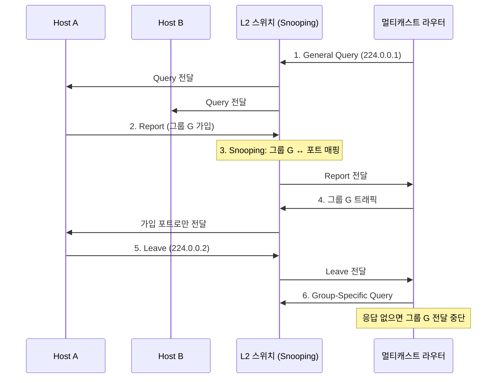

# IGMP (Internet Group Management Protocol)

---

## I. 원하는 곳에만 멀티캐스트, IGMP의 개요

### 가. 정의

- [[IPv4]]에서 **호스트와 인접 멀티캐스트 [[라우터]] 사이의 그룹 가입·유지·탈퇴 정보를 교환**하는 [[네트워크 계층]] [[프로토콜]] (IP 프로토콜 번호 2)

### 나. 필요성 및 특징

| 구분 | 내용 |
| --- | --- |
| 등장 배경 | 유니캐스트는 송신 부하, 브로드캐스트는 대역 낭비 → 수신 희망자에게만 전달 필요 |
| 적용 서비스 | IPTV, 화상회의, 금융 시세 배포 |
| 주소 | 클래스 D(224.0.0.0/4) 그룹 주소 |
| 역할 범위 | 호스트–첫 홉 라우터 구간, 라우터 간 전달은 [[PIM]] 담당 |
| 버전 | v1 → v2(명시적 탈퇴) → v3(소스 지정) |

---

## II. 동작 구조 및 구성요소

### 가. 가입·탈퇴 흐름

- 라우터는 주기적 Query로 가입자를 확인하고, 스위치는 IGMP 메시지를 엿들어 가입 포트에만 멀티캐스트를 전달

### 나. 구성요소

| 구분 | 요소 | 설명 |
| --- | --- | --- |
| 메시지 | General Query | 라우터가 모든 그룹 가입 여부 주기 확인 |
| | Group-Specific Query | 특정 그룹에 남은 가입자 확인 (v2 이상) |
| | Membership Report | 가입 또는 Query 응답 |
| | Leave Group | 명시적 탈퇴 (v2 이상) |
| 선출 | Querier Election | 한 서브넷에 라우터가 여럿이면 IP가 가장 낮은 라우터가 질의자 (v2 이상) |
| L2 최적화 | IGMP Snooping | 스위치가 그룹–포트 테이블을 만들어 불필요한 플러딩 차단 |
| 소스 지정 | INCLUDE / EXCLUDE (v3) | 특정 소스만 수신하거나 제외, SSM(Source-Specific Multicast) 기반 |
| 연계 | [[PIM]] | 라우터 간 멀티캐스트 분배 트리 구성 |

---

## III. 비교 및 동향

### 가. IGMP 버전 비교

| 비교 항목 | v1 (RFC 1112) | v2 (RFC 2236) | v3 (RFC 3376) |
| --- | --- | --- | --- |
| 탈퇴 | 타임아웃 (Silent Leave) | 명시적 Leave | 소스 목록 상태 변경 보고 |
| 탈퇴 지연 | 수 분 | 수 초 | 수 초 |
| Query | General | General + Group-Specific | + Group-and-Source-Specific |
| 질의자 선출 | 라우팅 프로토콜에 의존 | IGMP 자체 (최저 IP) | IGMP 자체 |
| 소스 지정 | 미지원 | 미지원 | 지원 (SSM) |

### 나. 동향

- **IPv6 MLD**: ICMPv6 기반 MLDv1(=IGMPv2), MLDv2(=IGMPv3)로 대체 ([[IPv6]])
- **SSM 확산**: IPTV·금융망에서 (S,G) 단위 수신으로 RP 없이 단순 운영
- **오버레이 멀티캐스트**: EVPN-VXLAN에서 IGMP 프록시·Snooping으로 BUM 트래픽 절감

---

### 🔗 연관 토픽

- **소속 도메인**: [[00_네트워크_MOC|🌐 네트워크]]
- **세부 분류**: `1. OSI 7계층 & 데이터링크 계층 (L1/L2)`
- **핵심 연관 토픽**:
  - [[PIM]]
  - [[ICMP]]
  - [[IPv4]]
  - [[IPv6]]
  - [[스위치]]
