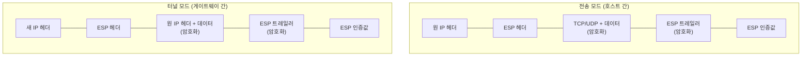

# IPsec (IP Security)

---

## I. IP 계층에서의 암호화, IPsec의 개요

### 가. 정의

- [[네트워크 계층]]에서 IP 패킷 단위로 **[[기밀성]]·[[무결성]]·데이터 출처 인증·재전송 방지**를 제공하는 IETF 보안 [[프로토콜]] 모음 (RFC 4301)

### 나. 특징

| 구분 | 내용 |
| --- | --- |
| 등장 배경 | [[IPv4]]의 평문 전송과 출발지 인증 부재 |
| 투명성 | 상위 [[TCP]]/UDP·애플리케이션 수정 없이 적용 |
| SA 기반 | 단방향 보안 연관(SA)을 양방향 각각 수립 |
| 활용 | Site-to-Site [[VPN]], 원격 접속 VPN, [[IPv6]] 보안 |

---

## II. 구조 및 구성요소

### 가. 동작 모드 (ESP 기준)

- 전송 모드는 원 IP 헤더를 유지하고 페이로드만 보호하며, 터널 모드는 원 패킷 전체를 암호화한 뒤 새 IP 헤더를 붙임
- ESP 인증 범위는 ESP 헤더부터 트레일러까지이며 바깥 IP 헤더는 포함하지 않음 (AH는 가변 필드를 제외한 IP 헤더까지 인증)

### 나. 구성요소

| 구분 | 요소 | 설명 |
| --- | --- | --- |
| 보안 프로토콜 | AH (프로토콜 51) | 무결성·출처 인증, 암호화 없음, NAT와 충돌 |
| | ESP (프로토콜 50) | 암호화 + 무결성·인증, 현재 주로 사용 |
| 모드 | 전송 모드 | 페이로드 보호, 호스트 간 |
| | 터널 모드 | 패킷 전체 캡슐화, 게이트웨이 간 VPN |
| 키 관리 | IKEv2 | SA 협상과 키 교환 (UDP 500, NAT 통과 시 4500) |
| 연관 | SA·SPI | 협상된 알고리즘·키 묶음, SPI로 식별 |
| 데이터베이스 | SPD / SAD | 패킷 처리 정책(PROTECT·BYPASS·DISCARD) / 활성 SA 정보 |
| 재전송 방지 | 순서 번호·윈도 | 중복·오래된 패킷 폐기 |

---

## III. 비교 및 동향

### 가. IPsec VPN vs SSL/TLS VPN

| 비교 항목 | IPsec VPN | SSL/TLS VPN |
| --- | --- | --- |
| 동작 계층 | 3계층 | 4~7계층 |
| 주 용도 | Site-to-Site | 원격 사용자 접속 |
| 접근 단위 | 네트워크·서브넷 | 애플리케이션 |
| 클라이언트 | 전용 클라이언트 필요 | 브라우저 기반 가능 |
| 장단점 | 모든 IP 트래픽 보호, 설정 복잡 | 접근 편리, 앱별 설정 필요 |

### 나. 동향

- **SD-WAN 오버레이**: 지점 간 IPsec 터널을 중앙에서 자동 구성 ([[SD-WAN (Software-Defined Wide Area Network)|SD-WAN]])
- **PQC 하이브리드 키 교환**: IKEv2 다중 키 교환(RFC 9370)으로 ML-KEM을 기존 DH와 함께 적용
- **ZTNA 대체**: 원격 접속 영역에서는 네트워크 단위 VPN을 애플리케이션 단위 ZTNA로 대체

---

### 🔗 연관 토픽

- **소속 도메인**: [[00_보안_MOC|🛡️ 보안]]
- **세부 분류**: `1. 정보보안 원칙 & 거버넌스 · 인증`
- **핵심 연관 토픽**:
  - [[VPN|VPN(Virtual Private Network)]]
  - [[SSL-TLS]]
  - [[네트워크 계층]]
  - [[HMAC|HMAC (Hash-based Message Authentication Code)]]
  - [[SD-WAN (Software-Defined Wide Area Network)]]
