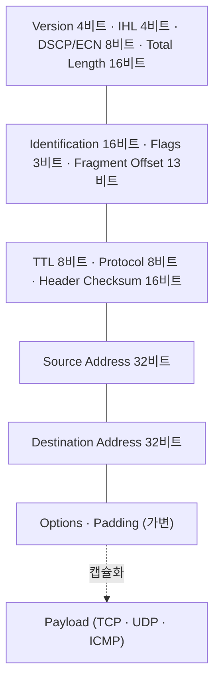

# IPv4 (Internet Protocol version 4)

---

## I. 32비트 주소로 연결된 인터넷, IPv4의 개요

### 가. 정의

- **32비트 논리 주소**로 호스트를 식별하고 비연결·최선형 방식으로 데이터그램을 전달하는 인터넷 프로토콜 4판 (RFC 791, 1981)

### 나. 특징

| 구분 | 내용 |
| --- | --- |
| 주소 공간 | 2^32, 약 43억 개 |
| 표기 | 8비트씩 4개 옥텟을 점으로 구분한 10진 표기 (예: 192.168.0.1) |
| 전송 특성 | 비연결형, Best-Effort |
| 헤더 | 기본 20바이트, 옵션 포함 최대 60바이트 |
| 주소 고갈 | IANA 할당 풀 2011년 소진 → NAT, CIDR, [[IPv6]]로 대응 |

---

## II. 구조 및 구성요소

### 가. 헤더 구조

- 32비트 워드 단위로 구성되며, 단편화 필드(ID·Flags·Offset)와 TTL이 핵심 제어 정보

### 나. 핵심 기술

| 구분 | 요소 | 설명 |
| --- | --- | --- |
| 주소 체계 | Classful | A(/8)·B(/16)·C(/24) 기본, D는 멀티캐스트, E는 예약 |
| | CIDR | 가변 길이 접두사(/n)로 할당·경로 집약 ([[Subnetting (서브네팅)\|서브네팅]]) |
| | 사설 주소 | 10/8, 172.16/12, 192.168/16 (RFC 1918) |
| 제어 | TTL | 홉마다 1 감소, 0이면 폐기 |
| | 단편화 | ID·Flags(DF·MF)·Offset(8바이트 단위)로 분할·재조립 |
| 품질 | DSCP · ECN | [[DiffServ (Differentiated Services)\|DiffServ]] 등급, 혼잡 통지 |
| 고갈 대응 | NAT · PAT | 사설 주소를 공인 주소(와 포트)로 변환해 공유 |
| | CGNAT | 통신사 수준 NAT, 100.64/10 공유 주소 대역 |
| 식별 | Protocol 필드 | [[TCP]] 6, UDP 17, [[ICMP]] 1 |

---

## III. 비교 및 동향

### 가. IPv4 vs IPv6

| 비교 항목 | IPv4 | [[IPv6]] |
| --- | --- | --- |
| 주소 길이 | 32비트 | 128비트 |
| 표기 | 10진 점 표기 | 16진 콜론 표기 (예: 2001:db8::1) |
| 헤더 | 가변 20~60바이트, 체크섬 있음 | 고정 40바이트, 체크섬 없음 |
| 단편화 | 송신지·중간 [[라우터]] | 송신지만 |
| 주소 설정 | 수동, [[DHCP]] | SLAAC, DHCPv6 |
| 브로드캐스트 | 있음 | 없음 (멀티캐스트·애니캐스트) |
| [[IP Sec\|IPsec]] | 선택 | 지원 권고 |

### 나. 동향

- **IPv6 전환**: 듀얼 스택, 터널링, 변환(NAT64·464XLAT) 병행 ([[IPv4와 IPv6 터널링]])
- **IPv4 지속**: 사설망·레거시는 IPv4 유지, 공인 주소는 CGNAT와 주소 거래 시장으로 연명
- **IPv4 as a Service**: IPv6 전용 코어 위에서 IPv4를 서비스로 제공하는 구조(MAP-T·DS-Lite) 확대

---

### 🔗 연관 토픽

- **소속 도메인**: [[00_네트워크_MOC|🌐 네트워크]]
- **세부 분류**: `1. OSI 7계층 & 데이터링크 계층 (L1/L2)`
- **핵심 연관 토픽**:
  - [[IP]]
  - [[IPv6]]
  - [[Subnetting (서브네팅)]]
  - [[IPv4와 IPv6 터널링]]
  - [[ICMP]]
