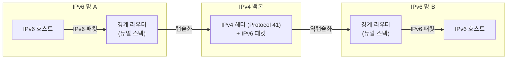

# IPv4와 IPv6 터널링

---

## I. 섬과 섬을 잇는 다리, IPv4/IPv6 터널링의 개요

### 가. 정의

- [[IPv4]]와 [[IPv6]]가 공존하는 전환기에 **한 버전의 패킷을 다른 버전 패킷의 페이로드로 캡슐화해, 지원하지 않는 망을 통과시키는** IPv6 전환 기술

### 나. 필요성 및 특징

| 구분 | 내용 |
| --- | --- |
| 점진적 전환 | 전체 망을 한 번에 IPv6로 바꿀 수 없는 비용·장비 제약 |
| IPv6 섬 연결 | IPv4 백본으로 분리된 IPv6 망 간 연결 (6-over-4) |
| 역방향 터널 | IPv6 전용망 위에서 IPv4 서비스 제공 (4-over-6, DS-Lite) |
| 듀얼 스택 경계 | 터널 양 끝 장비는 두 프로토콜을 모두 처리 |
| 부담 | 헤더 오버헤드, MTU 감소, 터널 내부 가시성 저하 |

---

## II. 구조 및 기술

### 가. IPv4 망을 통한 IPv6 터널

- 입구 라우터가 IPv6 패킷 앞에 IPv4 헤더(프로토콜 번호 41)를 붙이고, 출구 라우터가 이를 제거해 IPv6 망으로 전달

### 나. 주요 터널링 기술

| 구분 | 기술 | 설명 |
| --- | --- | --- |
| 수동 | 설정 터널 (6in4, GRE) | 관리자가 터널 양 끝 주소를 정적으로 지정 |
| 자동 | 6to4 (RFC 3056) | 공인 IPv4 주소로 2002::/16 접두사 생성, 공용 릴레이 문제로 사용 중단 권고 (RFC 7526) |
| | 6rd (RFC 5969) | 6to4를 ISP 자체 접두사로 개선, 통신사 IPv6 조기 제공 |
| | ISATAP (RFC 5214) | 조직 내부 IPv4 망에서 호스트–라우터 자동 터널 |
| | Teredo (RFC 4380) | IPv6를 UDP(3544)에 담아 NAT 뒤 호스트도 통과 |
| | Tunnel Broker | 중개 서버가 사용자별 터널 설정을 자동 발급 |
| 4-over-6 | DS-Lite (RFC 6333) | IPv6 접속망 위에 IPv4를 터널링, 통신사 측 AFTR에서 CGNAT |
| 식별 | Protocol 41 | IPv4 헤더 Protocol 필드로 내부가 IPv6임을 표시 |

---

## III. 비교 및 동향

### 가. IPv6 전환 기술 비교

| 비교 항목 | 듀얼 스택 | 터널링 | 변환 (Translation) |
| --- | --- | --- | --- |
| 개념 | 장비가 IPv4·IPv6를 모두 운용 | 한 프로토콜을 다른 프로토콜에 캡슐화 | IPv4 ↔ IPv6 헤더 변환 |
| 대표 기술 | 듀얼 스택 OS·라우터 | 6in4, 6rd, DS-Lite | NAT64/DNS64, 464XLAT (NAT-PT는 폐기) |
| 장점 | 호환성 가장 높음 | 기존 인프라 재활용 | IPv4 전용–IPv6 전용 노드 간 통신 |
| 단점 | 두 주소 체계 동시 운영 부담 | 오버헤드, MTU·단편화, 디버깅 어려움 | 변환 지연, 종단 간 투명성·일부 응용 호환성 저하 |

### 나. 동향

- **보안**: Protocol 41·Teredo 터널이 방화벽 정책을 우회할 수 있어 미사용 시 차단, 필요 시 [[IP Sec|IPsec]] 결합
- **MTU 관리**: 캡슐화로 유효 MTU가 줄어 PMTUD·MSS 조정 필요
- **IPv6 전용화**: 모바일망은 IPv6 전용 + 464XLAT, 유선은 DS-Lite·MAP-T로 IPv4를 서비스로 제공하는 방향

---

### 🔗 연관 토픽

- **소속 도메인**: [[00_네트워크_MOC|🌐 네트워크]]
- **세부 분류**: `1. OSI 7계층 & 데이터링크 계층 (L1/L2)`
- **핵심 연관 토픽**:
  - [[IPv4]]
  - [[IPv6]]
  - [[IP]]
  - [[IP Sec]]
  - [[라우터]]
