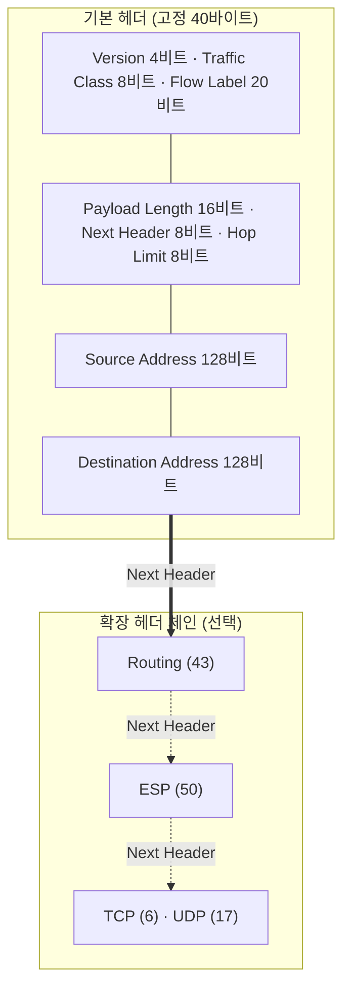

# IPv6 (Internet Protocol version 6)

---

## I. 128비트 주소의 차세대 인터넷, IPv6의 개요

### 가. 정의

- [[IPv4]] 주소 고갈을 해결하기 위해 **128비트 주소와 고정 40바이트 기본 헤더 + 확장 헤더 구조**를 채택한 차세대 인터넷 프로토콜 (RFC 8200)

### 나. 등장 배경 및 특징

| 구분 | 내용 |
| --- | --- |
| 주소 고갈 | IoT·모바일 증가로 32비트 공간 한계, NAT의 종단 간 통신 제약 |
| 헤더 단순화 | 고정 헤더, 체크섬 제거, 중간 [[라우터]] 단편화 금지 |
| 자동 설정 | SLAAC로 라우터 광고(RA)만으로 주소 생성 |
| 브로드캐스트 폐지 | 멀티캐스트·애니캐스트로 대체 |
| 확장성 | 부가 기능을 확장 헤더 체인으로 분리 |

---

## II. 구조 및 구성요소

### 가. 기본 헤더와 확장 헤더 체인

- 기본 헤더의 Next Header가 다음 헤더 종류를 가리키는 체인 구조로, 중간 라우터는 대부분의 확장 헤더를 처리하지 않음 (Hop-by-Hop 제외)

### 나. 구성요소

| 구분 | 요소 | 설명 |
| --- | --- | --- |
| 주소 | 128비트 주소 | 2^128(약 3.4×10^38), 16비트씩 8그룹 16진 표기, 연속 0은 `::`로 한 번 생략 |
| 주소 유형 | 유니캐스트 | 글로벌(2000::/3), 링크 로컬(fe80::/10), 고유 로컬(fc00::/7) |
| | 멀티캐스트 · 애니캐스트 | 그룹 전체(ff00::/8) / 그룹 중 가장 가까운 하나 |
| 자동 설정 | SLAAC · DHCPv6 | RA의 접두사로 주소 생성 / 서버 할당 |
| 이웃 탐색 | NDP (ICMPv6) | 주소 해석, 라우터 탐색, 중복 주소 검출(DAD) ([[ARP]] 대체) |
| 단편화 | 송신 호스트만 | 중간 라우터는 분할하지 않고 [[ICMP]]v6 Packet Too Big 통보 |
| 품질 | Traffic Class · Flow Label | DSCP 표시, 같은 플로우 식별 (ECMP 해싱 등) |
| 보안 | [[IP Sec\|IPsec]] (AH · ESP) | 확장 헤더로 지원, 구현은 권고 사항 (RFC 6434) |
| 이동성 | Mobile IPv6 | Home Address와 Care-of Address 분리, 경로 최적화 지원 |

---

## III. 비교 및 동향

### 가. IPv4 vs IPv6

| 비교 항목 | IPv4 | IPv6 |
| --- | --- | --- |
| 주소 | 32비트 | 128비트 |
| 헤더 | 가변 20~60바이트, 체크섬 있음 | 고정 40바이트, 체크섬 없음 |
| 전송 방식 | 유니·멀티·브로드캐스트 | 유니·멀티·애니캐스트 |
| 주소 설정 | 수동, [[DHCP]] | SLAAC, DHCPv6 |
| 단편화 | 송신지·라우터 | 송신지만 |
| 주소 해석 | ARP | NDP |

### 나. 동향

- **전환 기술 병행**: 듀얼 스택, 터널링, NAT64·464XLAT 변환 ([[IPv4와 IPv6 터널링]])
- **보급 확대**: 모바일망·대형 콘텐츠 사업자 중심으로 IPv6 트래픽 비중 증가, 국가별 편차 큼
- **SRv6**: IPv6 Routing Header(SRH)로 경로를 지정하는 네트워크 프로그래밍, 통신사 백본·5G 전송망 적용

---

### 🔗 연관 토픽

- **소속 도메인**: [[00_네트워크_MOC|🌐 네트워크]]
- **세부 분류**: `1. OSI 7계층 & 데이터링크 계층 (L1/L2)`
- **핵심 연관 토픽**:
  - [[IPv4]]
  - [[IP]]
  - [[IPv4와 IPv6 터널링]]
  - [[ICMP]]
  - [[IP Sec]]
