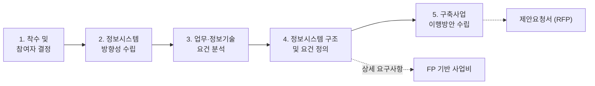

# ISMP (Information System Master Plan)

---

## I. 발주 전에 요구사항을 확정하는, ISMP의 개요

### 가. 정의

- 특정 정보시스템 구축 사업의 **제안요청서(RFP)를 작성할 수 있도록 업무·기술 요건을 분석하고, 기능점수(FP) 산정이 가능한 수준까지 요구사항을 상세화**하며 이행 방안을 수립하는 활동

### 나. 필요성 및 특징

| 구분 | 내용 |
| --- | --- |
| ISP 보완 | 전사 방향을 다루는 [[ISP (Information Strategy Plan)\|ISP]]만으로는 개별 사업 요구사항·RFP 도출이 어려움 |
| 적정 예산 | 상세 요구사항 기반 FP 산정으로 사업비 과소 책정 방지 |
| 과업 변경 예방 | 모호한 RFP로 인한 잦은 과업 변경·분쟁 감소 |
| 발주 품질 | 상용 SW 분리발주, 클라우드 도입 여부 등 발주 방식 사전 결정 |

---

## II. ISMP 수립 절차 및 구성요소

### 가. 수립 절차 (공통가이드 5단계)

- 4단계에서 FP 산정이 가능한 수준으로 요구사항을 정의하고, 5단계에서 사업비·발주 방식·RFP로 연결

### 나. 단계별 핵심 요소

| 구분 | 요소 | 설명 |
| --- | --- | --- |
| 방향성 | 환경 분석·벤치마킹 | 업무 환경, 법·제도, 기술 동향, 유사 사례 분석 |
| | 목표 설정 | 구축 시스템의 비전·목표·추진 전략 |
| 요건 분석 | As-Is 분석 | 현행 업무 [[프로세스]]와 HW·SW·네트워크 현황·문제점 |
| 구조·요건 정의 | To-Be 아키텍처 | 응용·데이터·기술·보안 아키텍처 |
| | 요구사항 상세화 | FP 측정이 가능한 기능·비기능 요구사항 정의 |
| 이행방안 | 사업비 산정 | FP 기반 SW 개발비, HW·상용 SW 비용 |
| | 발주 전략·RFP | 분리발주 대상, 클라우드 적용, 사업 일정과 RFP 작성 |

---

## III. ISP 비교 및 동향

### 가. ISP vs ISMP

| 구분 | ISP | ISMP |
| --- | --- | --- |
| 목적 | 전사 중장기 정보화 방향 수립 | 특정 사업의 상세 요구사항·RFP 도출 |
| 대상 | 조직 전체 | 개별 구축·고도화 사업 |
| 요구사항 수준 | 개괄적 (과제 단위) | FP 산정 가능한 상세 수준 |
| 예산 산정 | 유사 사업 참조 등 개략 추정 | 상세 요구사항 기반 산정 |
| 산출물 | 정보화 비전, 목표 모델, 로드맵 | 요구사항 정의서, 사업비 내역, RFP |

### 나. 동향

- **공공 발주 개선**: 요구사항 상세화로 과업 범위를 명확히 하고 과업 변경 시 대가 반영을 제도화하는 흐름과 연계 ([[SW사업 대가산정 가이드]])
- **클라우드·애자일 반영**: 클라우드 우선 검토와 애자일 방식 적용 시 요구사항을 백로그 수준으로 정의하는 등 유연한 기획 필요
- **가이드 개정**: [[ISP 및 ISMP 수립 공통가이드 9판(2025.05)]]에 따라 최신 정책·기술 점검 항목 반영

---

### 🔗 연관 토픽

- **소속 도메인**: [[00_경영전략_MOC|📈 경영전략]]
- **세부 분류**: `2. IT 거버넌스 & 엔터프라이즈 아키텍처 (EA/ISP)`
- **핵심 연관 토픽**:
  - [[ISP (Information Strategy Plan)]]
  - [[ISP 및 ISMP 수립 공통가이드 9판(2025.05)]]
  - [[SW사업 대가산정 가이드]]
  - [[SI]]
  - [[전자정부 성과관리 지침]]
